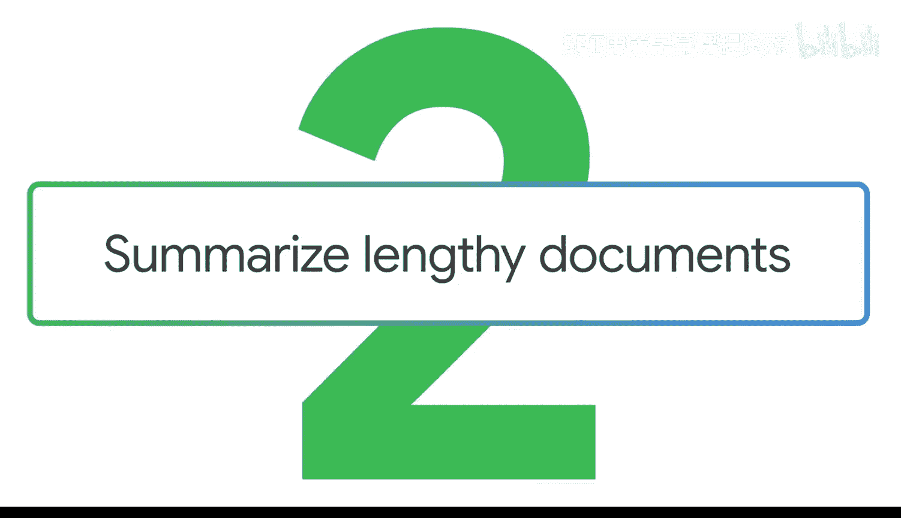
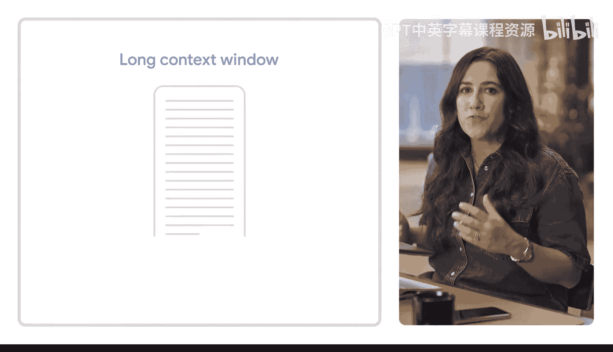
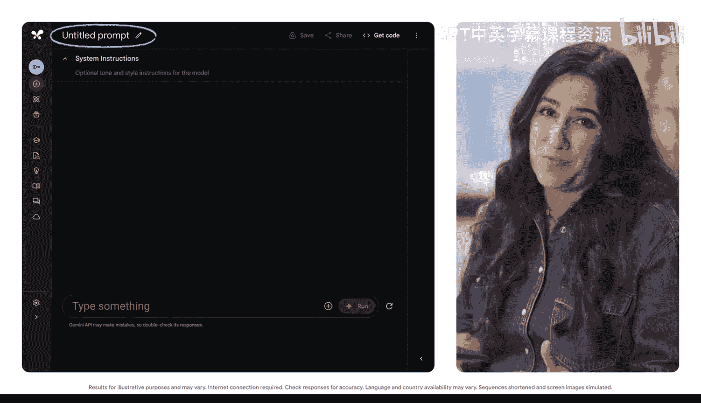
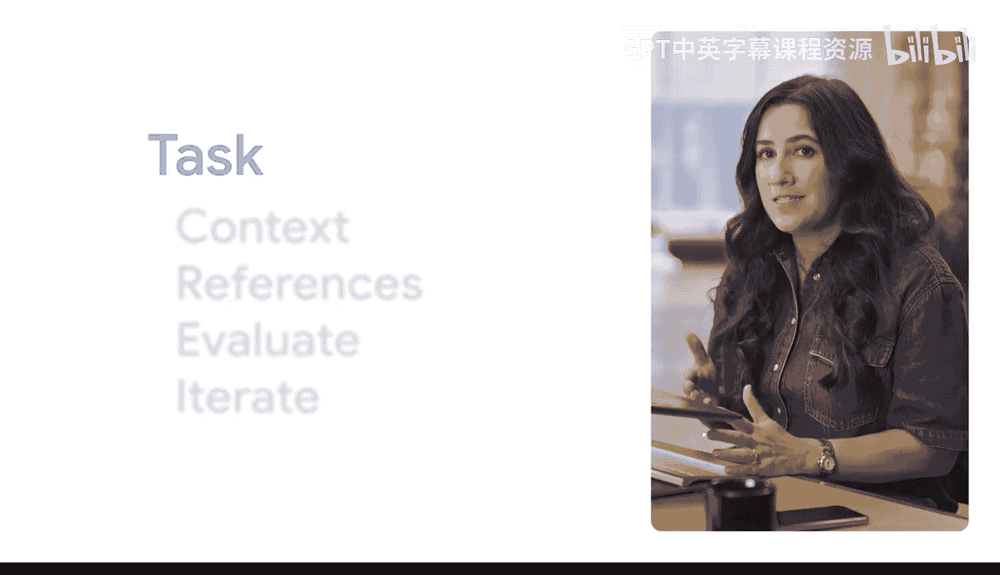
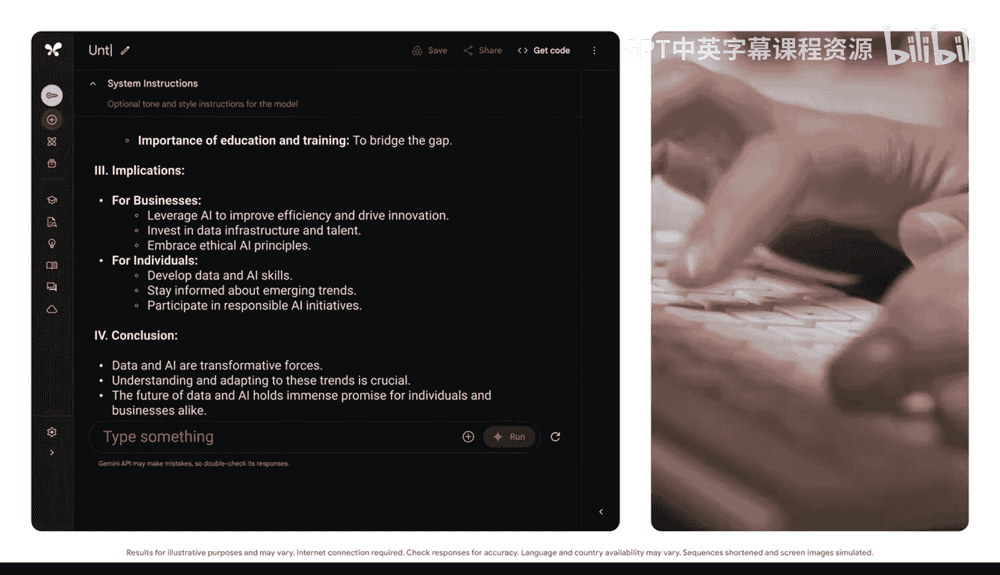

# 谷歌《提示词基础课程｜Google Prompting Essentials》中英字幕（deepseek p20 7_01_02_总结冗长文档.zh_en -BV1zT6eYqEeR_p20-

When you're doing research， writing a report or investigating market trends。

 you're bound to come across some especially complex or lengthy materials。Luckily。

 a generative AI tool can summarize long blocks of text， extract key insights。

 and even transform them into new resources。 You can also specify your preferred format in your prompt。

 So you get exactly the type of output you want。What's a report you've been meaning to read。

 but you haven't had the time to。 You want to summarize it and pull out key insights。

 But since the report is so long， you'll have to use a Gen AI tool with a long context window。

 A long context window allows for the processing of a large amount of information in different formats at once。

 The long context window also enhances the Gen AI model's ability to understand and generate more coherent and contextually relevant responses to our prompts。

 We'll test this in Google AI studio。

Let's open up AI Studio and sign in with a Google account。Notice how we can give our prompt a name。

 This can make it easier to find our prompts later。

 and it can be useful when sharing prompts with others。

Now， let's start using the prompting framework。 Here's the task， including the format。

Summarize this report in an outline。Focus only on the most essential points。Pretty cool，huh。

 44 pages of information distilled down into a few points。Let's call this prompt report summary。

 Long context windows aren't available on every Gen Ai tool。 So depending on the gen Ai tool you use。

 it may not be able to analyze long documents， Gen Ai technology is dynamic and ever changing。

 So always double check what features and capabilities are available in the tools you're using。

 And here's a pro tip in the meantime。 If you are using a Gen Ai tool that can handle a large piece of text。

 and you need a summary， break the text up and paste chunks of it in at a time。

 prompt to summarize each chunk and then ask to summarize the summaries。

 whether you are doing research or analyzing reports。

 getting a summary of what youre reading can help you understand the material in a shorter amount of time。

 Another pro tip for you， not only can Gen A I tools summarize lengthy documents。

 but they can also explain them to you in different ways。

 by incorporating a persona specifying who the audience is。 you can personalize the summary for。

🎼Different，For example， you can ask things like summarize this for someone who isn't great with numbers or summarize this for a small business owner or even summarize this using 80s movie quotes。

