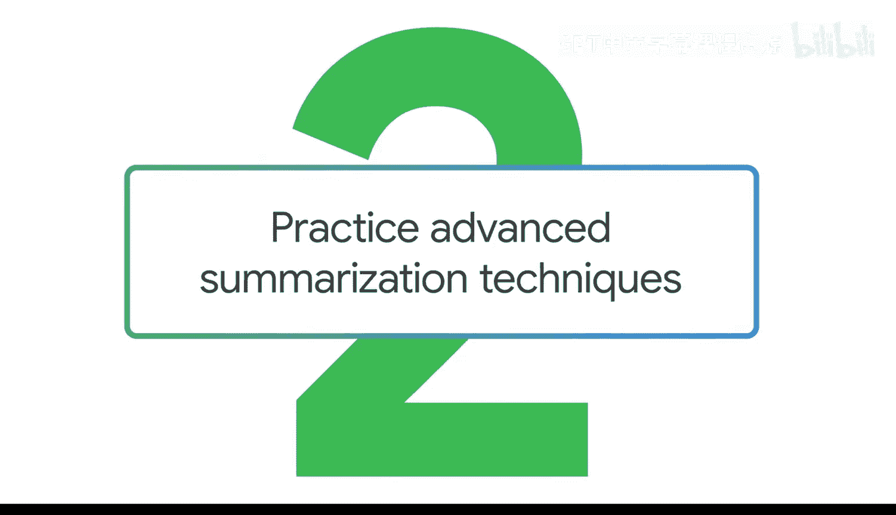
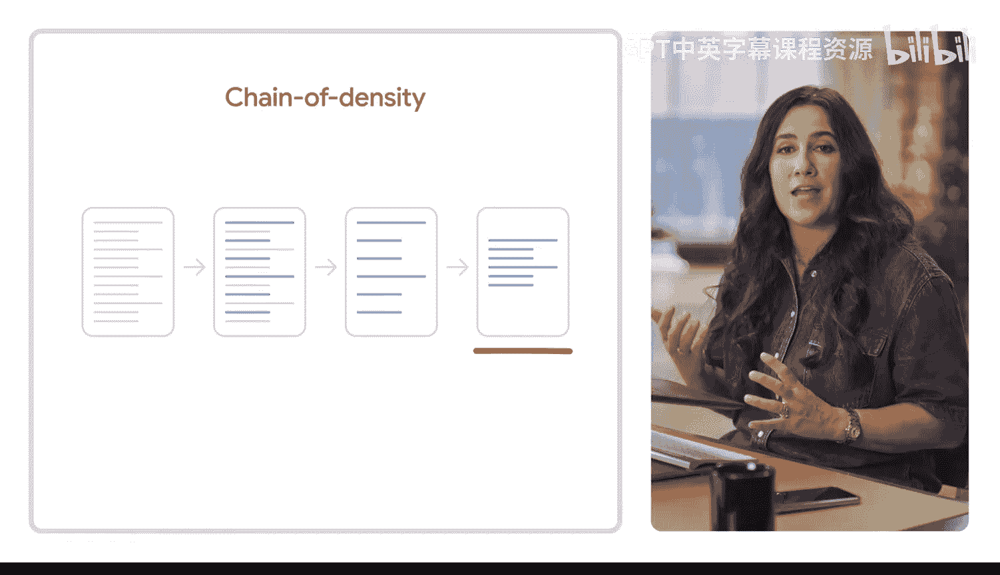
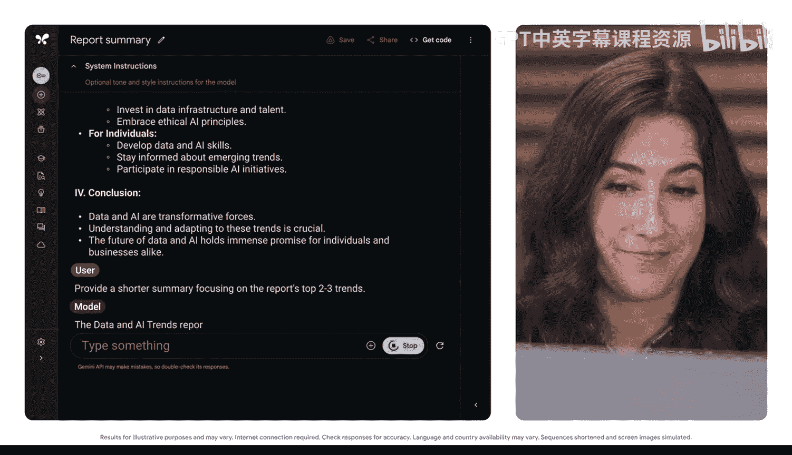

# 谷歌《提示词基础课程｜Google Prompting Essentials》中英字幕（deepseek p22 9_01_04_练习高级总结技巧.zh_en -BV1zT6eYqEeR_p22-

Now that you know a few summarizing techniques， let's discuss some more advanced methods you can use to condense information with Gen Ai tools。

 When you ask a Gen A I tool to provide a summary， Sometimes the initial output is way too broad。

 You need a bit more detail to make it truly useful to you。

 A technique called chain of density prompting can help with that。 with this method。

 you get increasingly concise summaries and end up with a chain of refined outputs。

 Think of it this way。 your working on the perfect elevator pitch for your company。

 Your first trap is way too long and includes too many details。 But as you refine it。

 it gets shorter and more direct。 All without losing the important points you need to get across。

 Eventually， you land on the perfect elevator pitch。 Quick， direct and effective。😊。

Iterating on our last prompt， we want to update the task and format。Provide a shorter summary。

Focusing on the report' top 2 to three trends。

Mission accomplished， but maybe you want it even shorter。

 We can get more specific with our prompt to ensure the output not only provides a simpler summary。

 but is also really targeted to your needs。 Let's go shorter。 We'll ask for a single sentence。

Condsense the summary into a single sentence。And even more specific context。

 highlighting the most dominant trend。Nice， we kept asking it to refine further。

 and we were direct and specific about the desired output。

 We can repeat this process until we generate the most useful and helpful outputs for the task。

 We can even get ahead of these extra iteration steps and ask that the Gen Ai tool provides multiple increasingly short iterations in the initial prompt。

😊，You might be wondering why we wouldn't get to the shortest output right away。 Well。

 iteration helps us check for hallucinations as we go from something super detailed to an output that's more direct and to the point。

It also helps us stay informed about what information is being taken out as the outputs get shorter。

 chain of density prompting also works in the other direction。 If the output is too short。

 we can also prompt to increase the length and add more detail。

Remember when I ask you to think of a report， you haven't found the time to read。

 give these prompting techniques a try and discover how quickly you can generate a helpful summary。

