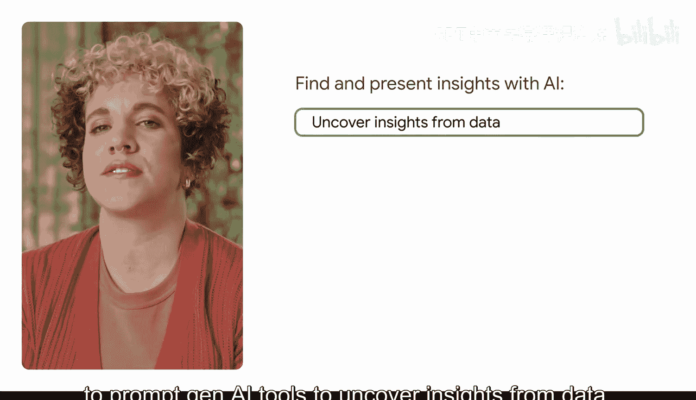
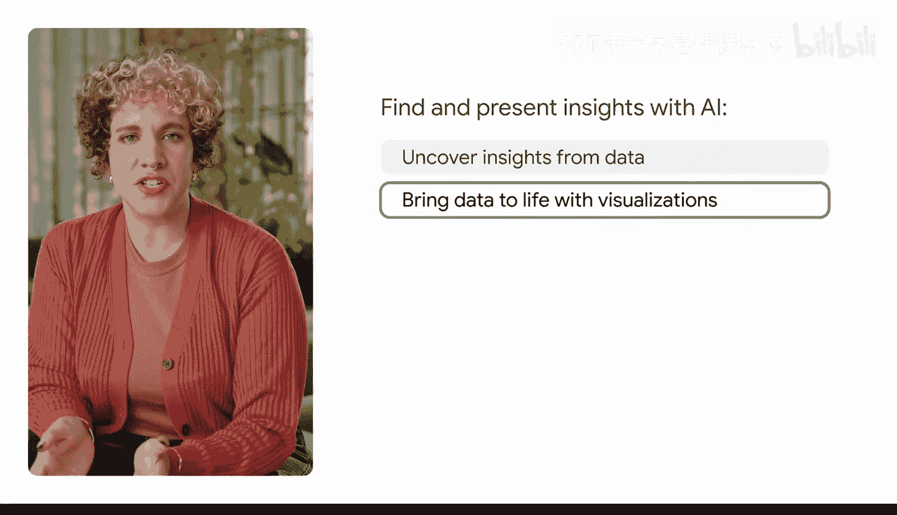
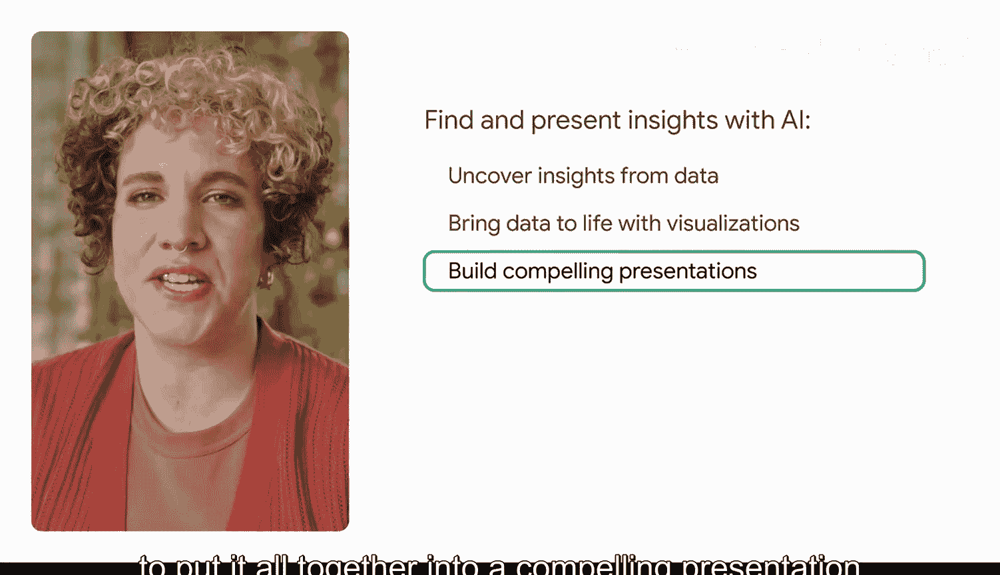

# 谷歌《提示词基础课程｜Google Prompting Essentials》中英字幕（deepseek p23 1_01_01_使用AI发现并呈现洞察.zh_en -BV1zT6eYqEeR_p23-

Remember that time your team launched a new product and sales went up in a specific region。

Or when a simple survey revealed an untapped customer need。

 Those weren't just numbers on a spreadsheet。 They were stories that LED to valuable insights。

 when organized and analyzed。The problem， you may not always have the time to track those stories down。

 generative AI tools can help you manage， analyze， visualize and present data。In this module。

 you'll first learn how to prompt GenAI tools to uncover insights from data。

 Then you'll bring that data to life with visualizations， and finally。

 you'll explore how to put it all together into a compelling presentation that helps you show and tell your story。

🎼我们。