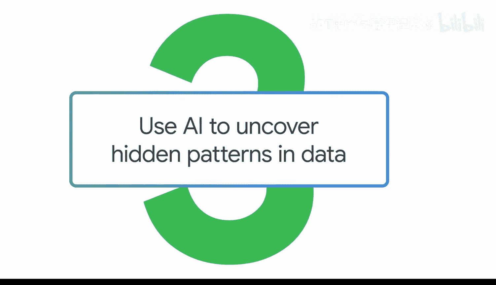
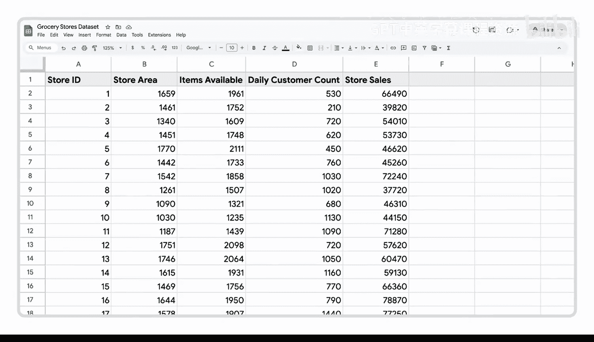
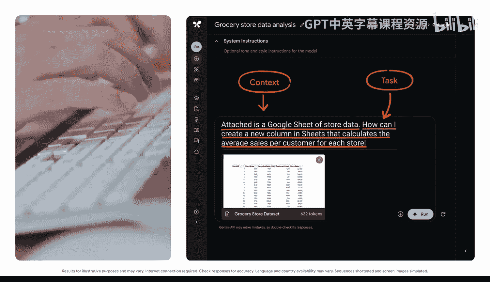

# 谷歌《提示词基础课程｜Google Prompting Essentials》中英字幕（deepseek p24 2_01_02_利用AI揭示数据中的隐藏模式.zh_en -BV1zT6eYqEeR_p24-

🎼。

🎼。Data can teach you a lot， but you need to know how to interpret it first。

 let's use the prompting framework， thoughtfully create really excellent inputs to unlock insights and patterns from data using a GenAI tool Before we get started。

 remember that not all GenAI tools work with data be sure to check what your tool can do before using it we'll teach you how to do this by prompting Gemini models in Google AI studio。

One other note。As you work with these tools， remember some of the ground rules about using Jen AI responsibly。

 always review your organization's policies before including sensitive or confidential data in your prompt。

 For this example， we're using publicly available data found on CAle。 Are you ready to try。

 Let's do it。Here we have a data set with information about a grocery chain。

 AI Studio can help us analyze all that data to find trends and patterns that could help inform how the company operates。

 but there are a lot of variables here， so it'll be helpful to organize the data to make it easier to work with。

First， we'll ask for step by step help。 We can upload the data directly from our Google Drive where the Google sheet is stored。

 If we were using Microsoft Excel， we'd upload it from our computer。

Once we've uploaded the spreadsheet， we're ready to write the prompt。

Attached is a Google sheet of store data。 Now that we shared some context。

 we'll add the specific task。How can I create a new column in sheets that calculates the average sales per customer for each store。

Let's review the output。The model provided some helpful suggestions for calculating the average sales per customer for each store。

 it even explained how to use a more descriptive formula to label our new column in the spreadsheet。

And that's just one example。 If that method of organization doesn't work。

 we can iterate on our prompt to get an output that's closer to what we need。

 Let's take this further。 Discovering trends in a data set can help us make informed decisions。

 and we can prompt a Gen AI tool to help find those trends。

Can you think of a spreadsheet that you've been meaning to analyze。

Keep that in mind as we go through this example。Start again with the task。

Give me insights into the relationship between daily customer count。Items available and。Sales。

Based on the given data。That prompt got us a lot of interesting information and fast。

 And this is fascinating。 There seems to be no clear correlation between the number of items in a given store and its total sales volume。

 Some small stores are even outpacing the big ones。

 The output even gives us some potential reasons behind this trend so we can investigate further and think about potential sales strategies。

 This is great。😊，Now back to that spreadsheet we've been meaning to analyze how can JenAI help us save time and extract meaningful insights with the help of JenAI tools we no longer have to spend hours crunching data。

 we can do it with just a few prompts。🎼。🎼。

