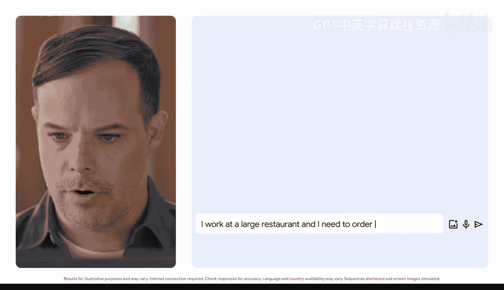
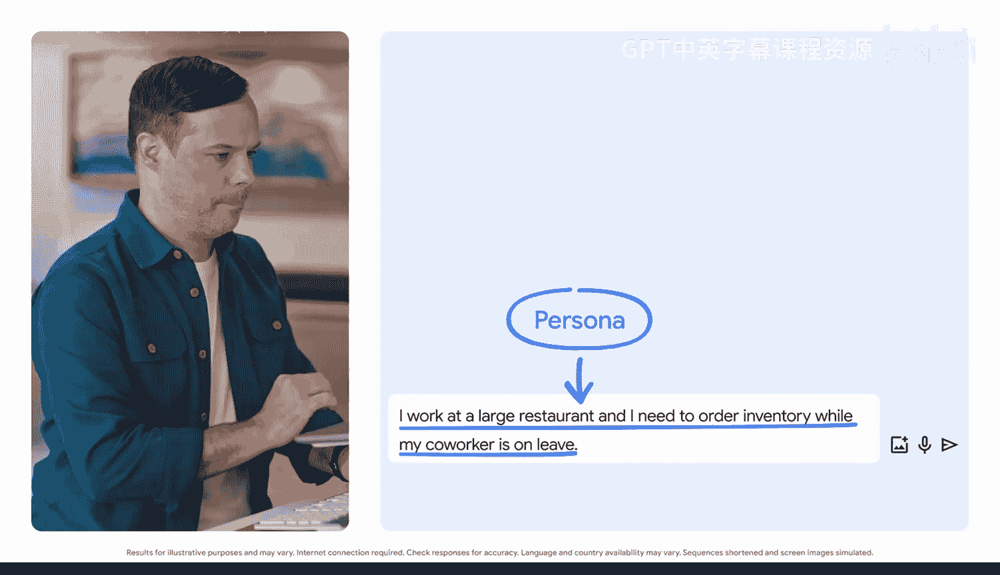
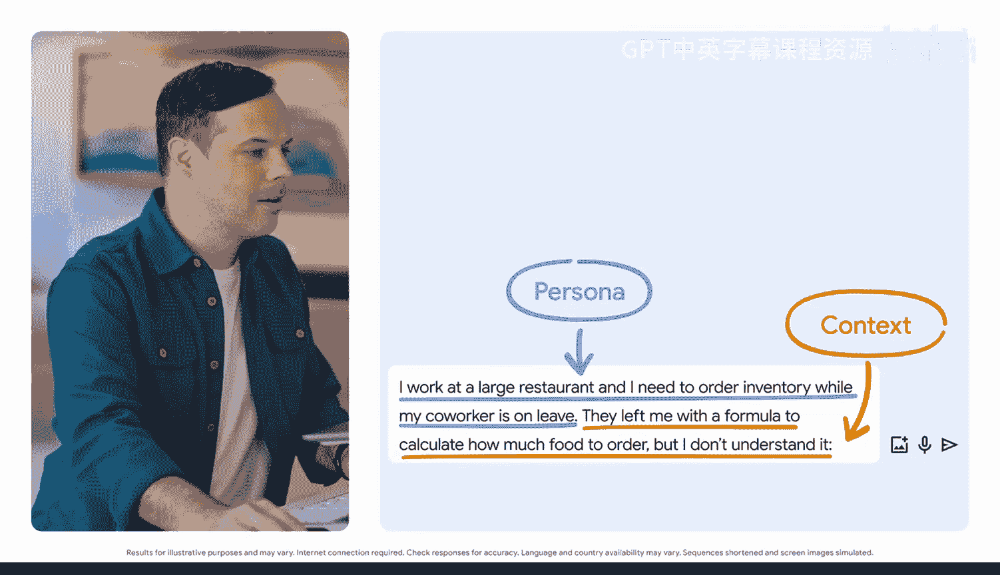
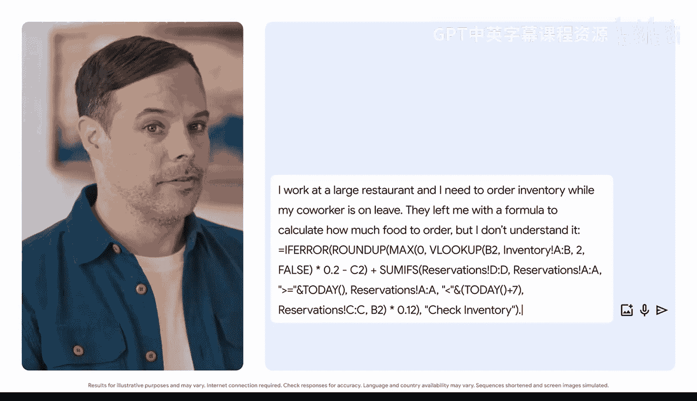
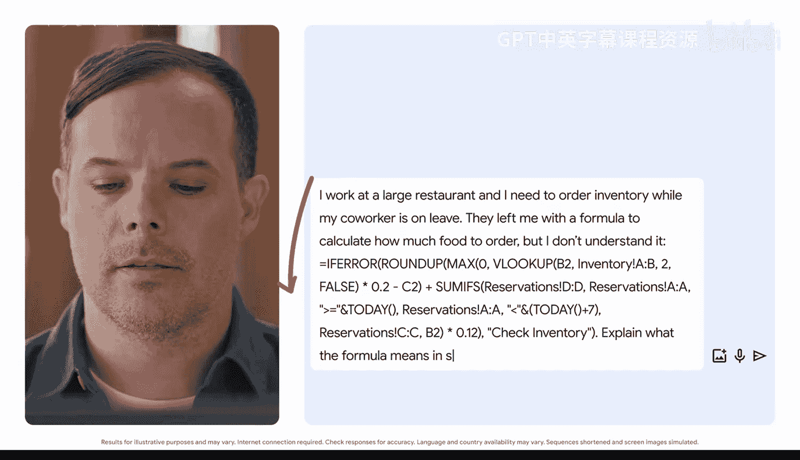
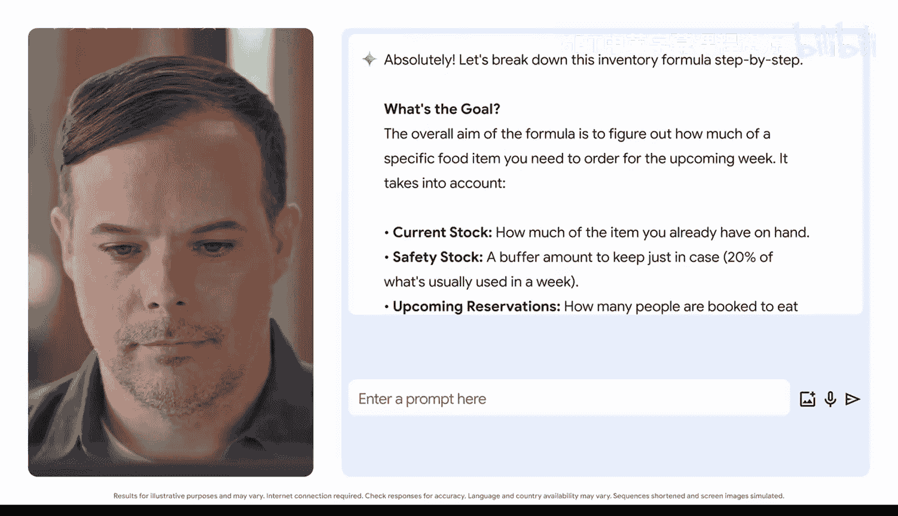
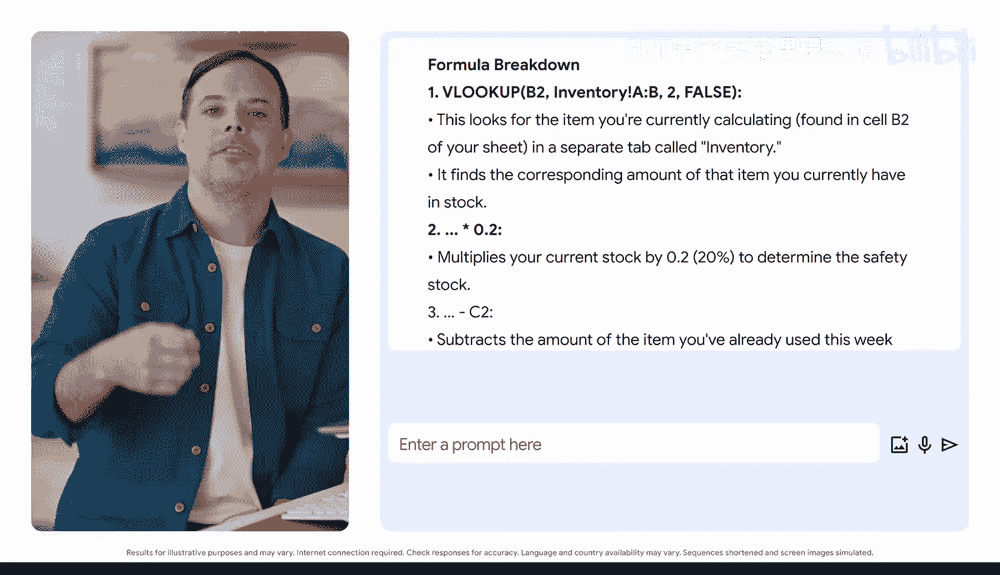
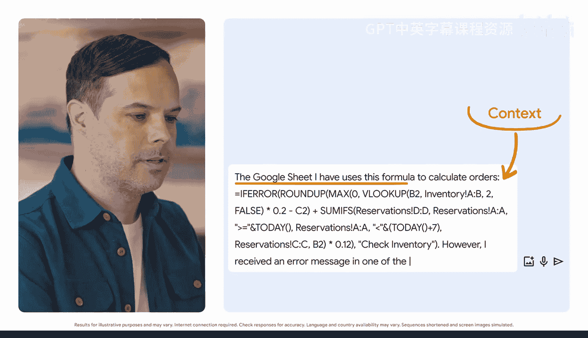
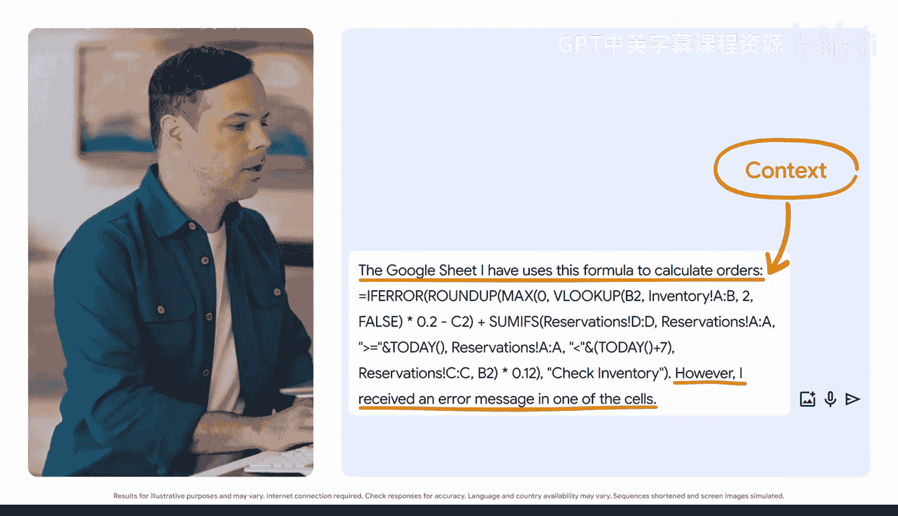

# 谷歌《提示词基础课程｜Google Prompting Essentials》中英字幕（deepseek p26 4_01_01_解读电子表格.zh_en -BV1zT6eYqEeR_p26-

🎼。

I'm a spreadsheet nerd。But I also know that not everyone shares my passion for cells and formulas。

 Denense spreadsheets and complex formulas can be intimidating， but fear not。

 generative AI can help you understand and write spreadsheet formulas just prompt it using natural language。

 You already know how to prompt a Gen AI tool to help you create and understand text。

 images and data points， but it can also help you better understand spreadsheet formulas。

 Let's put the framework into action。Imagine your coworker at a restaurant。

 went on vacation and gave you a spreadsheet full of data and formulas。 Some of them seem familiar。

 but there are others that hurt a little more complicated。 You need to order inventory to day。

 but you don't want to bother your colleague。 So you turn to Gemmin I for some guidance。

 We'll start off with the persona and some background。I work at a large restaurant。

 and I need to order inventory while my coworker is on leave。

Then add in some context， they left me with a formula to calculate how much food to order。

 but I don't understand it。

Here's where we'll paste in the formula。

And let's give Gemini the task and desired format。 Explain what the formula means in simple step by step terms。

That's much easier to understand。You now hopefully have a clearer sense of what the formula is trying to accomplish so that you can get that stock order handled quickly now that you understand the formulas。

 you can figure out what to do if you get stuck。

Let's try another one。Have you ever received an error message in your spreadsheet and not known what to do？

Let's prompt Gemini to learn how you can figure out where those errors are coming from。

The Google sheet I have uses this formula to calculate orders。 I'll paste in the formula。

However， I received an error message in one of the cells。

Time to specify the task and what format we want。

Give me a step by step process for finding the error and fixing it in Google Sheets。

And there you have it， clear instructions for resolving that pesky error message。

 and with those out of the way， you can get that inventory order moving。🎼今。

