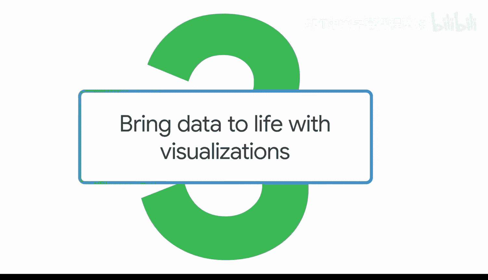
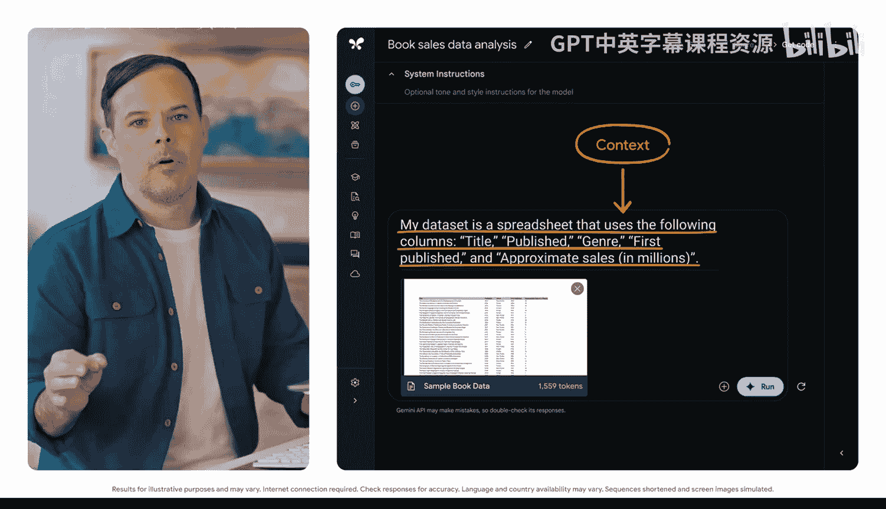
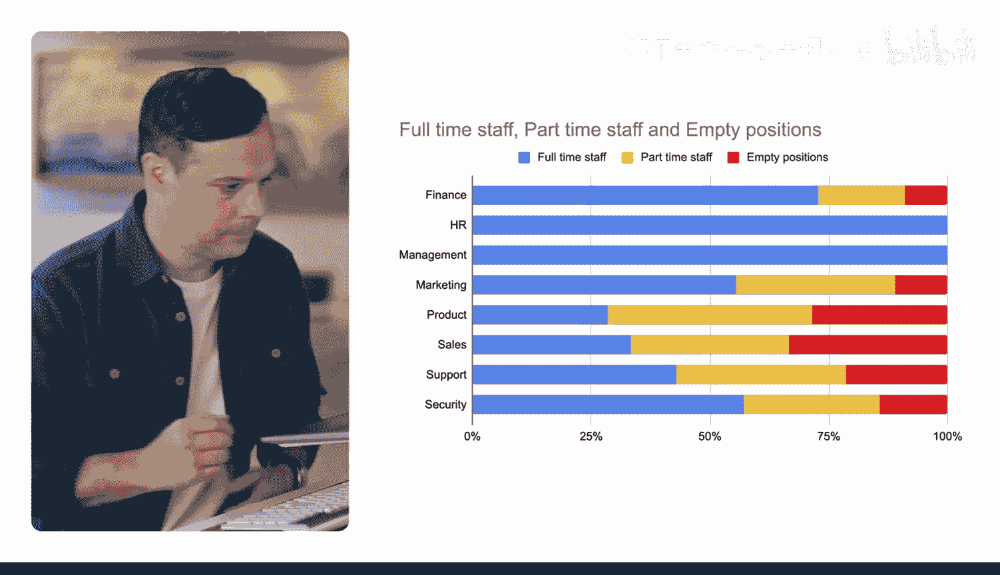

# 谷歌《提示词基础课程｜Google Prompting Essentials》中英字幕（deepseek p27 5_01_03_通过可视化让数据生动呈现.zh_en -BV1zT6eYqEeR_p27-

🎼，🎼。

嗯。Does your job involve presenting information to different people。

 Maybe you need to pitch new potential clients or relay information to your colleagues or your organization's leadership。

 when it comes to presenting data， you want to show rather than tell。 Thankly。

 generative AI tools are really good at helping you determine the best ways to visualize data。

 You just need to know what to ask for。 You can prompt to Gen AI tool to get advice on the best types of charts and graphs to illustrate your data。

 the prompting framework should still be your guide。 Add your task， context and references if needed。

 evaluate the output and iterate。

The clearer you are about the kind of chart you want and what the parameters are。

 the more useful your output will be。Consider this， you and I are co owners of a bookstore。

Here we have a list of bestselling books and how many copies have been sold around the world since they've been published。

Before we choose to stock some of those titles， let's examine the data。Remember。

 not all JenAI tools can analyze data， be sure to check what your tool can do before using it。

For this example， we'll use Google AI Studio。First。

 let's think through how to represent this data visually with a chart。

If you don't know what type of chart to use， you can always prompt a GAI tool for suggestions。

We'll prompt the model using plain language to describe the data set in order to find out what kind of chart might work best。

Describe the data here。 This is our context。My data set is a spreadsheet that uses the following columns。

Tle。Published。Gre。First， published。And approximate sales in millions。

Now let's request the format to be a chart， so we have some choices。

 Give me options for a chart that shows the correlation between genre and sales。

Let's be even more specific so that we know what kind of correlation the chart will actually be displayed。

 Explain how genre and sales are correlated。According to the information。Interesting。

Now we have three great ideas for creating charts that will visualize the data clearly。 Even better。

 we have detailed explanations about each chart， giving us the option to choose which visualization works best for our data set。

You're not always going to know what type of chart you want to use。

 which is where adding a reference to your prompt can be helpful。

 You can use charts that are similar to what you want or charts you found helpful and include those as a reference in your prompt。

Then ask for recommendations on how to create a similar chart using your data。

We'll find a chart to reference and prompt the model to emulate it using data from our bookstore scenario。

 Start by uploading the sample chart and then prompt the model to get some information about what it's depicting。

Remember， it's sometimes better to start simple and then gradually add complexity。

Describe this chart。What kind of data relationships are highlighted in the chart。

We're asking for a description of the chart before we prompt to recreate it just so that we can take it step by step。

Okay， we have some good Intel about the chart， the model is telling us it's called a stacked barred chart and that it represents the staffing breakdown across different departments in an organization。

 and it analyzed the data telling us how the finance department has a high proportion of fulltime staff while the product department has a more even mix。

Now we'll enter a prompt about the data we already have and ask for recommendations on visualizing it in the same way as the chart we referenced。

You guessed it， let's add some context。My data set is a spreadsheet。That uses the following columns。

Title。Published。Gre。First， published and approximate sales in millions。

Im interested in showing the relationship between genre and sales and the task。

Suggest modifications to make this chart work better with my specific data using Google Sheets。

Amazing。Now we have instructions about how to create a new chart with our data。

 The output even explains how to modify a bar to illustrate the relationship between genre and sales more clearly。

And remember， if your output doesn't match what you need。

 you can always tweak your prompt and iterate。

🎼。