# 谷歌《提示词基础课程｜Google Prompting Essentials》中英字幕（deepseek p28 6_01_01_快速开始演示文稿的演讲者备注.zh_en -BV1zT6eYqEeR_p28-

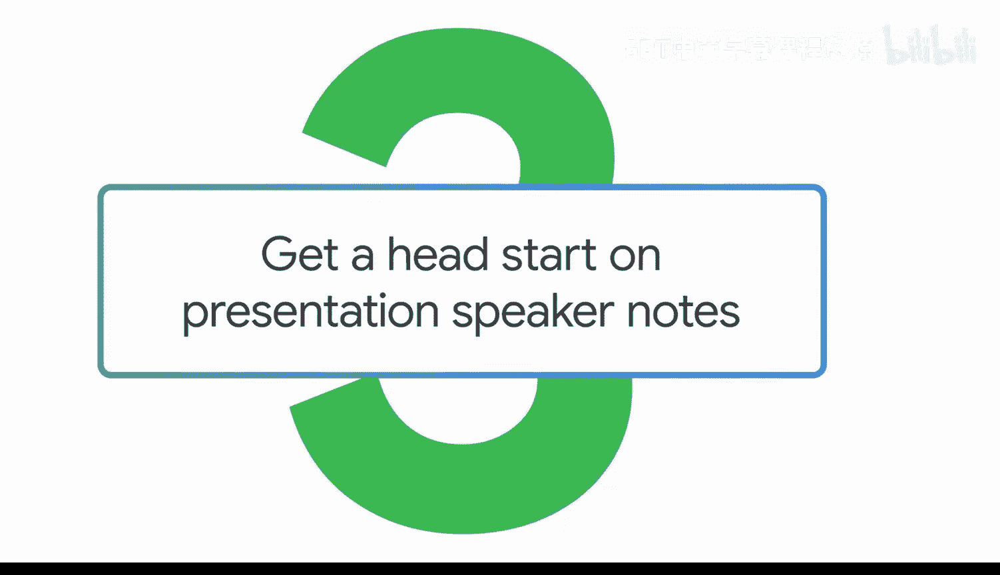

Communication goes way beyond sharing information with someone。 You need to tell a story。

 storiesies are how you make information stick in people's minds。

Generative AI tools can help organize your presentations into compelling stories。

 build talking points， and even create images to keep your audience engaged。

 We'll use Gemini to bring it all together。

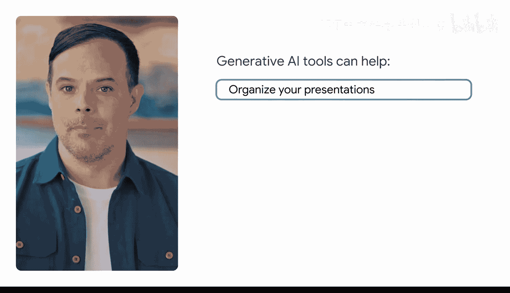

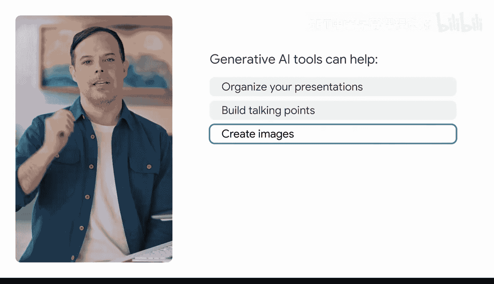

In this scenario， you work for a company that designs， makes， and sells headphones。

You're preparing to pitch your team on some cool new features。

 There's a lot of information and insights to convey。

 So you'll need to distill what you learned into a clear presentation。😊，First。

 let's prompt Gemini to help figure out how to structure the presentation and summarize the findings。

Let's add in the persona。I'm a product designer at a headphones brand。

Here's where we'll paste in the context。Now here's the task。

How should I structure my presentation and don't forget to specify the format list each slide's topic with its key points and visuals。

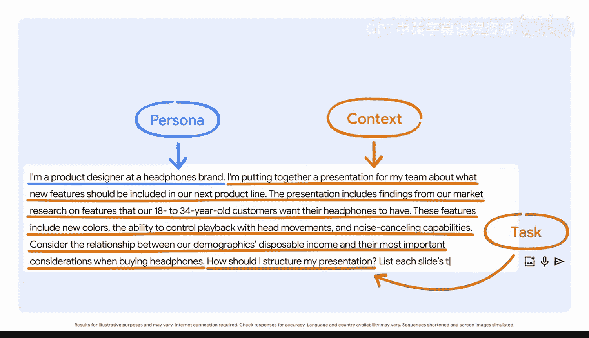

Yeah， nice。Jemmin I has suggested a structure for your presentation that includes key points and visuals for each slide。

 including a title slide， an intro that sets the stage and details on the three features that the audience is interested in。

Jem and I even suggested a call to action at the end of the presentation。 It's good advice。

 There are a few other things that you can do to make it more engaging。

 like adding visuals that complement the information on the slides。

 When using Gen AI for image generation。 you want to use the prompting framework with a few additional things added in。

 you want your input prompt to be as vivid and detailed as possible to help the Gen AI tool to the type of image you want to create。

😊。

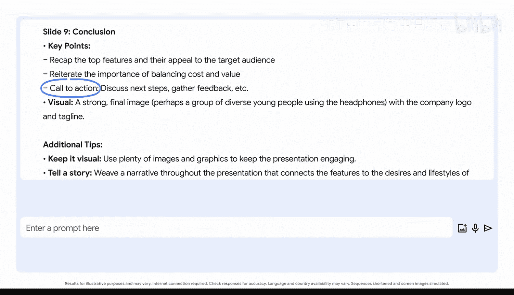

This means specifying the size， color and position of things in the image and the overall aesthetic we want。

 so first we'll specify our task and format。

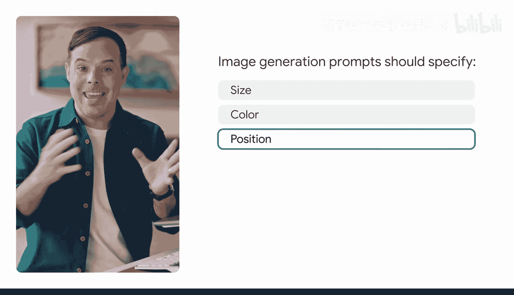

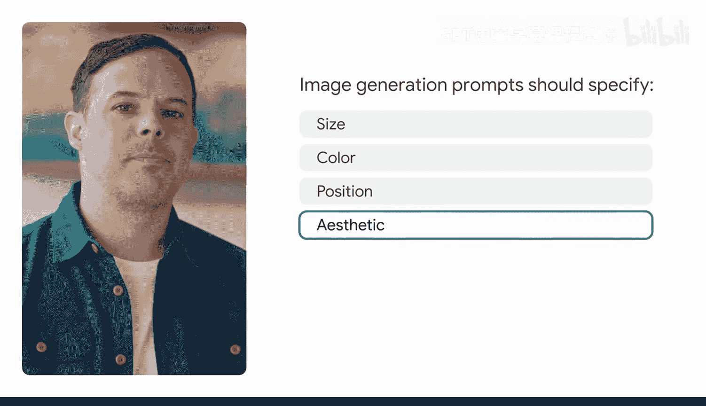

Start with the task。Generate close up images of a pair of sleek silver headphones and add in some more context。

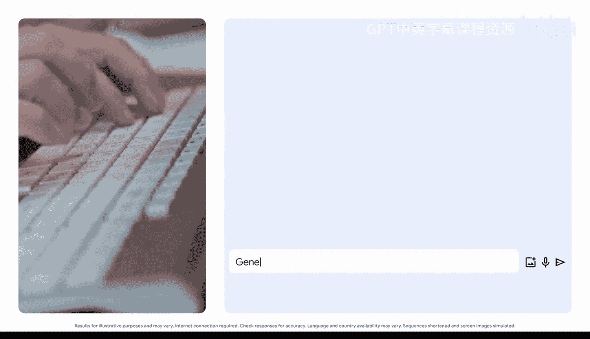

On a desk in a college dorm room， they should have musical notes floating around the headphones to show that they're plain music。

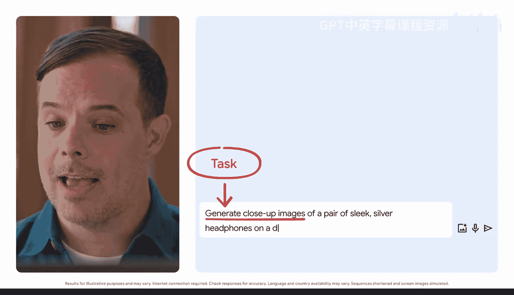

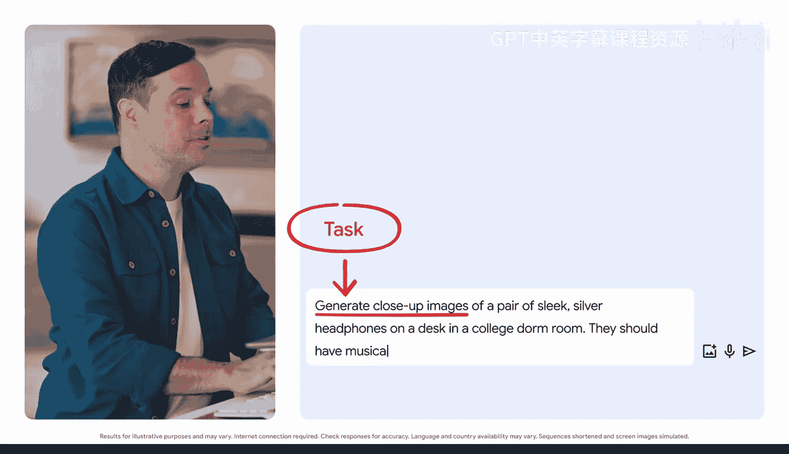

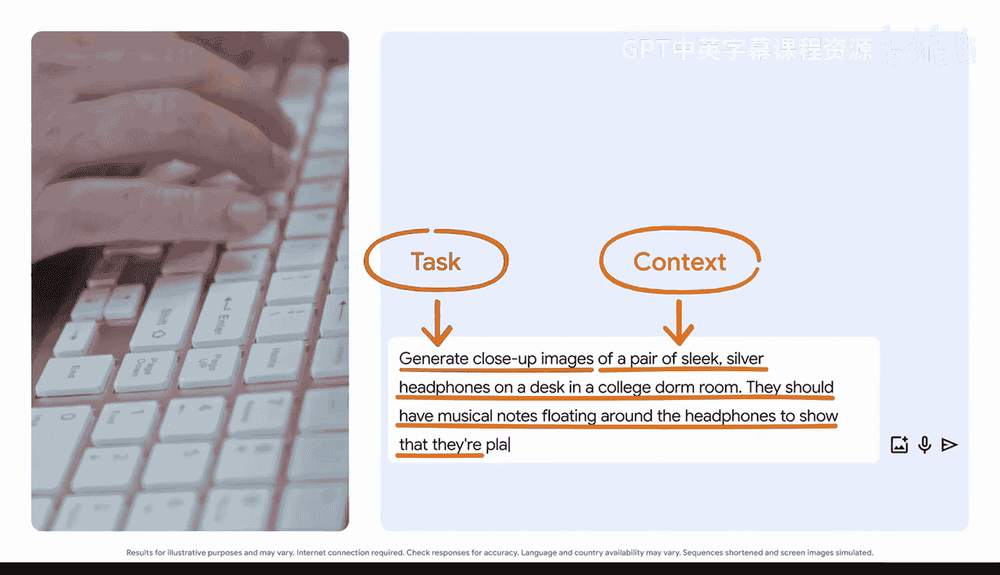

Yeah。So cool。

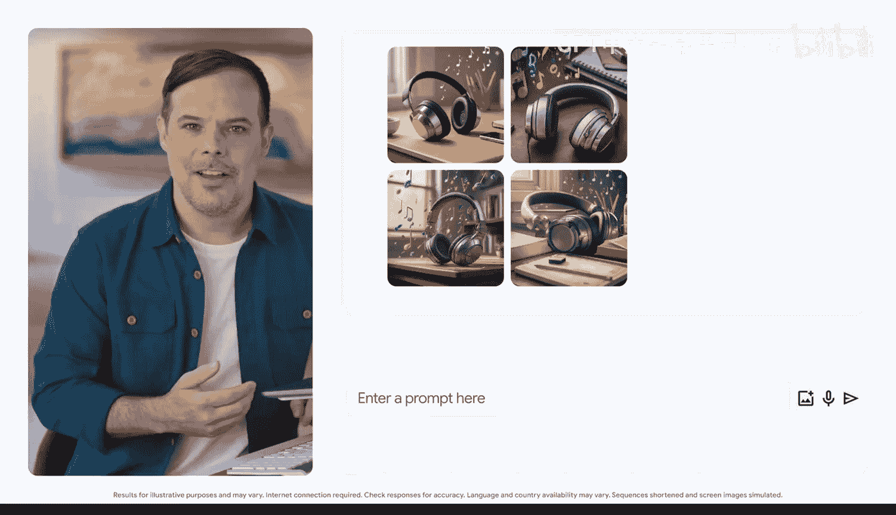

Jem and I created several images to choose from you can even choose between photography， vector art。

 sketches， or watercolors for the style。You still want to evaluate the output just like you would when generating text。

 Check your images to make sure you're getting what you want and that there aren't any mistakes like a headphone cord that's not plugged in or anything else that seems off。

 And remember， part of being a responsible Gen AI user is disclosing when you've used these tools。

So add a disclaimer whenever you're including an AI generated image in your work。🎼Yeah。

