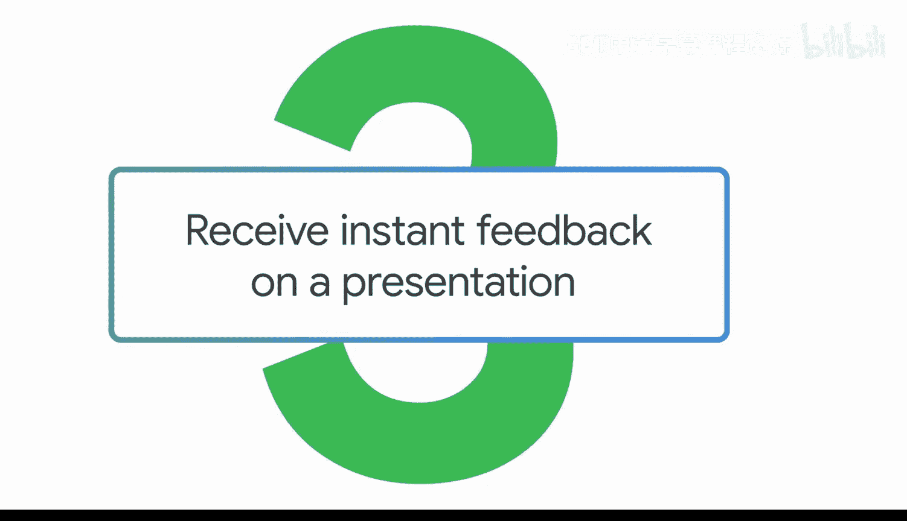
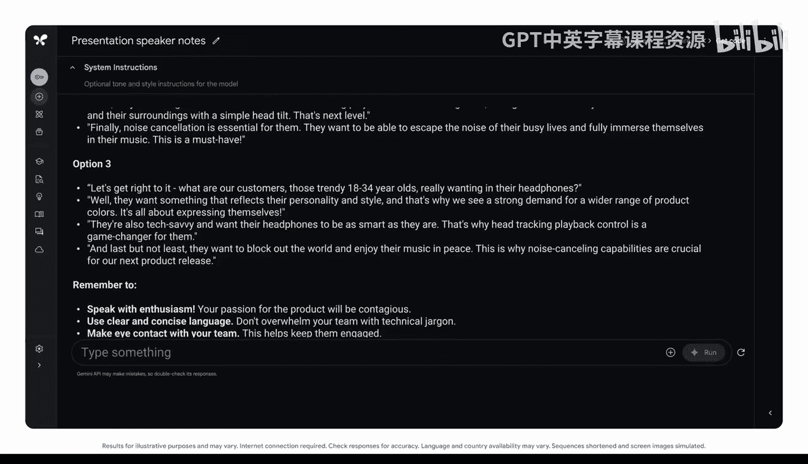
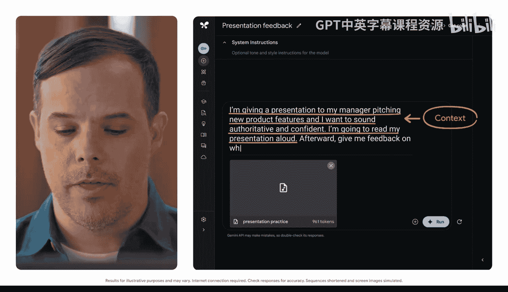

# 谷歌《提示词基础课程｜Google Prompting Essentials》中英字幕（deepseek p29 7_01_02_即时获取演示文稿的反馈.zh_en -BV1zT6eYqEeR_p29-

You've now created your presentation， but there's still one thing left to do Preent your work。

 but you don't want to just read off your slides you want to give your audience helpful context and commentary as you go through them you could go through your whole deck and draft up some talking points yourself。

 but starting from scratch will take a lot of time Instead you can prompt a generative AI tool to give you a head start and generate speaker notes for you。

For this example， we need a long context window。 Remember。

 long context windows aren't available on every AI tool。 Different tools have different capacities。

 For this example， we'll switch to Google AI Studio。Let's upload our slide with the prompt。First。

 we'll add the persona and context。 I'm a product designer at a headphones brand。

Here's where we'll paste in the context。Then we'll give some more direction on tone and specify the format。

Provide multiple options of concise， personable and engaging speaker notes。

I can use while presenting this slide。Okay。You got some great ideas。

 the suggested speaker notes have some personality and energy。

 which will help keep your audience engaged。😊。

But you can get more specific。 You learn that your company's marketing director will attend the presentation。

 You can prompt the model to adjust the speaker notes for a more senior audience。

 Let's give it a try， although this time will use voice to prompt just to save time。

 provide alternate speaker notes for this slide that are specifically directed toward my headphone company's marketing director。

 The director values， precision and their priorities for the organization are to stay on top of industry trends and foster a strong community of loyal customers。

😊，And just like that， you have new speaker notes that are more appropriate for a marketing director。

Now one last thing， you have the presentation and the speaker notes。

 but you want to fit in some practice before the big day。

 you can upload a recording of yourself to get specialized feedback。

Let's start off by specifying the tone and what we want to accomplish。

I'm giving a presentation to my manager。Pitching new product features。 and I want to sound。

Authoritative。And confident。Then we'll explain what you're going to do and the task。

 I'm going to read my presentation aloud。 Afterward。

 give me feedback on whether I've accomplished this goal。

This was really helpful。 You got a list of things to remember to deliver a great presentation。

 but you also got specific examples of where you can work on pacing and tone。

 Since you're using a Gen AI tool with a long context window or large memory。

 you can save your prompt and come back to where you left off。😊。

You can continue practicing without starting all over again。🎼这个。

