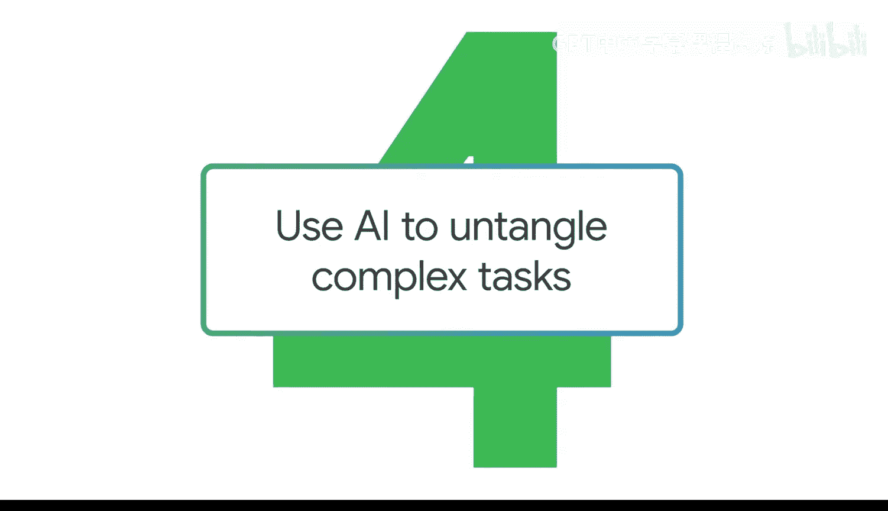
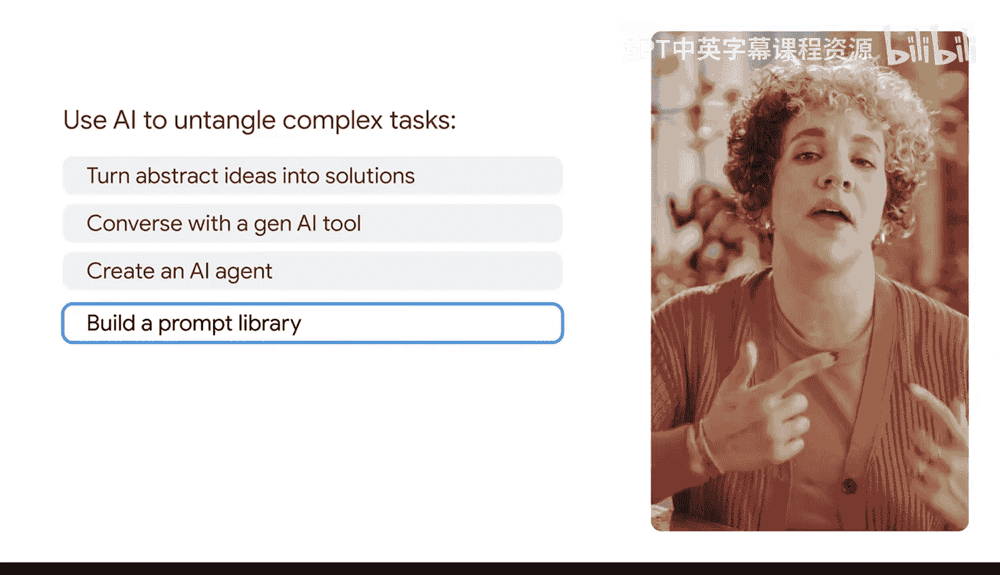
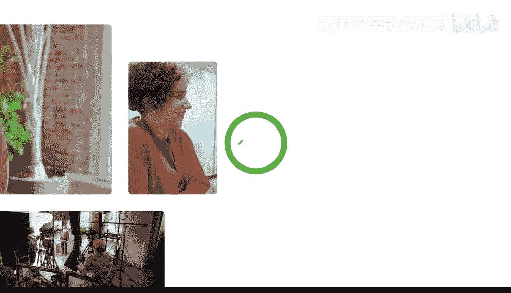

# 谷歌《提示词基础课程｜Google Prompting Essentials》中英字幕（deepseek p31 01_01_01_利用AI解构复杂任务.zh_en -BV1zT6eYqEeR_p31-

So I'm a researcher， which means that sometimes I have to deal with these hefty grant proposals that match my area of expertise。

 and not only that， I have to go out and find grants that I can apply for。

 which is in of itself its own headache。 Something I've been doing is uploading my profile as a researcher to a generative AI tool and using it to find potential grants。

 I'll add my resume。 My published work。 my C and then use different prompt techniques to search for grant programs that match my background。

 It's especially helpful because so many places have specific rules of requirements about who they're giving grants to。

 using generative AI has taken a lot of the guesswork out of that process for me。 In this module。

 you'll learn how to prompt Gen AI tools for more complex projects。

 You can turn abstract ideas into step by step solutions。

 We'll explore how to converse with a Gen AI tool。 create an AI agent and build a prompt library to help you save time and reuse your prompts。

Let's get started。🎼Yeah。

