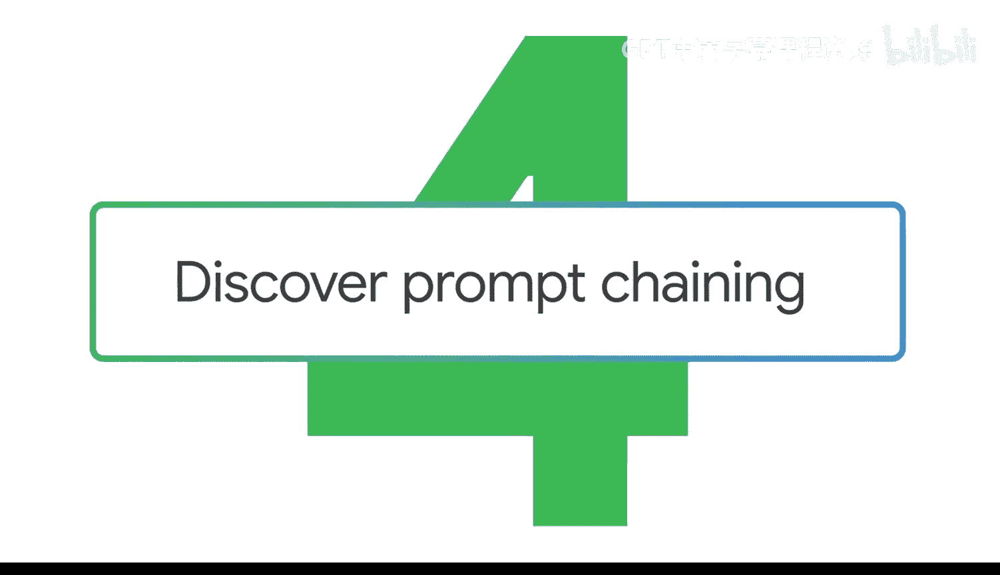
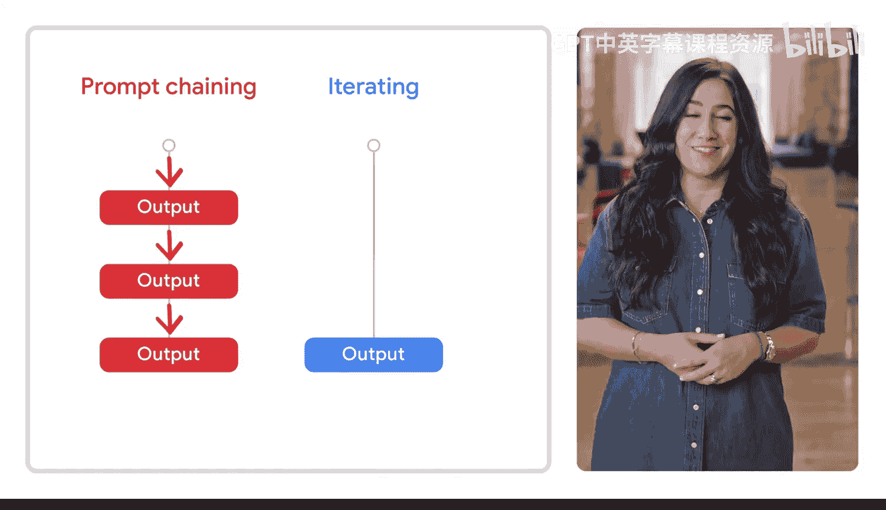
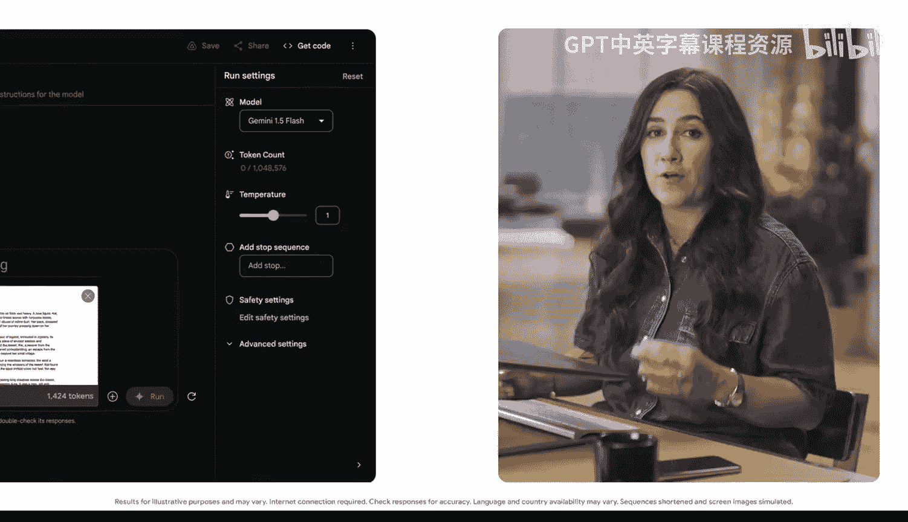
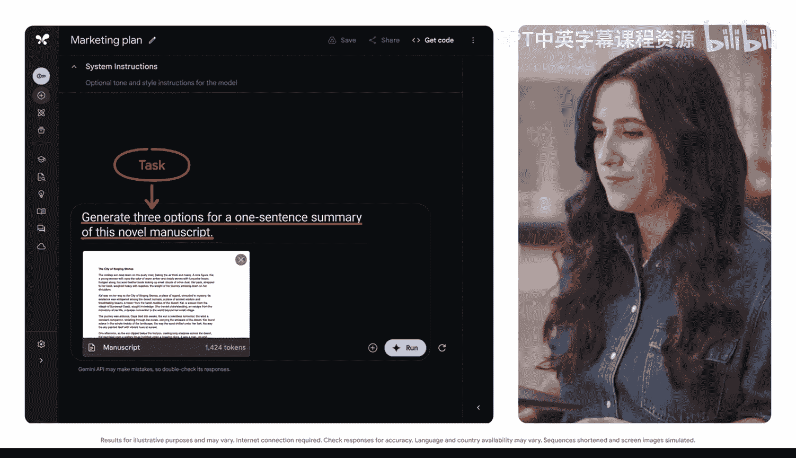
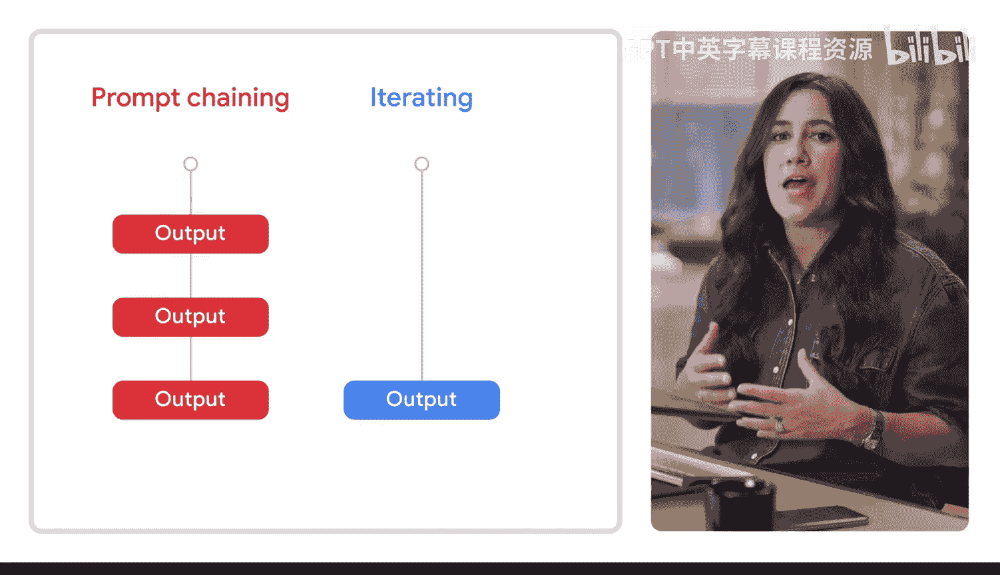

# 谷歌《提示词基础课程｜Google Prompting Essentials》中英字幕（deepseek p32 02_01_02_探索提示链技术.zh_en -BV1zT6eYqEeR_p32-

Have you ever tried to put together a jigsaw puzzle。

 You don't just dump all the pieces out and hope for the best， right， You start with a game plan。

 Maybe you find the corner pieces and slowly build the edges before working on the middle section。

 or maybe you find the small sections to work on before connecting them to a bigger picture。

 The point is that it's a deliberate process it builds over time。

 That's what prompt chaining is like。 Promp chaining guides a generative AI tool through a series of interconnected prompts。

 adding new layers of context or tasks each step of the way。 Eventually， those linked prompts。

 help the tools solve complex problems one step at a time。 Just like putting together a puzzle。

 Here's how we can put that to work for you。 Have you ever taken time off work and needed to catch up on what you miss。

 You could prompt a Gen AI tool to summarize your emails and any documents you receive while you were gone。

 After reviewing the output， you may want to prompt it again to focus on time sensitive request。

 If the new output reveals an urgent issue， you could prompt the tool again。😊。

For some solutions on how to handle it and on and on with this technique。

 you're not just iterating instead each prompt and response builds on the previous one。

 you're creating a chain of prompts together and a single sequence。

Let's demonstrate prompt chaining in action。 We'll use Google AI Studio as it enables us to get access to Gemini models with a long context window。

 You just finished writing a novel。 hugege accomplishment， right？ Well， now the other work starts。

 You need to market and sell it。 So you decide to create a marketing plan to promote the book。

 They claim you can't judge a book by its cover， but it's still important to make a good first impression。

😊，First， you'll need a catchy hook or tagline。 We can use the prompt framework to generate some options in AI Studio。

 As always， let's be specific about our task。

Generate three options for a one sentence summary of this novel manuscript。

The manuscript will provide the story's background information directly。

 so let's just specify the tone。

The summary should be similar in voice and tone to the manuscript， but more catchy and engaging。Okay。

 let's check out the output。These options are good。

 but maybe you want the tagline to focus on a specific theme in your book。

 We can write a follow up prompt to refine the tagline。

 Cate a tagline that is a combination of the previous three options。

With a special focus on the exciting plot twist and mystery of the book。😊，There's the new context。

Find the catchiest and most impactful combination。 The tagline should be concise and leave the reader hooked and wanting to read more。

😊，And we specified the task and format。Great， this is really strong and gives you a great one liner for marketing your book。

 Remember， prompt chaining isn't just about adding more context to your prompts。

 It's about expanding on what the Gen A I tool has previously generated。

 This is a little different from iteration in the prompt framework。

 Since that focuses on adjusting a given prompt to improve the results。 here。

 you want to use its output as a building block for more complex requests。

 This brings us back to the tagline you generated。 It's a great starting point for the next piece in your prompt chain。

 You want to generate a blurb for the back cover of the book。 Let's continue。😊。

Create a five sentence summary of the entire manuscript below that expands on the one sentence summary。

Okay， so we like this summary。 We could iterate on it， of course。 But for the moment。

 let's use this output as the first step in your chaining process with your tagline and blurb set。

 it's time to think about your book tour。 where youve promoted in local bookstore。

 Store that specialize in your book's genre。 Let's continue to build the chain and generate a plan based on what we've already told the Gen Ai tool about your book。

 Since the model has already analyzed your manuscript and remembers the conversation thanks to the long context window。

 Just provide the new task。😊，Generate a six week promotional plan for a book tour。

 including what locations I should visit。😊，And what channels I should utilize to promote each stop on the tour。

Awesome， you' got a plan and of course， you can iterate on any of these prompts if you're not happy with the options the GenAI tool provided。

😊，That's the power of prompt chaining All it took was a series of prompts。

 and we guided the Gemini model and AI studio to write tagline。

 summaries and a plan for the book tour。

🎼对。