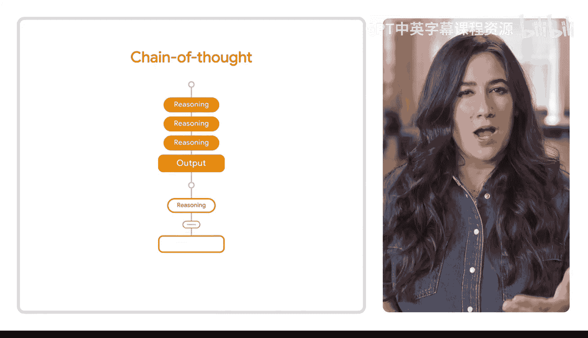

# 谷歌《提示词基础课程｜Google Prompting Essentials》中英字幕（deepseek p33 03_01_03_深入链式思维与树状思维提示法.zh_en -BV1zT6eYqEeR_p33-

Here are two advanced prompt training techniques you can try。

 The first is chain of thought prompting or C， O T。 C。

 O T prompting asks the Gen Ai tool to explain its reasoning or to describe step by step。

 how it got to a specific result。 It's similar to the way math teachers ask students to explain how they got to an answer。

 This method can help you understand the Gen Ai tool' reasoning methods。

 which can help you make better decisions based on its outputs。 For example。

 you might need help deciding how to balance visiting all six book tour locations with a limited budget or time constraints。

 You could prompt the Gen Ai tool for ideas on how to solve this。 But this time。

 you include explain your thought process in your initial prompt。 That way。

 you can evaluate the logic behind each proposed solution。

 A related concept is tree of thought prompting or T， O T。

 T of thought involves asking the tool to explore multiple reasoning paths at once。 like branches。

Going on a tree。T， O， T enables the tool to explore multiple solutions to a given problem。

 It evaluates as it goes， which helps you get the best outcome。 It's like going through a maze。

 Your goal is to get to the end， but you may have to follow a couple of different paths before you get there。

 This method is particularly helpful when solving abstract problems like developing a plot for the novel sequel with new characters and complex story lines。

 These techniques can be really useful for creating outlines or drafting small sections of longer documents at work。

 too。😊，Prompt chaining gives you the chance to explore more complicated ideas and generate interesting responses。

 You might even uncover some insights you could miss with a single prompt。🎼走。

