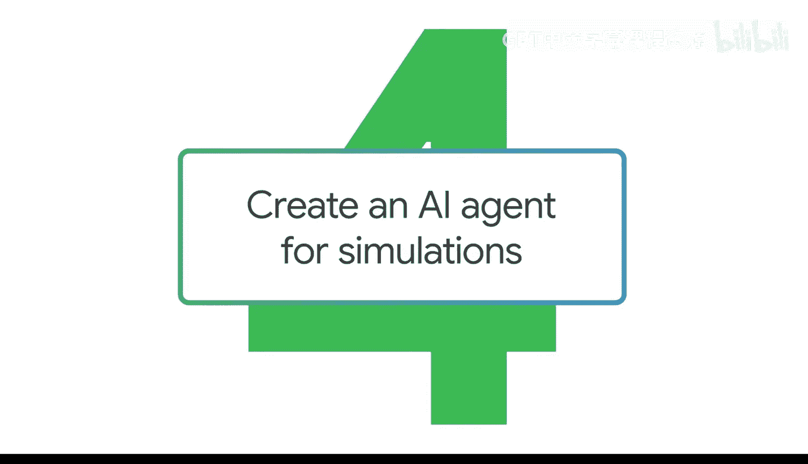
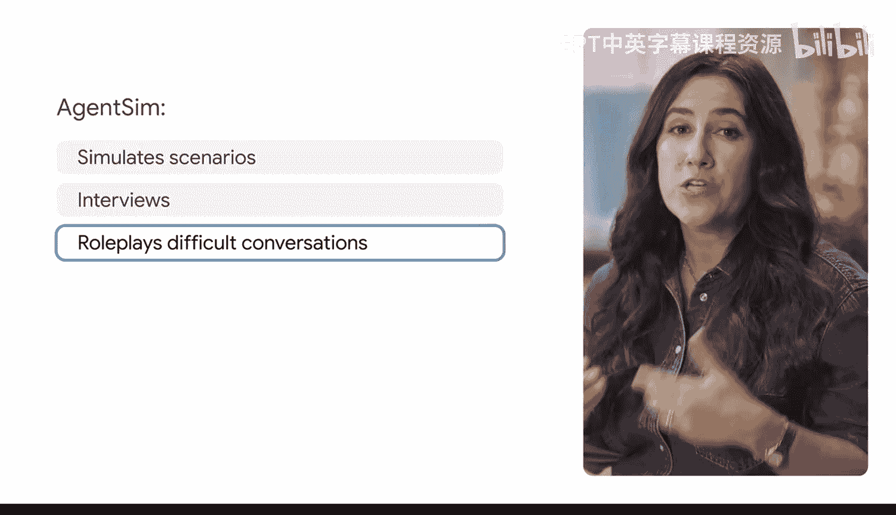
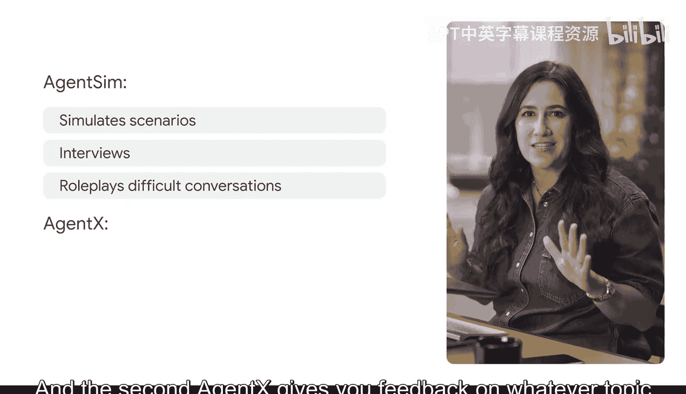
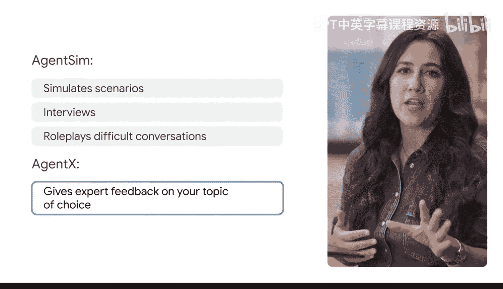
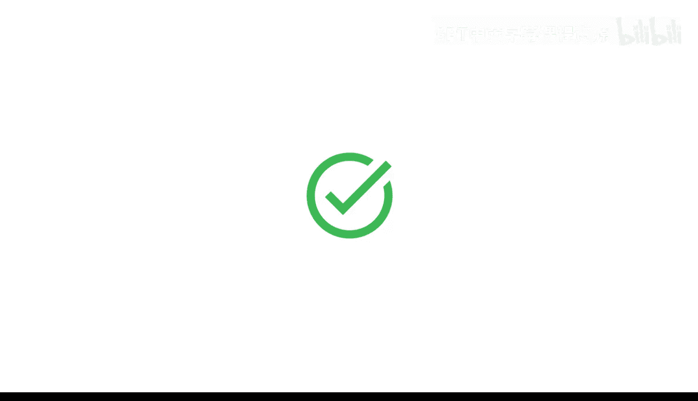

# 谷歌《提示词基础课程｜Google Prompting Essentials》中英字幕（deepseek p35 05_01_01_创建用于模拟的AI代理.zh_en -BV1zT6eYqEeR_p35-

🎼。

I work at a tech company， but I don't have a traditional tech background。

 A lot of what I know is self taught or something I learned on the job。

 There are lots of things I'm curious about， but it's tough to find the right time or a place to ask。

 One great thing about generative AI tools is that they can create a safe space for me to ask questions instead of getting embarrassed or avoiding it。

 I can get expert advice from a Gen AI tool with just a few prompts。

 with the right prompting techniques。 You can transform your gen AI tool into your own team of experts。

 ready to help you take on any challenge。 These are called AI agents。😊。

And while they don't have secret night vision glasses or rocket powered sports cars。

 they are incredibly effective at helping you do your job。

 You can create a eye agents for different purposes， depending on what you need， a coding partner。

 a creative sound board or even an accountability buddy to keep you on track with your goals。😊。

We're going to learn about two different types of AI agents。 We'll assign them names。

 So it's easy to follow。 The first one， let's call it agent Sim helps you simulate scenarios like interviews or role playing a difficult conversation so you can practice and change your approach as needed。

 And the second agent X gives you feedback on whatever topic you prompted to be an expert on。

 Think of agent X， like a personalized consultant。 Let's start with agent Sim。 a simulation。

You've been asked to create a training program to help interns improve their interview skills。

 to help them get new positions。 Let's go through a series of prompts that will help us create this AI agent in Gemini。

Act as a career development training simulator。To make this agent effective。

 we need to provide a lot of detail and background information about the persona。

Your task is to help interns master interview skills and conduct conversations with potential managers。

Now let's set the scene to do that， we'll give it benchmarks about what it actually needs to provide in the outputs in this case。

 and for a lot of simulation or roleplay AI agents like this。

 you need to specify the types of conversations you want it to have。

You need to support the following types of conversations， articulating strengths and skills。

Communicating professionally and confidently。Discussing future career development goals。

We could stop there and let the tool process。 It's not necessary。

 but it can help the output for our purposes， Let's just continue the same prompt。

Once an intern has picked a conversation topic， provide details about the situation and the interviewer's role。

Then act as the interviewer and allow the intern to participate as the employee。

Make sure to guide the conversation in a way that will allow the intern to exercise their interview skills。

Notice how much detail we're giving it to help ensure that the conversations proceed the way we want them to。

 And now we're going to add a stop phrase to indicate when and how the role play can end。

 This could be anything。 The end。 That's a wrap and seen or something a little fun， like gas hands。😊。

Continue the role play until the intern replies with jazz handss。😊。

After the intern gives the stop rule， jazz hands， provide them with key takeaways from the simulation and skills they can work on。

Okay， let's review our prompt。 We've specified the role act as the task， your task is2。

And the intended outcome， the skills specified。 We also provided plenty of details and background to set the scene。

 It's time to start the simulation and have a real conversation。

 Let's use articulating strengths and skills It test it out。 Okay， here we go。😊。

It's asking me to tell it a bit about my strengths and why I would make a good fit for the role。

 I'll respond。My top strength is translating complex marketing concepts into clear。

 engaging messages that resonate with diverse audiences。Great， Gemini is doing its job。

 The response is encouraging。 and now it's asking me for a specific example。 Here's what I write。😊。

Yes， I designed a marketing campaign for a local company who sells custom jewelry online。😊，Okay。

 let's check out the response。Agent Sim is impressed。 Okay， I'm ready。 I'll type my stop rule。

 Ja hands。😊，Now， in the original prompt， we told it to provide key takeaways from the simulation。

 let's make sure。Yes， it responded that I did a great job citing specific examples and demonstrating enthusiasm and value。

 That's good。啊。And here we can find the areas for improvement。

 which include being more concise and tailoring my answers better。 This is so helpful。

 This is one of the most interesting ways to interact with a Gen AI tool because there are so many possibilities。

 You can even upload a job description and prompt the tool to ask interview questions based on the jobs criteria。

 Another example， you can design a prompt to make the AI agent take on different roles you might encounter in the workplace and use it to simulate conversations。

 meetings and feedback sessions。😊，🎼。

