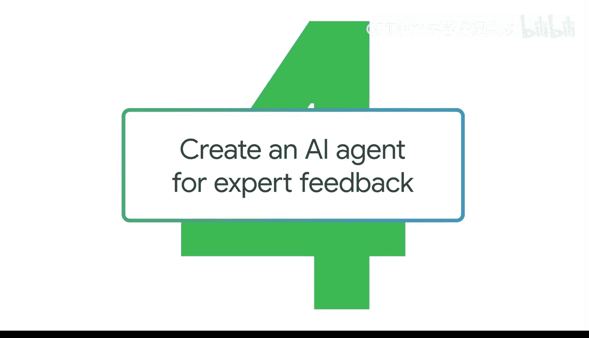
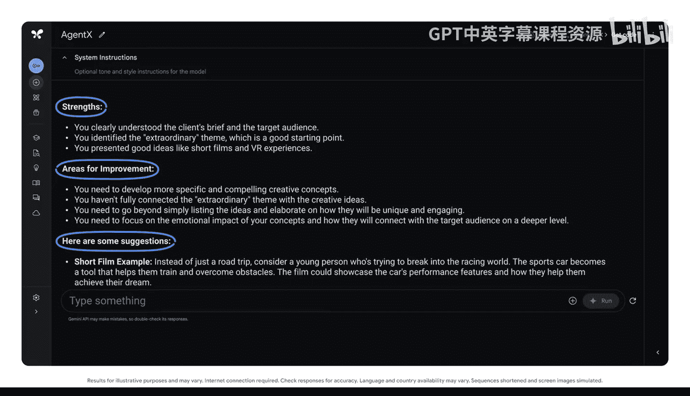
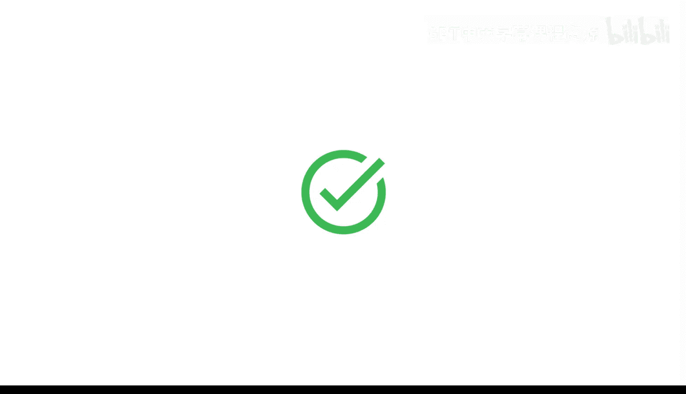

# 谷歌《提示词基础课程｜Google Prompting Essentials》中英字幕（deepseek p36 06_01_02_创建用于专家反馈的AI代理.zh_en -BV1zT6eYqEeR_p36-

We're done with agent Sim for now。 Let's move on to the second type of AI agent， agentnt X。

 Think of agent X as your personalized consultant with the right prompt。

 you can instruct your agent to be an expert on anything you need。 In this example。

 we need our AI agent to provide expert feedback on a pitch for a potential client。

 Since this prompt will include a lot of context and information about the potential client。

 We'll need to use a long context window that allows the generative AI tool to retain and utilize more information。

 leading to better responses。 So we'll switch to Google AI Studio。😊，You're my potential client。

 the V P of advertising at a world famous sports car company known for its innovation。

 performance and engineering excellence。 Okay， it's got the persona and background。

 but we need to set up the interactive conversation of it。 Let's set the scene。😊。

You're considering hiring a creative agency to develop a new campaign that will attract a younger generation of buyers。

 You are in a meeting with me， the design director of a creative agency that's pitching a new campaign for your company。

😊，We could put the whole pitch in here。Act as my potential client When I provide answers。

 critique the answers。 if needed， ask follow up questions。

Continue the conversation until I give the stop rule rake。

Then give me a summary of the whole conversation highlighting ways I can improve my itch。😊。

We'll upload the brief the client gave us here that way the model will critique the pitch through the client's point of view。

I have included the brief the car company provided me that has all the relevant information for this project。

Use the information from this brief to inform your answers。This was another long involved prompt。

 Let's review it。 Keep in mind that we're still using our prompt framework。

 We started by setting up the role of the V P before establishing what we want the Gen A I tool to do。

 which is to critique the pitch and ask follow up questions。 We also specified our intended outcome。

 which involved highlighting ways the pitch can get better。😊，Okay， time to converse。

It's asking for more details。Let's check out the response。Oh。

 there are still some concerns that need addressing。That's super helpful for this practice round。

 Let's type the stop rule now， and evaluate the feedback。Break。Nice。

The AI agent has given a summary of the conversation so far。

 what's working and what needs improvement and recommendations to strengthen the pitch。Wonderful。

Now that the Gen Ai tool is acting as your client， you can continue asking for feedback on the pitch。

 Remember to save your prompt so you can return to this conversation after you revise your pitch to help you test more ideas as you hone in on a final version。

 You can even create customized versions of Gemini called Ges。

 Simply describe what you want your gem to do and how you want it to respond and Gemini will take those instructions and help you create a gem for your specific needs。

😊，🎼。🎼。

