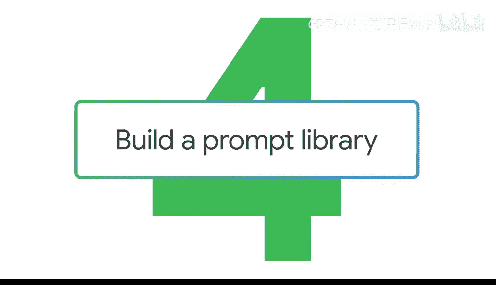
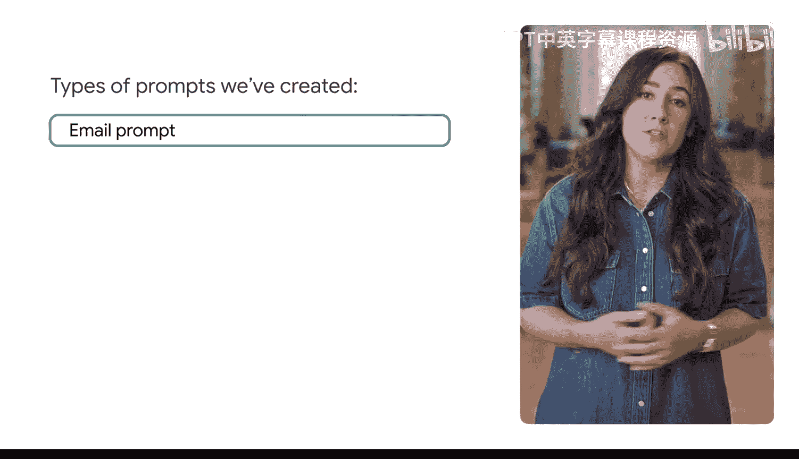
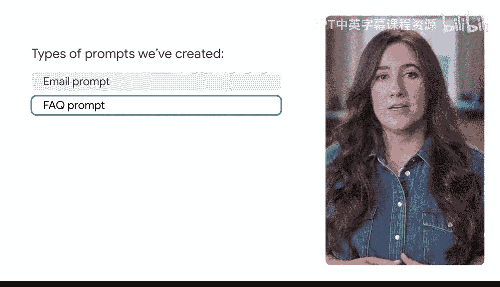
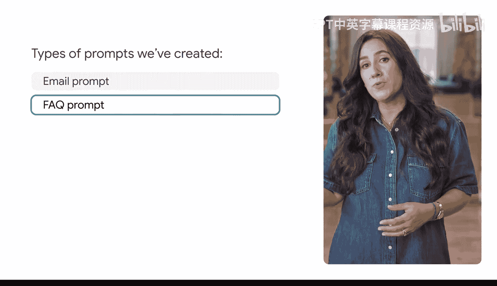
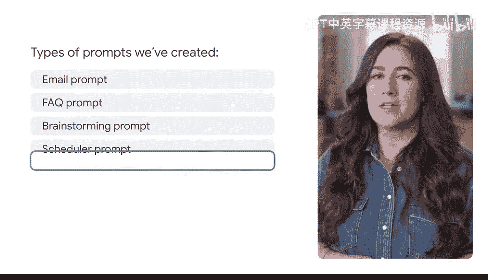

# 谷歌《提示词基础课程｜Google Prompting Essentials》中英字幕（deepseek p38 08_01_01_构建提示词库.zh_en -BV1zT6eYqEeR_p38-

Throughout this course， you've learned how to thoughtfully create really excellent inputs out a prompt。

 Like most skills， your prompting abilities will improve through experimentation and practice。

 You can save a ton of time by noting which prompts work best and for what use cases。

 I encourage you to keep track and go back to determine what's worked and what hasn't。😊。

That's where prompt versioning comes in。 Prompt versioning is a way to keep track of the different versions of your prompts over time。

 It's a powerful way to capture your most effective prompts。

 track your progress and develop your Gen AI prompting skills。 And here's a tip。

 You can name your most effective prompts and store them in your personal prompt library for easy access in the future。

 In fact， some generative AI tools allow you to name and save your prompts right inside the tool。

 Imagine you're doing meal prep for your family。😊，You found a set of meals you really like。

 but you want to start experimenting with new cuisines。

 You wouldn't scrap your entire meal plan and start again， right？

 You'd use what you've already learned about things like preferences。

 portiontions and allergies and use that as a base to create a new weekly menu for your family。

 The same goes for prompt versioning。 Once you have a prompt that works。

 You don't need to reinvent the wheel。 You can experiment with different tasks。

 Cons and references to get different results based on what you need。 For example。

 you can develop a reusable prompt for emails。 The Gen A I tool will draft the email for you。

 but you can adjust the tone and format based on the audience you're communicating with。

 or you could use a single source of information to create different frequently asked questions sections dedicated to different types of customers that visit your website。

 You can tweak the prompt that generated the FAQ for individual consumers and change the persona to make an fQ for enterprise customers。

 Think about all the prompts we've created in this course。 What versions can you。😊。

For your needs， playing and experimenting with prompts is the best way to figure out how to get what you want。

 And the only way to get there is to get comfortable， explore and learn what path works for you。

 And remember， you're not alone。 There's a big community of folks out there that are sharing prompts that have worked for them so that people can learn from each other's successes。

 Find inspiration and support。😊，Participating in that community is a great way to improve your prompting skills and build a network。

