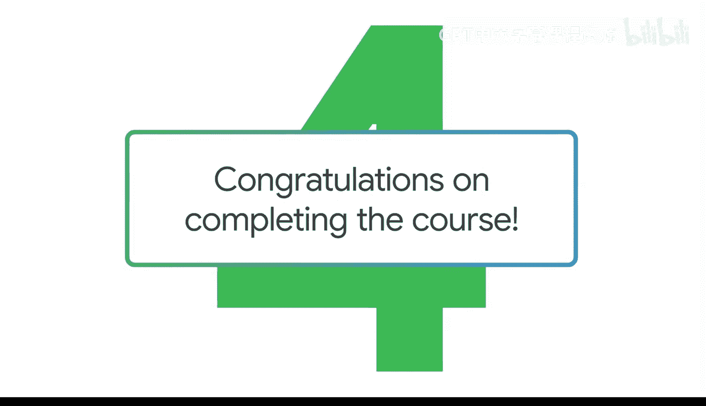

# 谷歌《提示词基础课程｜Google Prompting Essentials》中英字幕（deepseek p40 10_01_03_恭喜完成课程.zh_en -BV1zT6eYqEeR_p40-

Congrats， you just learned a lot， and you should be really proud of all the work you put into this course。

 Prompting is key to unlocking the power of generative AI。

 You've learned how to do everything from writing simple text prompts to creating your own personal AI agent。

 You learned how to gradually build on the complexity of your prompts to get useful outputs。

 from helping you draft emails to summarizing documents and to creating engaging presentations。

You've learned how to draw insights out of data， create advanced prompts and turn Gen AI tools into creative collaborators。

 But remember， it's vital that you use these tools responsibly。

 I'm so glad to have been a part of your journey。 And I encourage you to keep experimenting with Gen AI so that you can figure out how to make these tools work for you。

 The best way to do that is to get out there and write your own prompts。 Now， go get started。😊。

