# 002：让我们再次穿越时空！⏳

在本节课中，我们将回顾决策与强化学习的一些核心概念。这些内容是理解后续更复杂主题的基础。

## 课程概述

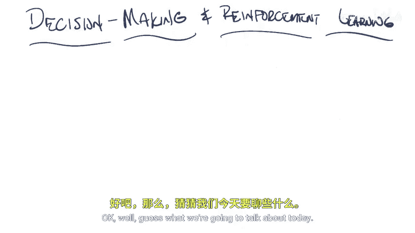

决策与强化学习是机器学习的一个重要分支。它关注智能体如何通过与环境交互来学习最优行为策略。

## 课程名称讨论

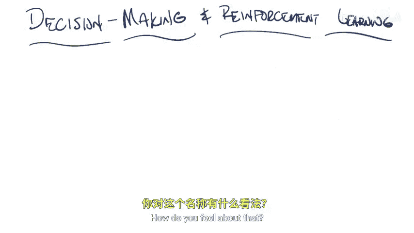

课程的名称是“决策与强化学习”。关于名称中连字符的使用，存在一个语法细节：通常在“决策”和“强化学习”作为复合名词修饰另一个名词时，才需要添加连字符。这让人回想起在机器学习课程中介绍本部分内容时，有过类似的讨论。

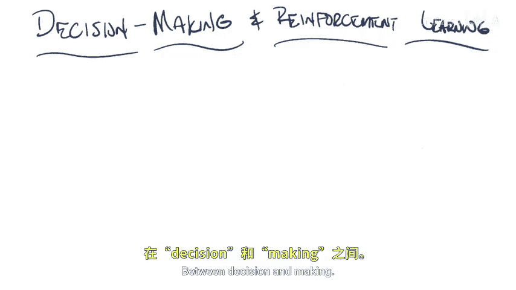

## 内容回顾的必要性

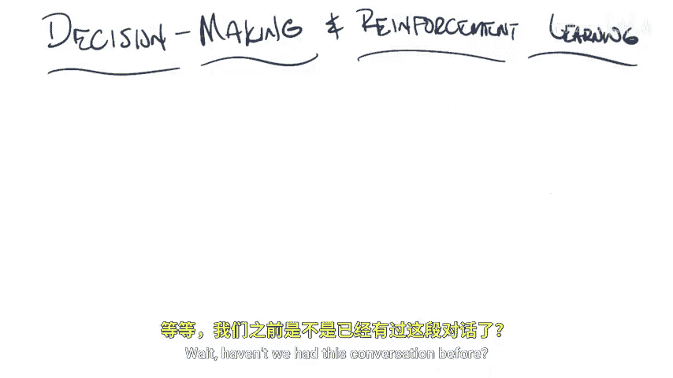

尽管部分内容可能重复，但课程开始时回顾一些核心材料是绝对重要的。这有助于巩固基础，确保所有学习者站在同一起跑线上。

## 采用“闪回”方式

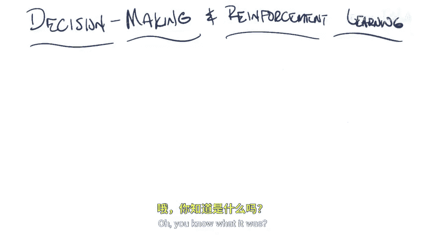

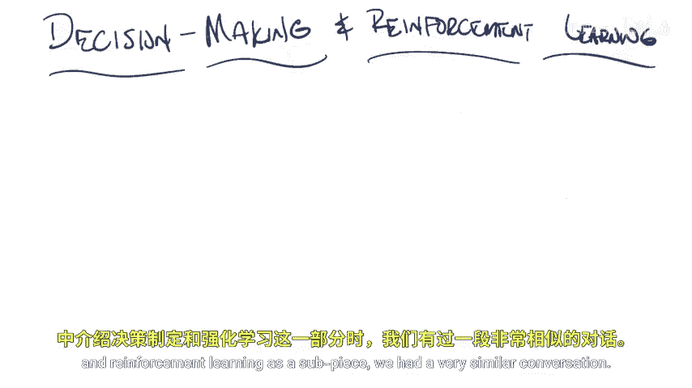

为了高效地完成这次回顾，我们决定采用一种“闪回”的方式。这意味着我们将整合之前课程中的相关视频材料，直接呈现核心内容，而不是重新录制。这种方法可以节省时间，让教学重点更加突出。

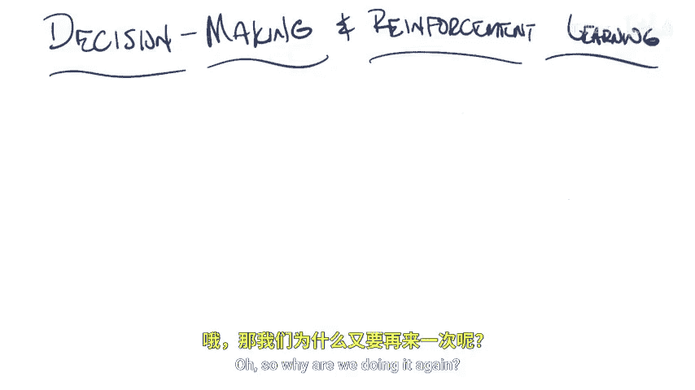

## 核心概念：马尔可夫决策过程

在强化学习中，**马尔可夫决策过程** 是描述序贯决策问题的标准数学模型。一个MDP通常由以下元素构成：

*   **状态集合 (S)**：环境所有可能情况的集合。
*   **动作集合 (A)**：智能体所有可能行为的集合。
*   **转移概率 (P)**：在状态 `s` 执行动作 `a` 后，转移到状态 `s‘` 的概率，通常表示为 `P(s'|s, a)`。
*   **奖励函数 (R)**：在状态 `s` 执行动作 `a` 后，转移到状态 `s‘` 所获得的即时奖励，通常表示为 `R(s, a, s')` 或期望奖励 `R(s, a)`。
*   **折扣因子 (γ)**：一个介于0和1之间的数，用于衡量未来奖励的当前价值。

智能体的目标是学习一个**策略 (π)**，即一个从状态到动作的映射（`π: S -> A` 或 `π(a|s)`），以最大化长期累积奖励（即**回报**）。

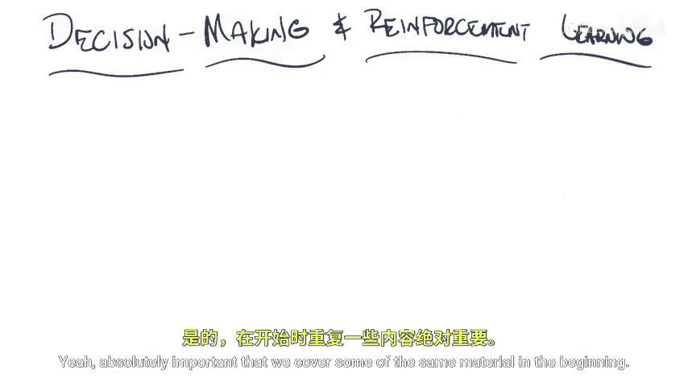

回报 `G_t` 的计算公式为：
`G_t = R_{t+1} + γ * R_{t+2} + γ^2 * R_{t+3} + ... = Σ_{k=0}^{∞} γ^k * R_{t+k+1}`

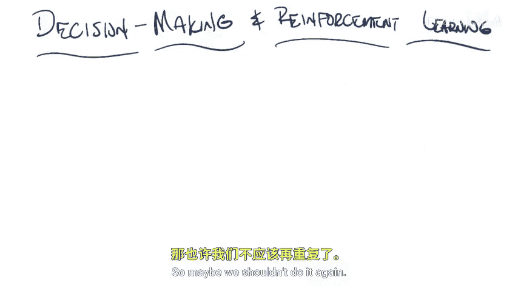

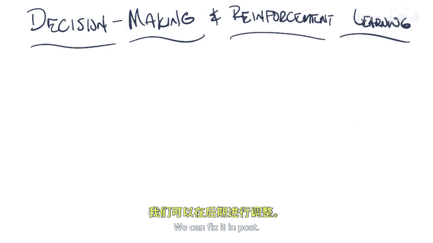

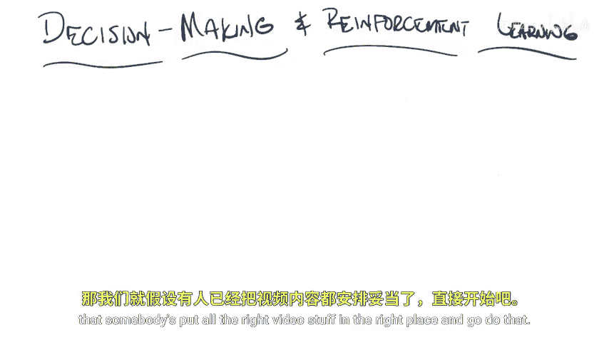

## 总结

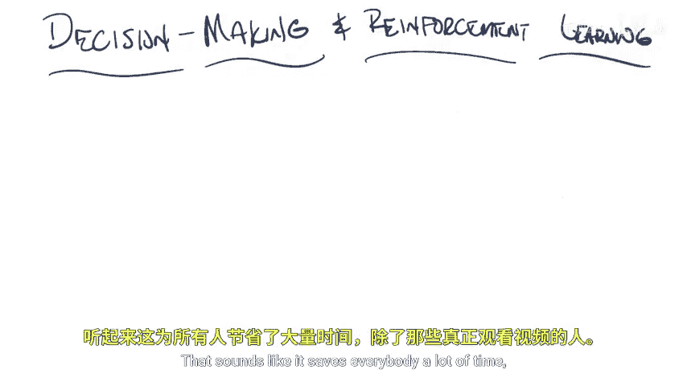

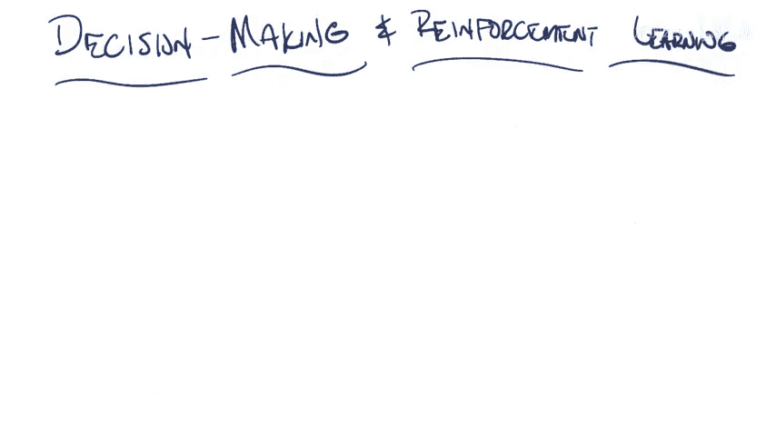

本节课中，我们一起回顾了决策与强化学习课程的基本框架和核心概念——马尔可夫决策过程。我们明确了学习目标是寻找最大化长期回报的策略。理解MDP是打开强化学习大门的钥匙，在接下来的课程中，我们将基于此构建各种学习算法。