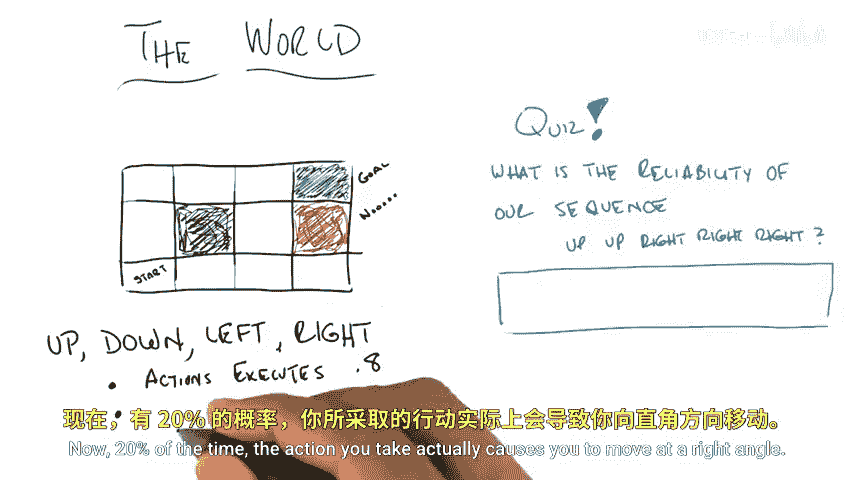
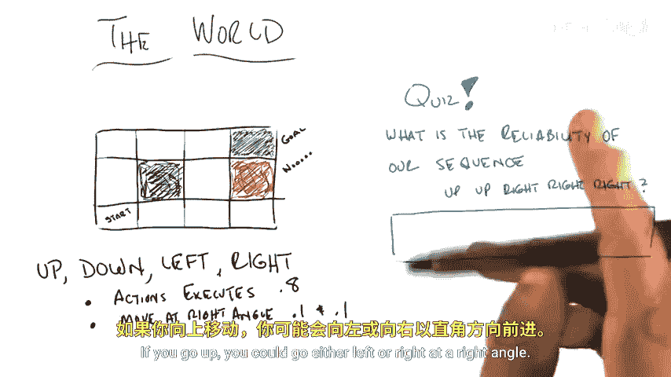
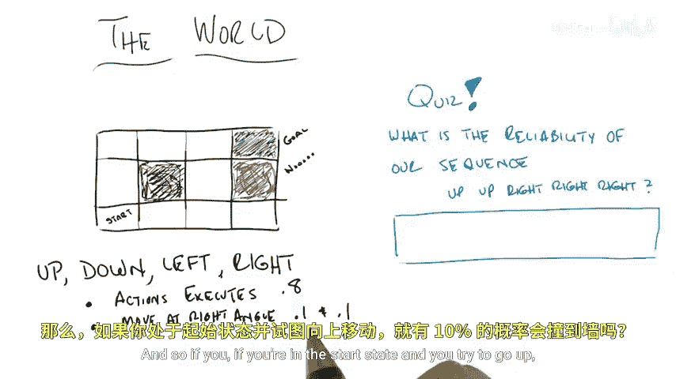
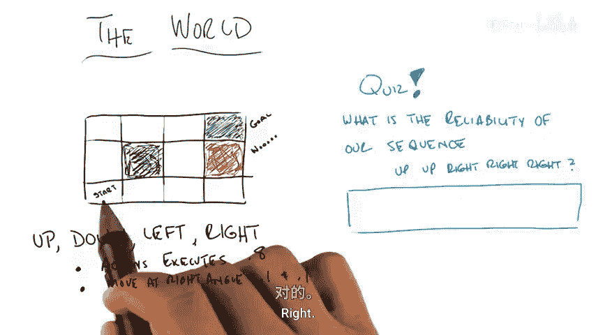
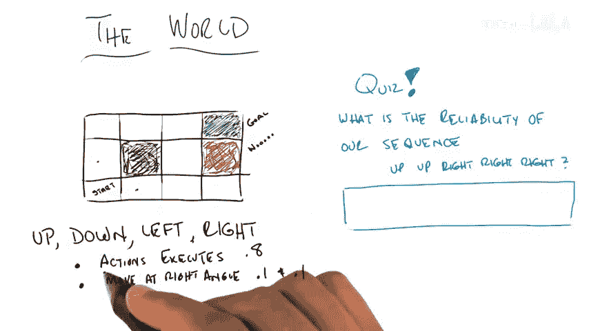
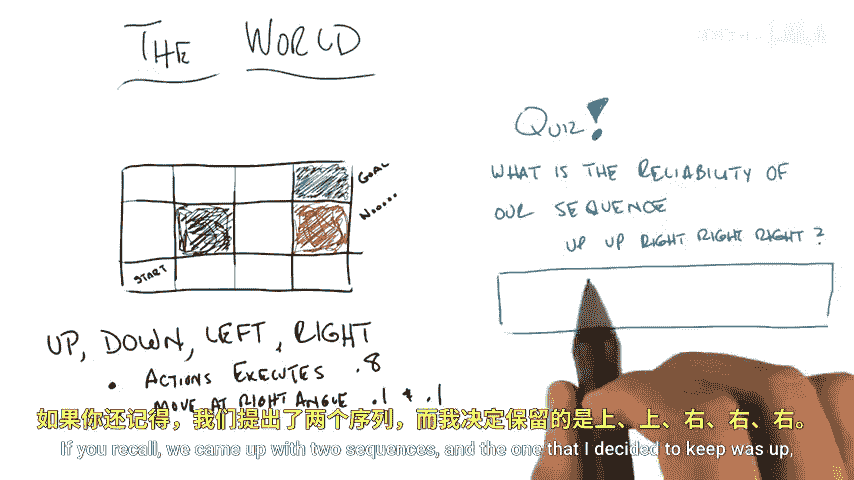

# 007：引入不确定性的世界

在本节课中，我们将学习如何在一个存在不确定性的环境中进行决策。我们将探讨当智能体的行动结果不再完全确定时，如何计算不同行动序列的成功概率。

上一节我们介绍了在确定性环境中的路径规划问题。本节中我们来看看当世界变得不确定时，情况会发生怎样的变化。

## 引入不确定性

在之前的问题中，每次执行一个动作都会产生预期的结果。现在，我要在环境中引入一点不确定性或随机性。

具体来说，当你执行一个动作时，它只有80%的概率会正确执行。这意味着，如果你选择向上移动，在80%的情况下，只要能够向上移动，你就会向上移动。

## 动作的随机结果

剩下的20%概率，你所执行的动作会导致你向一个垂直方向移动。当然，对于每个动作，存在两个可能的垂直方向。

例如，如果你试图向上移动，那么你可能会向左或向右移动。这20%的概率会被均匀地分配到这两个方向上。

以下是动作“向上”在起始状态下的可能结果：
*   **80%概率**：成功向上移动。
*   **10%概率**：向右移动（撞墙，停留在原地）。
*   **10%概率**：向左移动（撞墙，停留在原地）。

因此，如果你在起始状态执行“向上”动作，你有80%的机会向上移动，有10%的机会试图向右移动但撞墙，还有10%的机会试图向左移动但撞墙，这两种情况都会让你停留在起始位置。

## 不确定性下的路径规划

好的，现在是我的测验问题。Michael，你是否还记得我们之前提出了两个动作序列，而我决定保留的那个序列是：`上， 上， 右， 右， 右`。

本节课中我们一起学习了如何在动作结果具有不确定性的环境中思考问题。我们明确了当动作执行成功率为80%，失败时随机转向垂直方向的具体规则，并分析了在起始状态下执行“向上”动作的概率分布。这为后续计算复杂路径的成功概率奠定了基础。