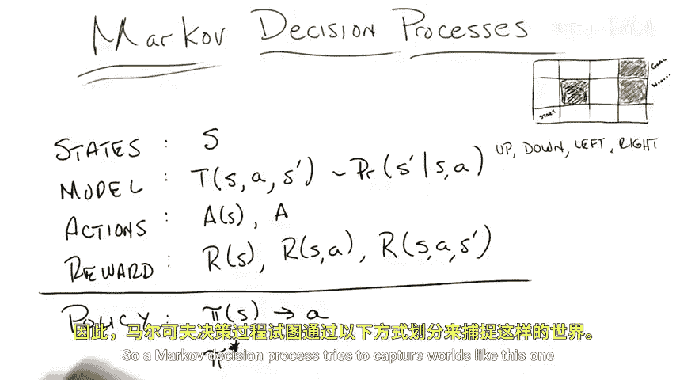
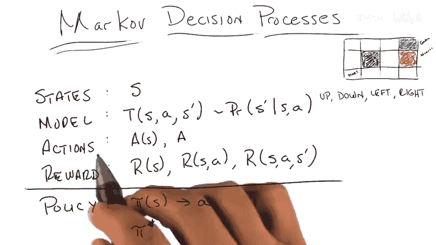
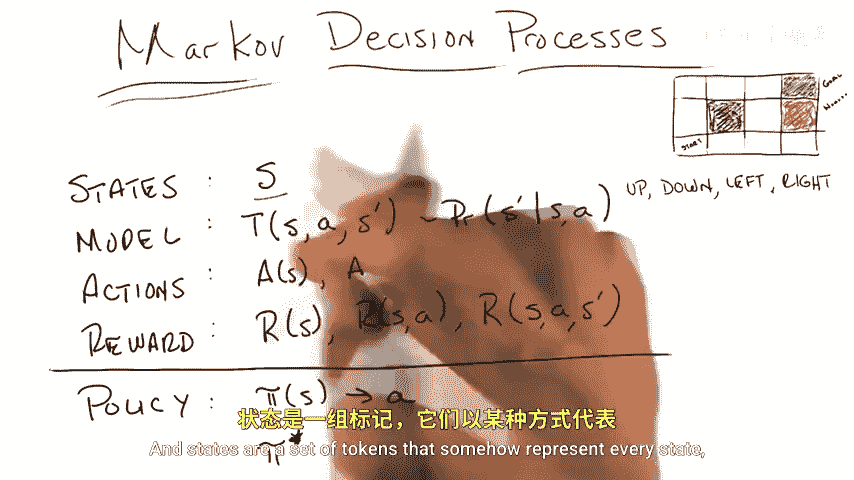
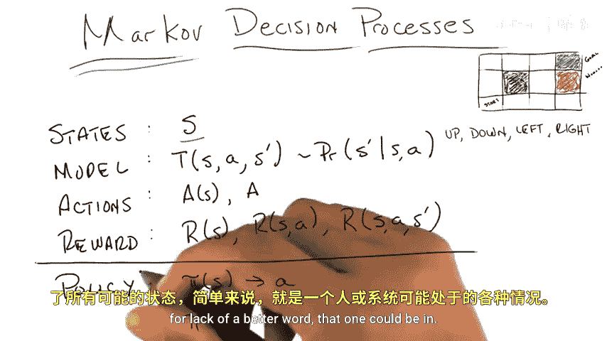
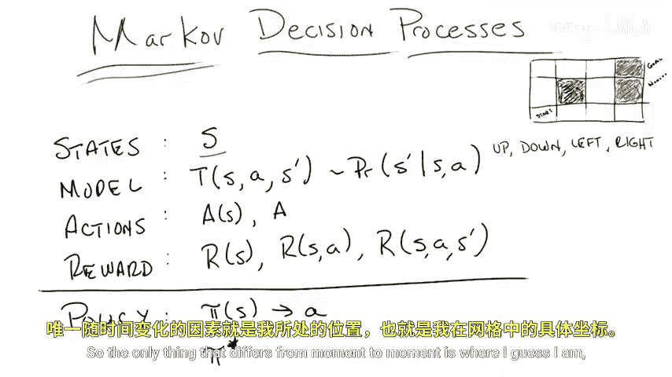
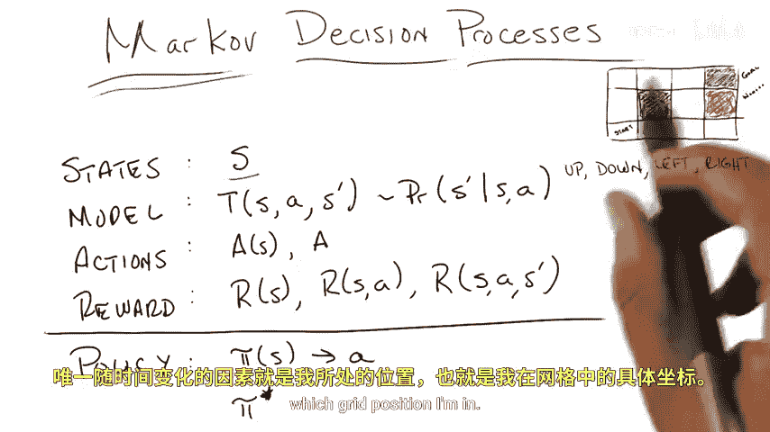
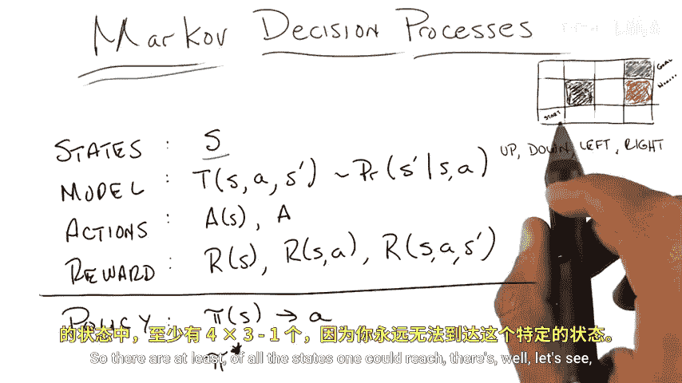
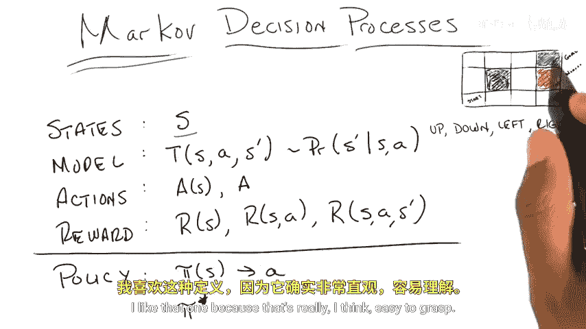

# 009：马尔可夫决策过程 - 1

在本节课中，我们将学习强化学习的核心建模框架——马尔可夫决策过程。我们将了解其基本构成要素，并通过一个简单的网格世界示例来直观理解这些概念。

马尔可夫决策过程是我们讨论强化学习，至少是单智能体强化学习时，将使用的主要框架。它被称为马尔可夫决策过程。这个框架旨在捕捉类似下图所示的世界。

它通过以下方式进行划分。

## 状态

我们定义存在**状态**。状态是一组标记的集合，这些标记以某种方式代表了智能体可能处于的每一种“情形”。

那么，在我们一直讨论的网格世界中，状态会是什么呢？从一刻到另一刻唯一变化的是位置。

我认为，我所在的每一个不同的网格位置就是一个状态。可能还存在表示“成功完成”或“失败完成”的状态。但让我们坚持一个简单的设定。

我喜欢这个简单的设定，因为它非常容易理解。所以，在所有可能到达的状态中，总共有 4 行乘以 3 列，再减去 1 个永远无法到达的状态。

---

本节课中，我们一起学习了马尔可夫决策过程的基本概念，并重点介绍了其第一个核心组成部分——**状态**。状态是描述智能体所处环境情形的抽象表示。在网格世界示例中，每个可到达的网格位置都可以被视为一个独立的状态。理解状态是构建MDP模型的第一步，在后续章节中，我们将继续探讨其他组成部分，如动作、转移概率和奖励。