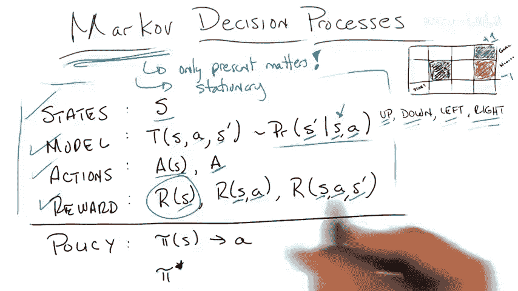

# 012：马尔可夫决策过程 - 4 - 策略与最优策略

在本节课中，我们将学习马尔可夫决策过程（MDP）的解决方案，即策略。我们将了解策略的定义、作用，并特别介绍最优策略的概念。

上一节我们介绍了马尔可夫决策过程的基本构成，本节中我们来看看如何解决一个MDP问题。

## 策略：MDP的解决方案

说到解决方案，这是你需要知道的最后一点内容。这定义了一个问题，但当我们遇到问题时，我们也希望拥有一个解决方案。

马尔可夫决策过程的解决方案被称为**策略**。

策略的作用是，它是一个函数，接收一个状态作为输入，并返回一个动作。换句话说，对于你所在的任何给定状态，它告诉你应该采取的动作。

它就像一个提示。不，它直接告诉你这就是应该采取的动作。我的意思是，你并非必须执行它。但从马尔可夫决策过程的角度来看，我们认为这就是将要采取的动作。

我明白了。所以它更像是一个指令。是的，它是一个命令。

以上就是策略的全部内容。策略是马尔可夫决策过程的一个解决方案。

## 最优策略

存在一种特殊的策略，我在这里写作 **π\*** 或**最优策略**。

这是能够最大化你长期预期收益的策略。

在所有你可能采取的策略或决策中，这是能够优化你在整个生命周期中将要获得或预期获得的奖励总量的策略。

就像在最后。嗯，是的，在最后，或者在任意给定的时间点。从马尔可夫决策过程的角度来看，你获得了多少奖励。

不一定非要有终点。不过在这个例子中，你什么也得不到。然后最后你会得到回报，或者如果你掉进红色方块，你会得到负回报。

所以实际上，你的问题指出了一个非常重要的点。我早先在谈论三种学习类型时提到过。

## 总结

本节课中我们一起学习了马尔可夫决策过程的解决方案——策略。我们了解到策略是一个从状态映射到动作的函数，它定义了在给定状态下应采取的行为。我们还介绍了最优策略 **π\*** 的概念，它是所有可能策略中能够最大化长期预期总收益的那个策略。理解策略是解决强化学习问题的关键一步。