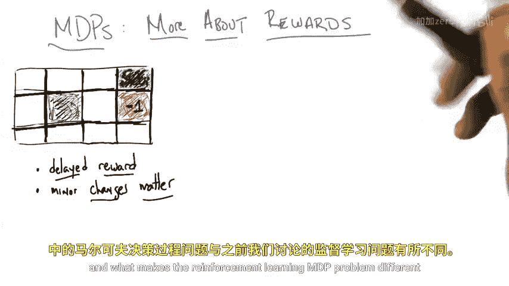
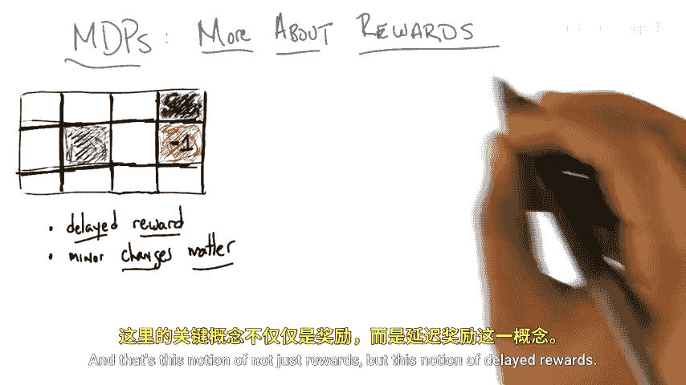
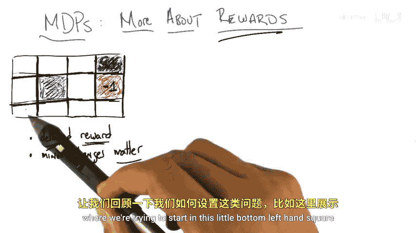
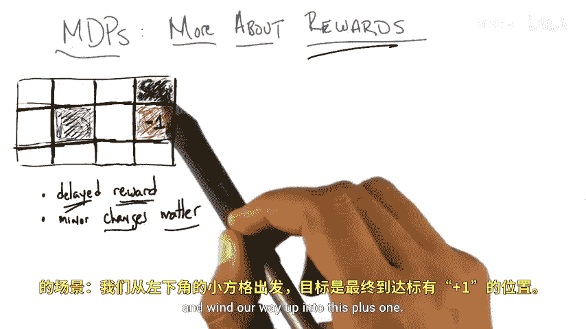
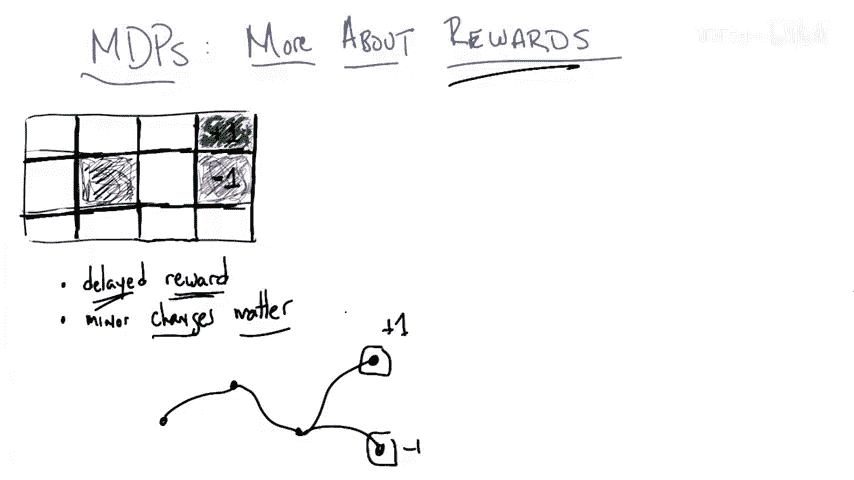

# 013：更多关于奖励 - 1 - ⏳

在本节课中，我们将探讨强化学习中的一个核心概念：**延迟奖励**。我们将了解它如何使强化学习问题区别于监督学习，并通过具体例子来理解其含义。

---

上一节我们介绍了马尔可夫决策过程的基本框架。本节中，我们来看看强化学习问题的一个关键特性：**延迟奖励**。

强化学习与之前学习的监督学习问题不同，其核心区别不仅在于“奖励”本身，更在于“奖励的延迟性”。

那么，什么是延迟奖励呢？让我们回顾一下之前设置的问题：我们试图从网格的左下角出发，最终到达标有“+1”的目标格子。这里存在一个**动作序列**的概念。

在强化学习的情境中，至少在我们目前讨论的范围内，存在这样一种问题模式：你采取一个动作，它会将你置于某个状态；然后你采取另一个动作，又将你置于另一个状态；如此反复。最终，你可能到达一个获得+1奖励的状态，也可能到达一个获得-1惩罚的状态。

这里真正发生的是：你采取的动作会为你后续的动作创造条件，后续的动作又为更后续的动作创造条件。**只有到了最后，你才知道之前采取的那些特定动作究竟有多好**。因此，这里的奖励不仅仅是关于在每个状态即时获得奖励，更是关于**延迟获得的奖励**——你并不知道当前的即时动作将如何影响未来的结果。

让我用一个具体的例子来说明这一点。

假设你下过国际象棋。我们进行了一盘漫长的对局，可能走了60、61或62步。

---

本节课中，我们一起学习了**延迟奖励**的概念。我们了解到，在强化学习中，智能体的动作会形成一个序列，其最终效果（即获得的奖励）是延迟体现的，这与监督学习中每个样本都有即时标签的情况截然不同。理解这一点是掌握强化学习问题本质的关键。