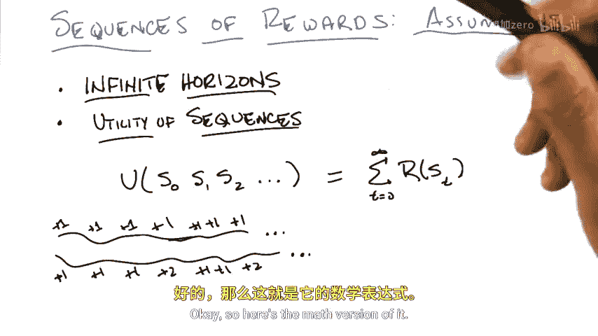
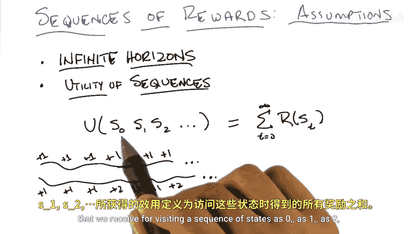
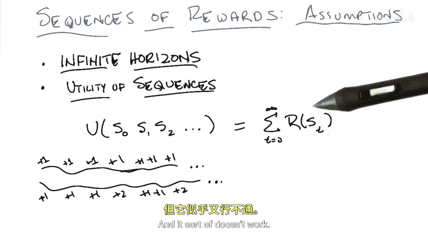

# 018：奖励序列 - 2

在本节课中，我们将探讨如何用数学公式定义智能体在一系列状态中获得的效用，并分析简单求和方法的局限性。

上一节我们讨论了智能体在环境中获得奖励的概念。本节中我们来看看如何用数学形式化地表示从状态序列中获得的总效用。

## 效用定义为奖励之和

我们可以将访问一个状态序列 `s0, s1, s2, ...` 所获得的效用 `U`，简单地定义为访问这些状态所获得的所有奖励 `R` 的总和。

以下是其数学公式：

`U(s0, s1, s2, ...) = R(s0) + R(s1) + R(s2) + ...`

这个定义与我们在网格世界示例中的直观理解是一致的。它类似于日常生活中金钱的累积方式：每日的收入会相加到你的银行账户中，而不是被减去、相乘或进行其他运算。

## 简单求和方法的局限性

尽管上述定义直观且合理，但它存在一个根本性问题。为了说明这一点，请考虑以下场景：

假设有两个不同的状态序列。
*   序列A：获得奖励 +1, +1, +1, +1, ...
*   序列B：获得奖励 +1, +1, +1, +1, +1, ...

根据简单求和的定义，无限延续的序列A和序列B的效用都会趋向于无穷大 (`U → ∞`)。这导致我们无法比较这两个序列的优劣，因为它们的效用“总和”在数学上都是发散的无穷大。在比较哪个序列更好时，无穷大与无穷大无法区分。

因此，虽然将效用视为奖励之和在有限步骤内是可行的，但对于可能无限进行的序列（这在强化学习中很常见），我们需要一个更严谨的数学框架来处理无穷级数，以便能有效比较不同策略的长期收益。

本节课中我们一起学习了效用的初始数学定义——即状态序列的效用等于其各状态奖励的简单求和。我们也认识到，当序列无限长时，这种简单的求和方法会失效，因为它无法比较两个效用都趋于无穷大的序列。在接下来的课程中，我们将引入折扣因子等概念来解决这一难题。