强化学习导论：P20：奖励序列 - 3 解决方案

在本节课中，我们将探讨一个关于无限奖励序列比较的经典问题。我们将分析两个不同的奖励序列，并理解为何在无限求和的情况下，它们无法被简单地比较优劣。

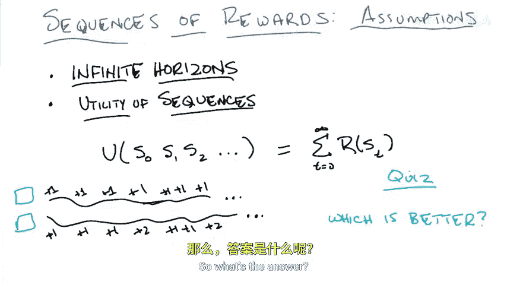

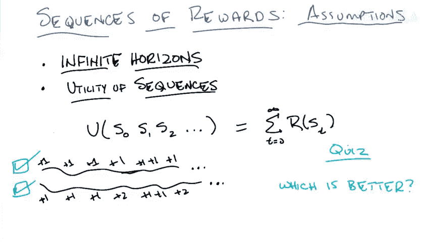

上一节我们讨论了奖励序列的效用计算，本节中我们来看看一个具体的比较案例。

### 问题场景与初步分析

假设有两个奖励序列：
*   **序列A（顶部）**：`+1, +1, +1, +1, ...`
*   **序列B（底部）**：`+1, +1, +2, +1, +1, +2, ...`

直观上，序列B似乎“更好”，因为它偶尔能获得+2的奖励，而序列A始终只能获得+1。然而，我们需要计算它们的总效用。

以下是两个序列效用的计算：
*   序列A的总效用：`U_A = 1 + 1 + 1 + 1 + ... = ∞`
*   序列B的总效用：`U_B = 1 + 1 + 2 + 1 + 1 + 2 + ... = ∞`

两者的总效用都发散至无穷大。

### 核心结论与解释

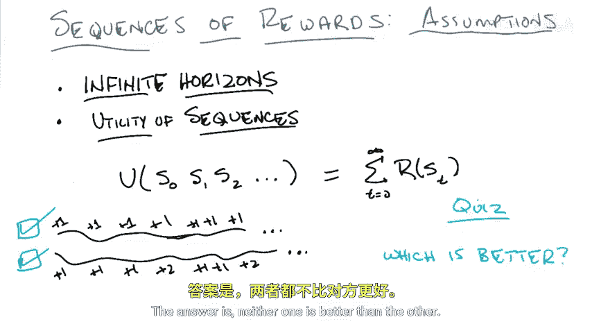

当两个序列的总效用都趋于无穷大时，我们无法判断哪一个“更好”。数学上，∞ 与 ∞ 无法比较大小。因此，结论是：**两个序列没有优劣之分**。

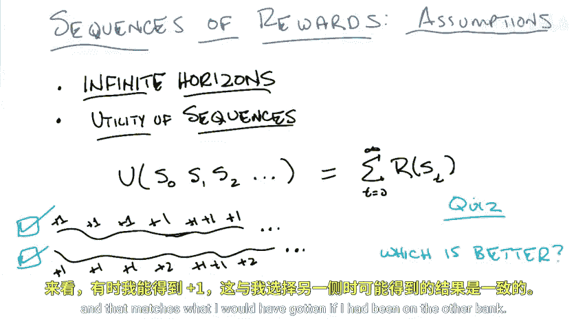

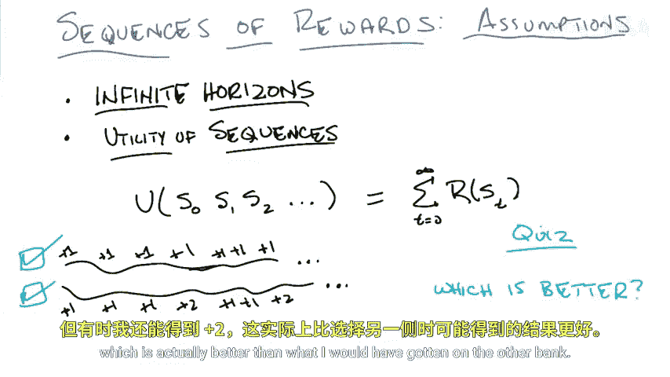

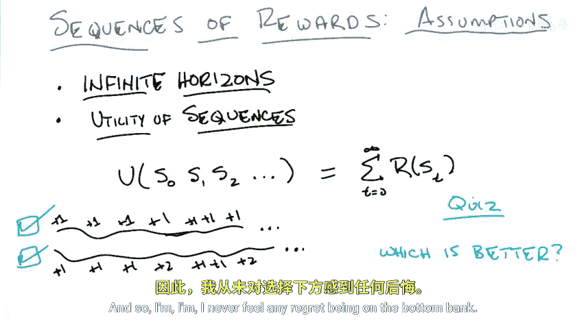

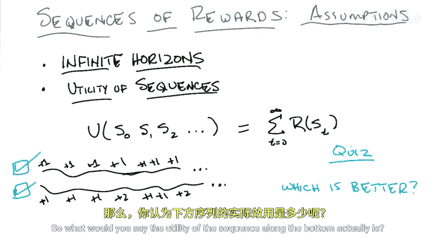

这个例子揭示了一个重要观点：在无限时域的强化学习中，简单地累加奖励（`Total Return = Σ R_t`）会导致比较失效，因为许多策略都可能产生无限的总奖励。为了解决这个问题，我们需要引入**折扣因子（Discount Factor）** 的概念，它通过给未来的奖励打折扣，确保总回报是有限的，从而使策略之间可以进行比较。其核心公式为：

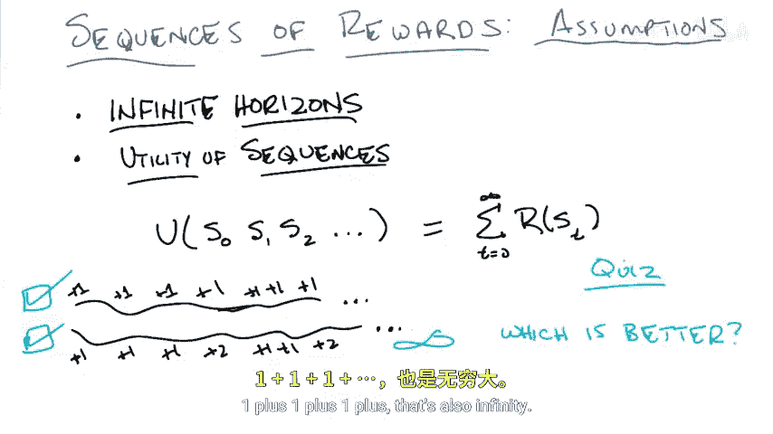

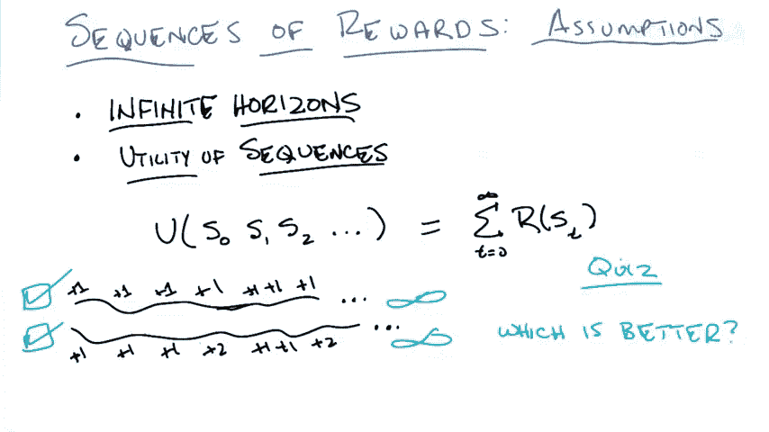

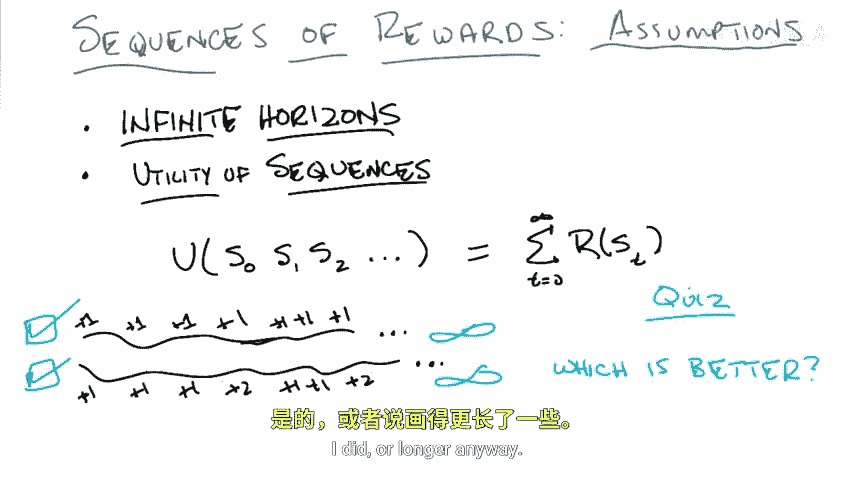

**折扣回报（Discounted Return）**：
`G_t = R_{t+1} + γ * R_{t+2} + γ^2 * R_{t+3} + ... = Σ_{k=0}^{∞} γ^k * R_{t+k+1}`

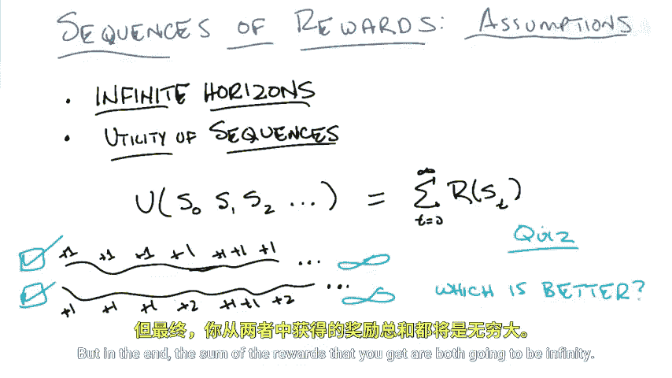

其中，`γ` (Gamma) 是折扣因子，取值范围为 `0 ≤ γ < 1`。

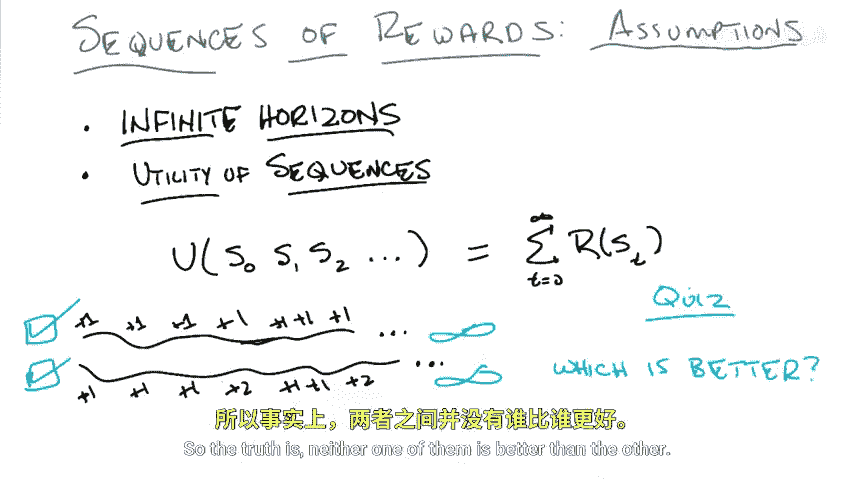

本节课中我们一起学习了无限奖励序列比较的局限性。我们通过一个具体例子看到，当总回报都是无穷大时，无法比较策略的优劣。这引出了我们需要使用**折扣因子**来定义一个有界的、可比较的回报值，这是强化学习中的一个基础且关键的概念。