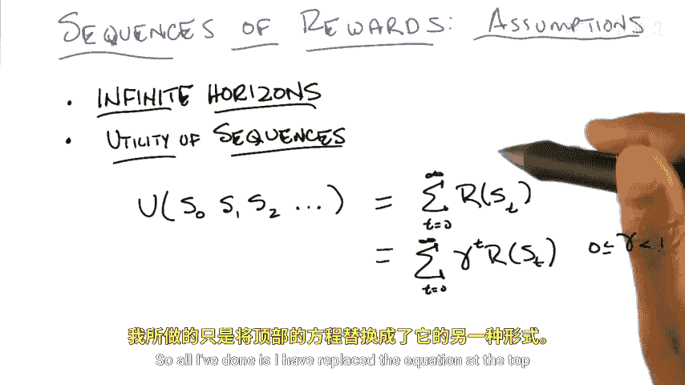
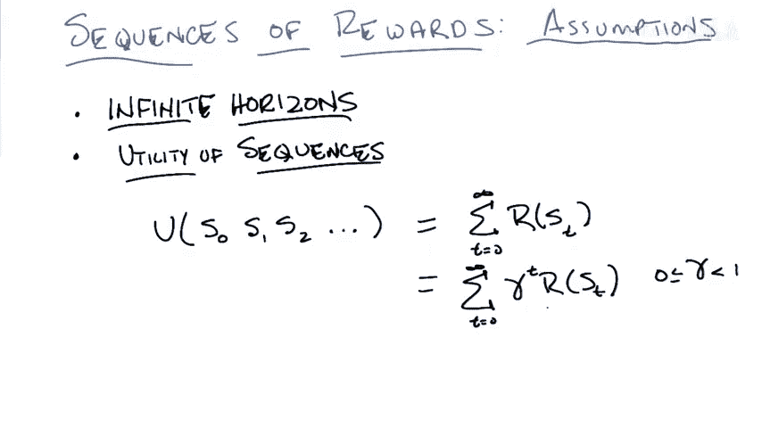
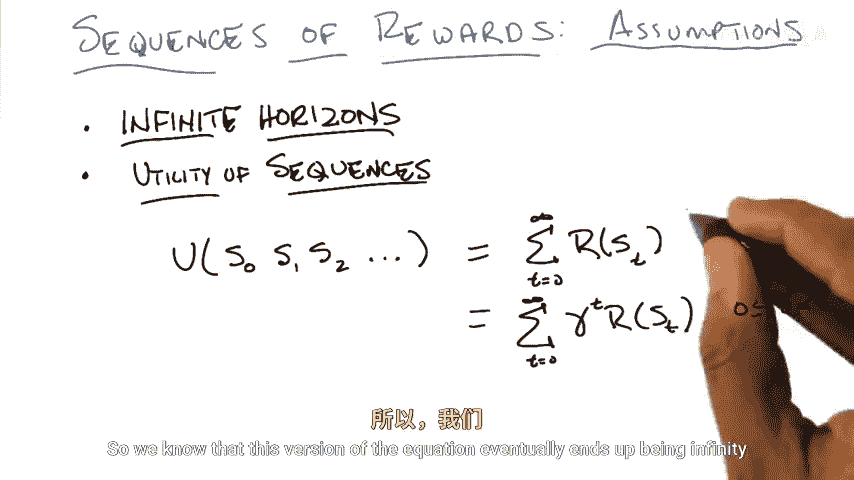
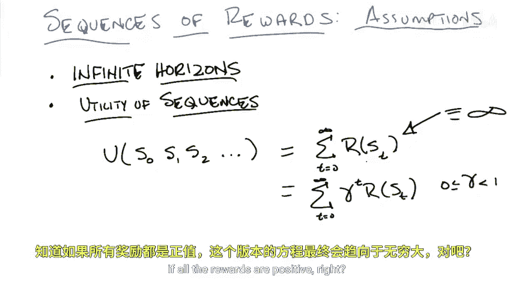

# 021：奖励序列 - 4

在本节课中，我们将探讨如何通过引入折扣因子来处理无限时间步长下的奖励总和问题，并理解其数学性质。

上一节我们讨论了无限时间步长下奖励总和可能发散的问题，本节中我们来看看如何通过一个“小技巧”来解决这个问题。

这里所做的，是将顶部的原始方程替换为一个替代版本。

这个新方程看起来像是在指数级地放大奖励。但实际上并非如此。我所做的是，将未来会获得的奖励累加起来，然后乘以 **γ^T**，而 **γ** 是一个介于0和1之间的数。

因此，奖励并不会指数级爆炸。相反，它会指数级内爆。对于那些发生在未来一千步之后的奖励，如果我们用一个小于1的数（γ）进行指数运算，其结果将趋近于零。这意味着，近期的奖励影响较大，而远期的奖励会迅速衰减。

事实上，我们可以从数学上描述这个总和。如果你仔细观察，可能会认出这是一种特殊的序列或级数。

为了理解其性质，我们可以尝试对这个特定的方程设定一个界限。我们知道，如果所有奖励都是正数，原始版本的方程最终会趋向于无穷大。

那么，这个新的折扣奖励总和最终会是多少呢？

本节课中我们一起学习了如何利用折扣因子 **γ**（0 < γ < 1）将无限时间步长的奖励总和转化为一个收敛的几何级数。这种方法确保了远期奖励的影响逐渐减小，从而得到一个有限的总价值估计，这是强化学习中价值函数定义的基础。