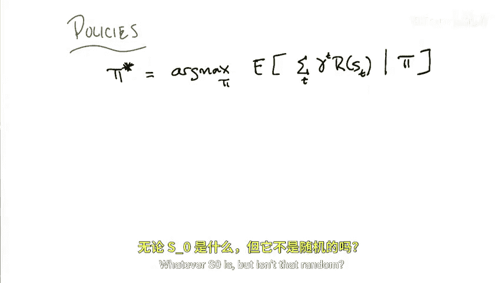
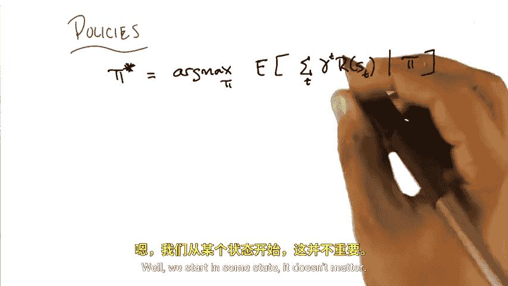
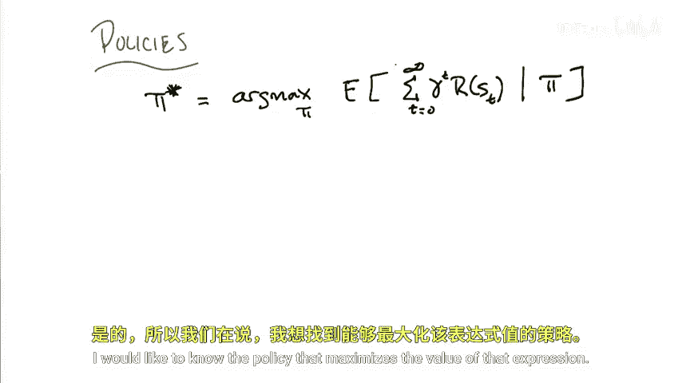

强化学习导论：P23：策略 - 1

在本节课中，我们将学习如何定义强化学习中的最优策略。我们将从回顾几何级数推导的思路出发，逐步构建出最优策略的数学表达式，并解释其核心组成部分。

上一节我们介绍了长期回报的几何级数形式，本节中我们来看看如何利用这个形式来定义最优策略。

首先，基于我们之前关于效用和回报的讨论，现在可以写下最优策略的定义。最优策略，记作 **π***，其目标是最大化我们的长期期望回报。

这个长期期望回报的表达式如下：

**公式：**
`E[ Σ (γ^t * R_t) | π ]`

其中：
*   `E[...]` 表示期望值。
*   `Σ` 表示从时间 `t=0` 到无穷大的求和。
*   `γ^t` 是折扣因子 `γ` 的 `t` 次方。
*   `R_t` 是在时间 `t` 获得的即时奖励。
*   `| π` 表示在遵循策略 `π` 的条件下。

这个表达式描述的是，在一个我们遵循策略 `π` 的世界里，我们将经历一系列状态，并在此过程中获得奖励。由于环境或策略本身可能具有随机性（非确定性），我们获得的回报序列不是固定的，因此需要计算其期望值。

关于起始状态 `S0`，它可以是任意的。表达式中的期望值计算已经隐含了对起始状态分布（如果存在）以及后续状态转移随机性的考虑。时间 `t` 从 `0` 开始，一直延伸到无穷大。

因此，最优策略 **π*** 就是那个能使上述期望值表达式取得最大值的策略。换句话说，它是在长期能为我们带来最高期望累积奖励的策略。

本节课中我们一起学习了最优策略 **π*** 的正式定义。我们了解到，它被定义为能够最大化从任意起始状态开始、在无限时间范围内获得的折扣累积奖励期望值的策略。其核心数学表达式是一个以策略 `π` 为条件的期望求和公式。理解这个定义是后续学习如何寻找和计算最优策略的基础。