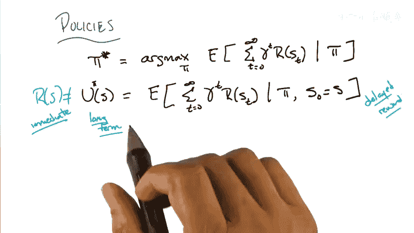
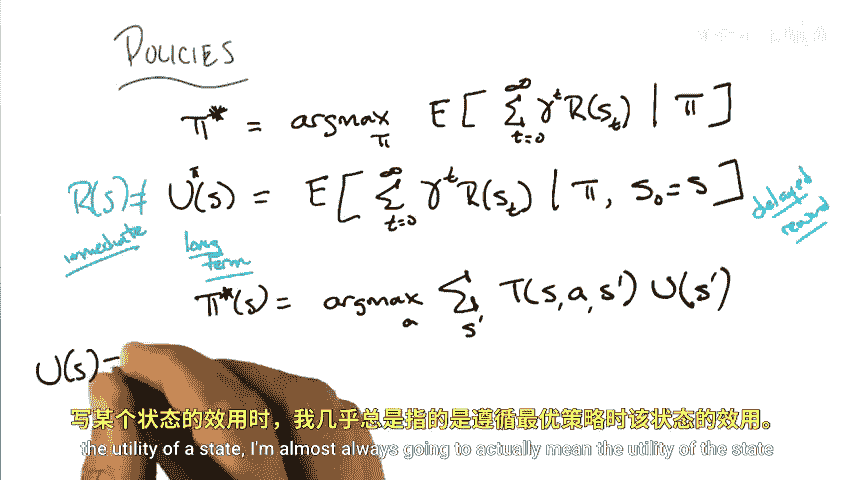
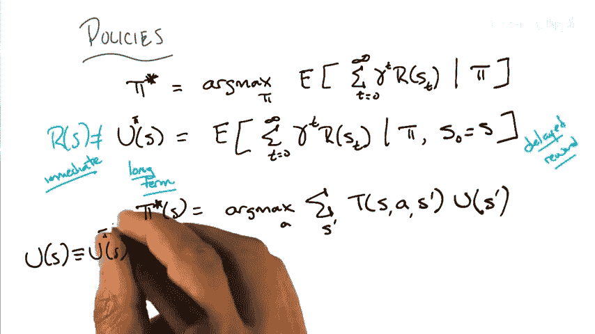
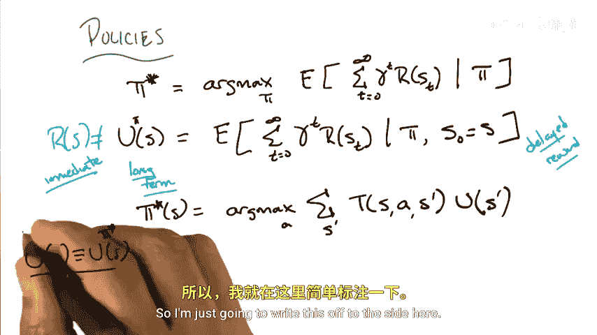
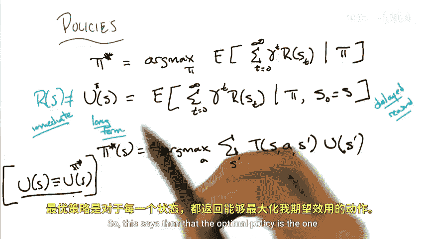
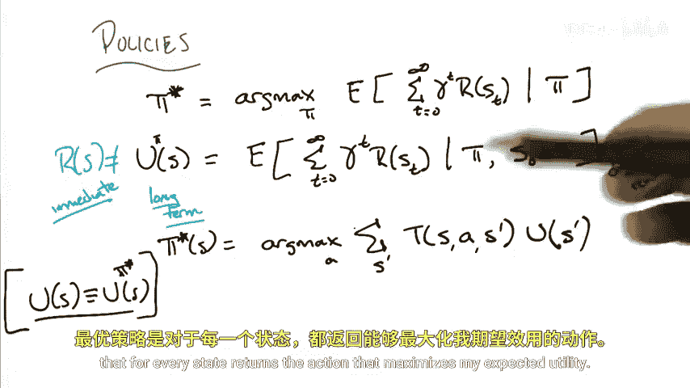

强化学习导论：P24：策略 - 2

## 概述
在本节中，我们将深入探讨最优策略的定义，并理解其看似循环的特性。我们将学习如何用公式精确地描述最优策略，并澄清相关概念。

---

上一节我们定义了效用函数和最优策略 π*。现在，我们可以更精确地写出 π* 的表达式。

请看这个公式：
`π*(s) = argmax_a Σ_s' P(s'|s, a) * U(s')`

这个公式合理吗？我们来分析一下。最优策略 π* 是指在状态 `s` 下，应该采取的最优动作 `a`。其计算方法是：遍历所有可能的动作 `a`，并对所有可能的下一个状态 `s'` 求和。求和项包含两部分：
1.  **转移概率** `P(s'|s, a)`：表示在状态 `s` 下采取动作 `a` 后，转移到状态 `s'` 的概率。
2.  **状态 `s'` 的效用** `U(s')`。

这里存在一个问题：我们如何知道状态 `s'` 的效用 `U(s')`？之前定义的效用函数 `U(s)` 是依赖于某个特定策略的。然而，我们想要求解的最优策略 π* 本身正是我们试图寻找的目标。

因此，公式中隐含的意思是：这里使用的效用 `U(s')` 应该是在**遵循最优策略 π*** 的前提下，状态 `s'` 的效用。我们可以称之为状态的**真实效用**。

为了明确这一点，我们将其记录如下：
> 重要提示：从现在起，除非特别说明，当我们提到状态 `s` 的效用 `U(s)` 时，我们几乎总是指“在遵循最优策略 π* 的前提下，状态 `s` 的效用”。

于是，最优策略的定义可以完整表述为：最优策略 π* 是这样一种策略，对于每一个状态 `s`，它返回的动作 `a` 能够最大化在**遵循最优策略 π*** 的前提下，从 `s` 出发的期望效用。

这个定义听起来有些循环：为了找到最优策略，我们需要知道遵循最优策略时的效用；而为了计算那个效用，我们又需要知道最优策略是什么。这确实是一个需要解决的循环定义问题。

---

## 总结
本节课中，我们一起学习了最优策略 π* 的正式数学定义。我们明确了公式 `π*(s) = argmax_a Σ_s' P(s'|s, a) * U(s')` 中 `U(s')` 的真实含义，即它代表在最优策略下的状态效用。我们也认识到了这个定义中存在的循环依赖问题，这为后续寻找实际算法来求解最优策略奠定了基础。