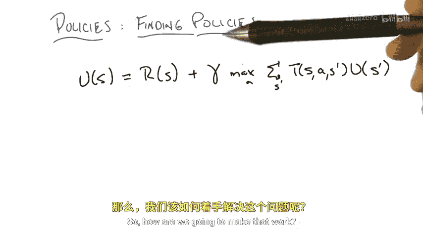
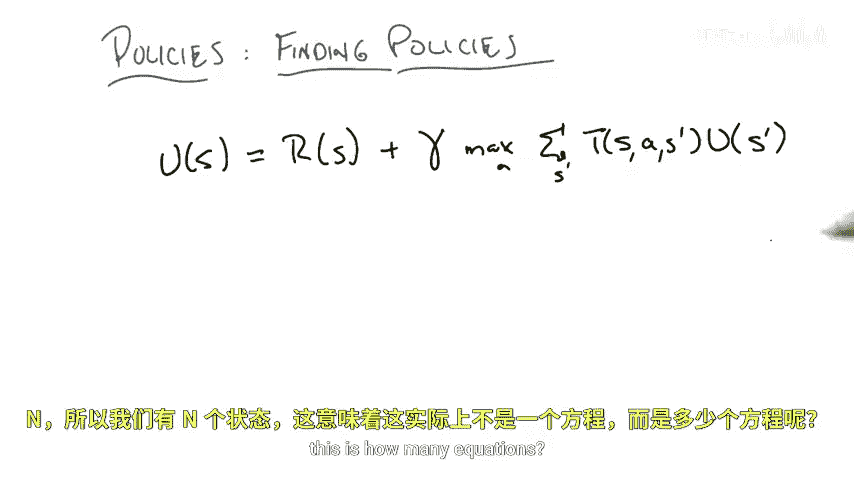
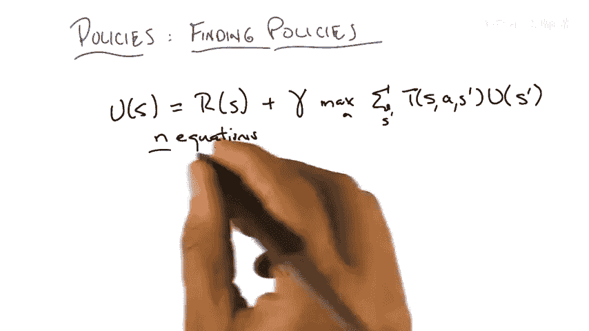
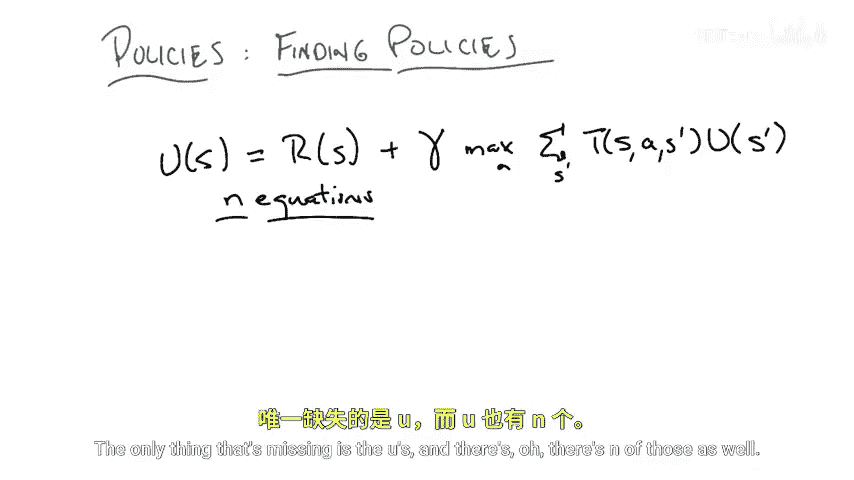
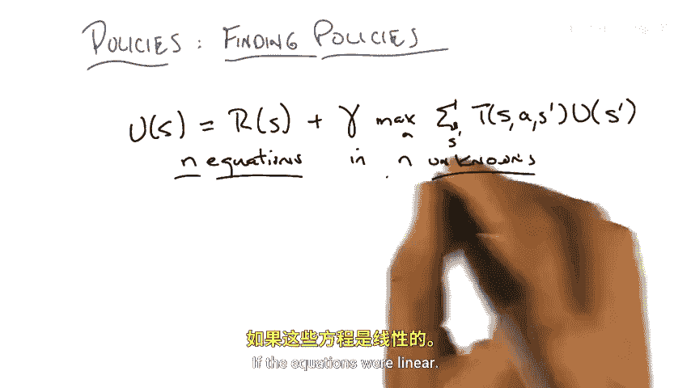
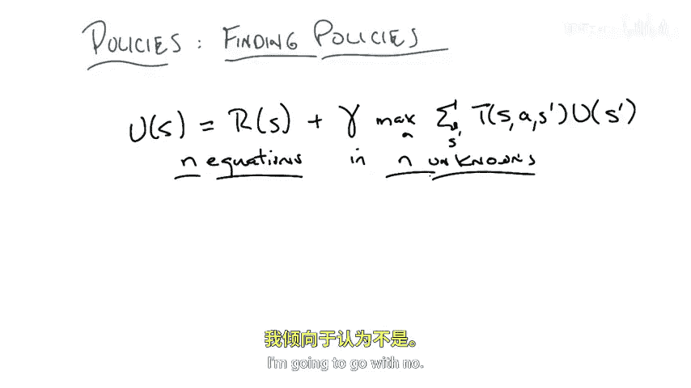
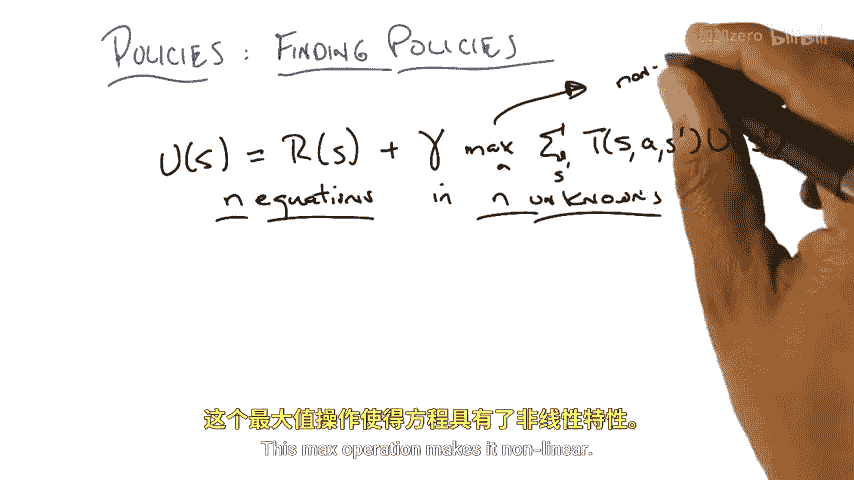
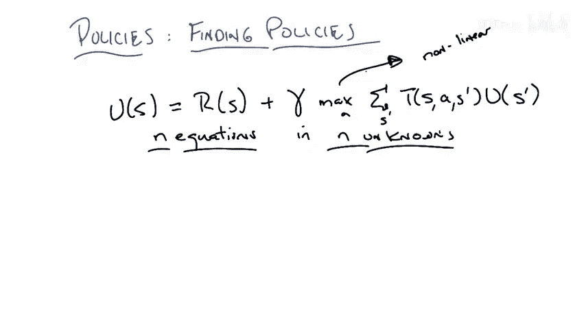

强化学习导论：P25：寻找策略 - 1

在本节课中，我们将学习如何求解贝尔曼方程，这是强化学习中最核心的方程。我们将探讨其数学形式，分析其求解的挑战，并介绍一种迭代求解方法。

---

上一节我们介绍了贝尔曼方程。现在，我们来看看如何求解它。

我们已将贝尔曼方程写为状态 `S` 的效用函数 `U(S)`：

`U(S) = R(S) + γ * max_a Σ_{s'} T(s, a, s') * U(s')`

这里有多少个状态 `S`？假设有 `N` 个状态。这意味着我们拥有的不是一个方程，而是 `N` 个方程（每个状态一个）。同时，我们也有 `N` 个未知数，即每个状态的 `U(S)`。

因此，我们似乎有 `N` 个方程和 `N` 个未知数。如果这些方程是线性的，我们就能直接求解。然而，这些方程是线性的吗？答案是否定的。原因在于方程中的 `max` 操作符使其成为非线性方程。这个 `max` 操作带来了非常棘手的非线性问题，没有简单直接的方法来处理它。

虽然存在一些技巧可以将 `max` 操作转化为可微分的近似形式（例如使用 `softmax`），但这对于当前求解精确的贝尔曼方程并无直接帮助。因此，我们需要寻找其他方法。

---

既然直接解析求解因非线性而困难，我们可以考虑采用迭代方法。以下是求解贝尔曼方程的基本思路：

1.  **初始化**：为所有状态 `S` 的效用值 `U(S)` 设定一个初始猜测值（例如全零）。
2.  **迭代更新**：根据贝尔曼方程，使用当前所有状态的效用值来更新每个状态的效用值。具体来说，对于每个状态 `S`，计算：
    `U_{new}(S) = R(S) + γ * max_a Σ_{s'} T(s, a, s') * U_{old}(s')`
3.  **收敛判断**：重复步骤2，直到所有状态的效用值 `U(S)` 的变化小于一个预设的极小阈值，此时我们认为迭代已经收敛，得到了（近似）最优的效用函数。

这种方法被称为**值迭代**。它通过反复应用贝尔曼更新规则，逐步逼近方程的解。

---

本节课中我们一起学习了贝尔曼方程的求解挑战。由于方程中的 `max` 操作符导致非线性，直接解析求解非常困难。因此，我们引入了值迭代这一迭代算法作为实用的求解方法，其核心是通过反复应用贝尔曼更新规则来逐步逼近最优的效用函数。在接下来的课程中，我们将深入探讨这一算法的具体细节和性质。