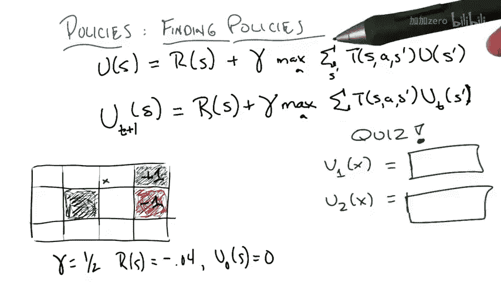
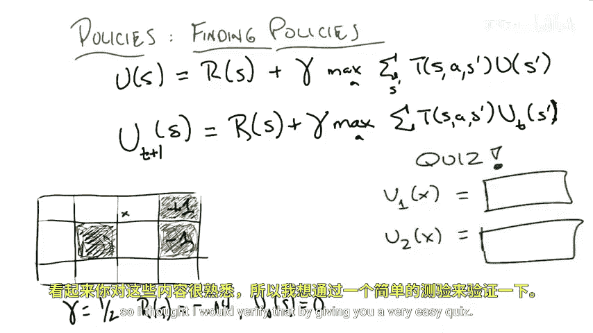
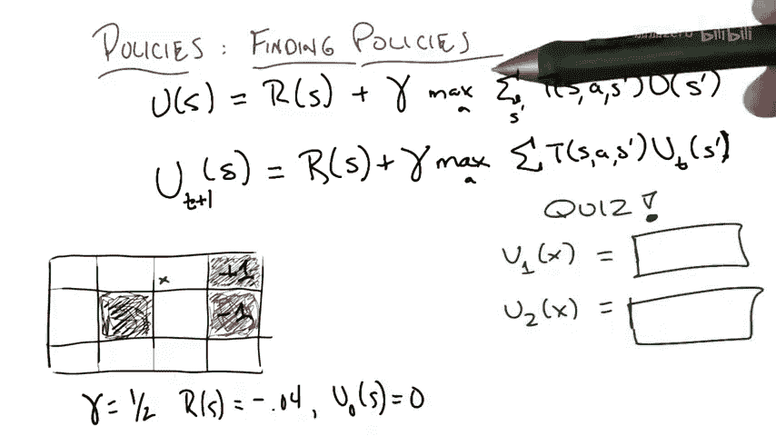
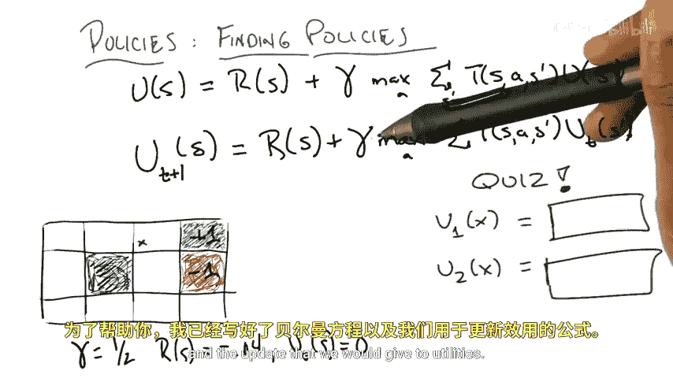
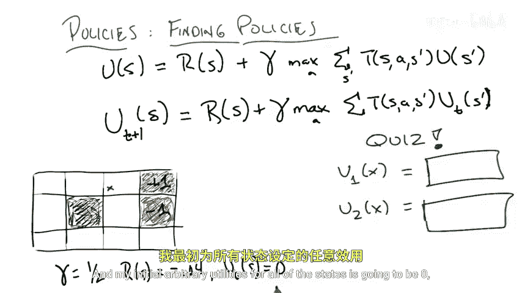
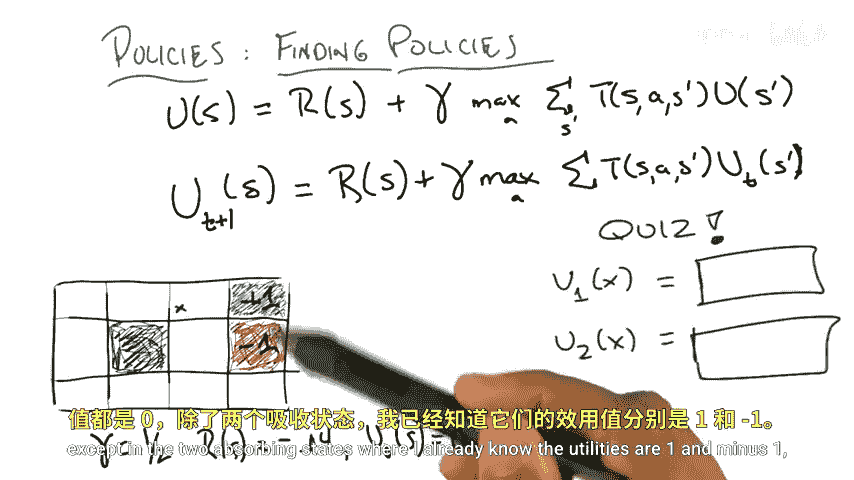
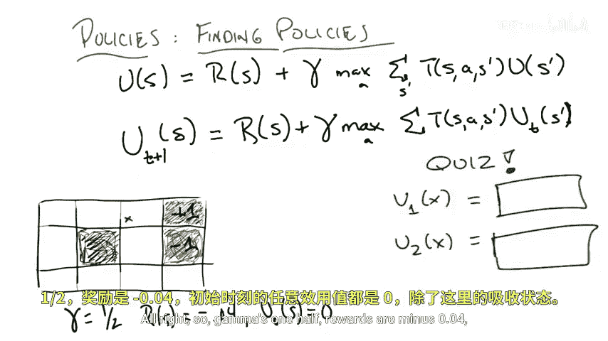

强化学习导论：P27：寻找策略 - 3

在本节中，我们将通过一个具体的网格世界示例，来演示价值迭代算法的前两次迭代过程。我们将重点关注一个特定状态，并应用贝尔曼方程和效用更新公式进行计算。

上一节我们介绍了价值迭代的基本思想。本节中我们来看看如何将其应用于一个具体的例子。

以下是本次演示所需的全部信息。

*   我们使用之前一直使用的网格世界。
*   折扣因子 **γ** 设置为 **0.5**，以便于计算。
*   除两个终止状态外，所有状态的即时奖励 **R(s)** 均为 **-0.04**。
*   所有状态的初始效用 **U(s)** 均设为 **0**。
*   两个终止状态的效用是已知且固定的：分别为 **1** 和 **-1**。

现在，我们需要计算图中标记为 **X** 的状态，在价值迭代第一次和第二次迭代后的效用值。

我们将使用以下两个核心公式进行计算：

1.  **贝尔曼方程**：用于计算给定策略下状态的效用。
    `U(s) = R(s) + γ * max_{a ∈ A(s)} Σ_{s'} P(s' | s, a) U(s')`
2.  **价值迭代更新公式**：用于迭代改进效用估计。
    `U_{i+1}(s) ← R(s) + γ * max_{a ∈ A(s)} Σ_{s'} P(s' | s, a) U_i(s')`

---

### 第一次迭代计算

初始时刻，所有非终止状态的效用 `U_0(s) = 0`。

对于标记为 **X** 的状态，其即时奖励 `R(s) = -0.04`。

我们需要考虑从该状态出发所有可能的动作（上、下、左、右），并计算每个动作的期望未来效用。由于 `U_0(s')` 初始都为0，任何动作的期望未来效用总和 `Σ P(s'|s,a) * U_0(s')` 都为0。

因此，第一次迭代后，状态X的效用 `U_1(X)` 计算如下：
`U_1(X) = R(s) + γ * max(0, 0, 0, 0) = -0.04 + 0.5 * 0 = -0.04`

所以，第一次迭代后，状态X的效用值为 **-0.04**。

---

### 第二次迭代计算

现在进行第二次迭代。此时，我们使用第一次迭代后得到的效用值 `U_1(s)` 进行计算。

状态X的即时奖励 `R(s)` 仍为 `-0.04`。

我们需要重新评估每个动作。此时，相邻状态的效用不再全是0。例如，假设状态X右侧是一个效用为 `U_1 = -0.04` 的普通状态，上方是效用为 `1` 的终止状态（但可能无法直接到达），下方是效用为 `-0.04` 的普通状态，左方是效用为 `-1` 的终止状态（但可能无法直接到达）。为简化演示，我们假设动作执行是确定性的（即执行某个动作必定到达预期相邻格子）。

关键点在于：**朝向高效用状态的动作将获得更高的期望未来回报**。

例如，考虑一个“向上”的动作，如果它能以一定概率进入效用为 `1` 的终止状态，那么它的期望未来效用将是 `P * 1 + ...`。即使考虑到折扣因子γ=0.5，这个值也可能大于0。

计算某个动作a的期望未来效用公式为：
`Σ_{s'} P(s' | s, a) * U_1(s')`

我们需要为每个动作计算这个值，然后选取最大值。

假设经过计算，所有可能动作中，最大的期望未来效用值为 **0.2**（这是一个示例值，实际值取决于精确的状态转移概率和相邻状态的U1值）。

那么，第二次迭代后，状态X的效用 `U_2(X)` 计算如下：
`U_2(X) = R(s) + γ * max_{a}(期望未来效用) = -0.04 + 0.5 * 0.2 = -0.04 + 0.1 = 0.06`

所以，第二次迭代后，状态X的效用值更新为 **0.06**。

---

本节课中我们一起学习了价值迭代算法的具体计算步骤。我们从一个所有效用初始化为0的网格世界开始，通过应用贝尔曼最优方程进行迭代更新。在第一次迭代中，由于邻居效用初始为0，状态效用仅反映其即时奖励。到了第二次迭代，邻居状态更新后的效用值开始产生影响，使得智能体能够“看到”更远一步的回报，从而更新当前状态的效用值。这个过程会持续进行，直到效用值收敛，此时对应的贪婪策略即为最优策略。