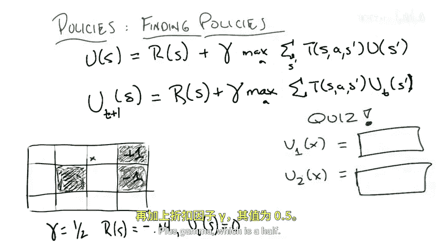
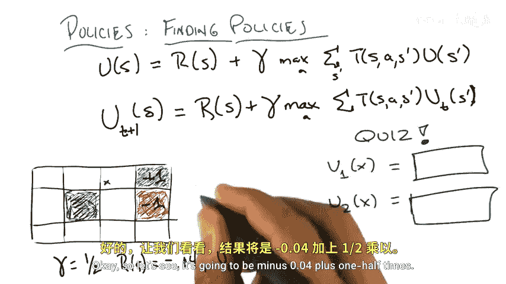
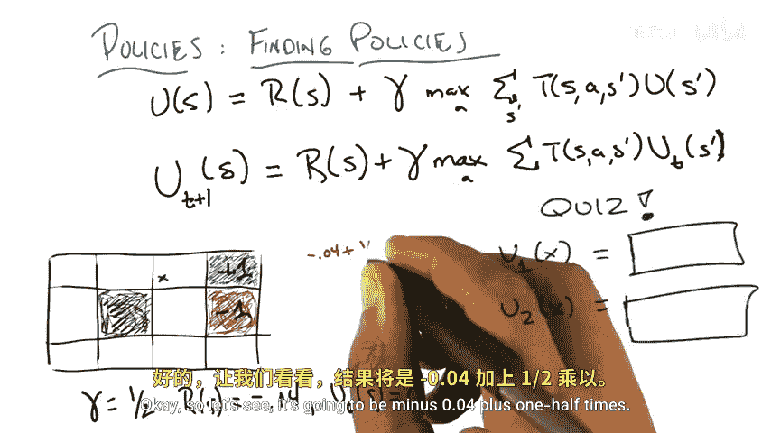
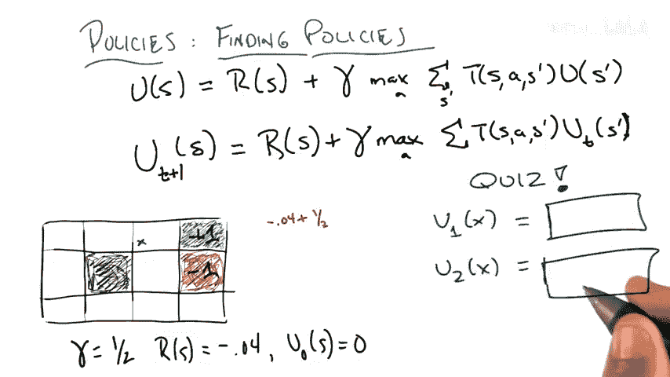
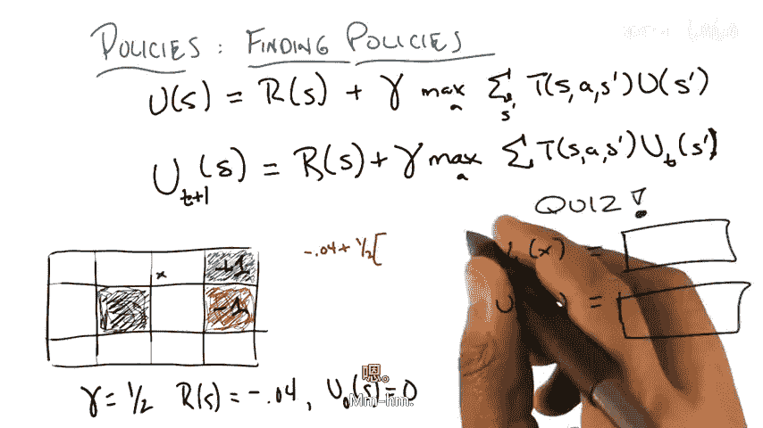
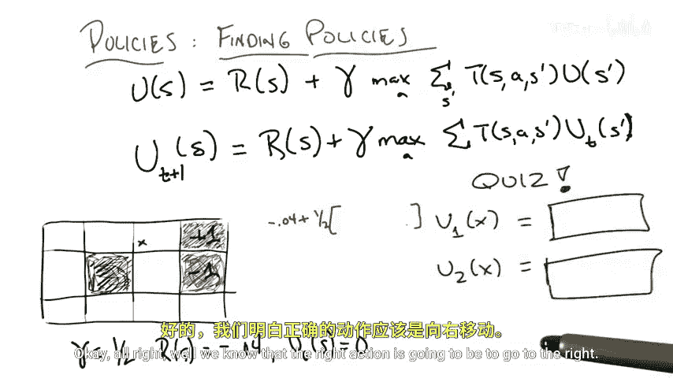
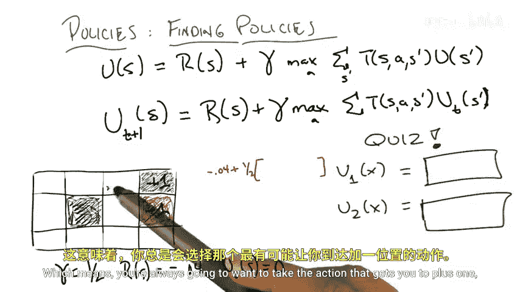
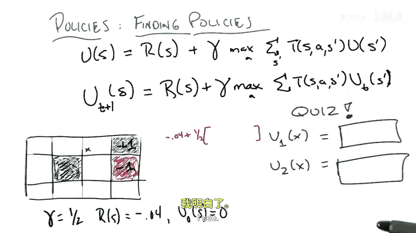

# 028：寻找策略 - 3 解决方案

在本节课中，我们将学习如何通过计算来验证和确定一个状态下的最优动作。我们将使用一个具体的网格世界例子，通过应用贝尔曼最优方程来比较不同动作的价值，并找出最佳选择。

上一节我们介绍了价值迭代和策略改进的概念，本节中我们来看看如何具体计算一个状态的动作价值。

根据贝尔曼最优方程，在状态 `x` 选择动作 `u1` 的价值 `Q(x, u1)` 计算公式如下：

**Q(x, u1) = R(x) + γ * Σ [ P(x' | x, u1) * U(x') ]**

其中：
*   `R(x)` 是状态 `x` 的即时奖励。
*   `γ` 是折扣因子。
*   `P(x' | x, u1)` 是在状态 `x` 执行动作 `u1` 后转移到状态 `x'` 的概率。
*   `U(x')` 是状态 `x'` 的效用值。

在我们的例子中，已知条件为：
*   即时奖励 `R(x) = -0.04`
*   折扣因子 `γ = 0.5`
*   所有状态的初始效用值 `U(·) = 0`

因此，计算简化为：
**Q(x, u1) = -0.04 + 0.5 * [ 后继状态的期望效用 ]**

接下来，我们需要计算执行不同动作后的期望效用。理论上，我们需要评估所有可能的动作。

以下是每个动作对应的状态转移和期望效用计算：

*   **动作：向右移动**
    *   以0.8概率到达目标状态 `+1`（效用为1）。
    *   以0.1概率向上偏移。
    *   以0.1概率向下偏移。
    *   期望效用 = `0.8*1 + 0.1*0 + 0.1*0 = 0.8`
    *   `Q(x, 右) = -0.04 + 0.5 * 0.8 = 0.36`

*   **动作：向上移动**
    *   以0.8概率到达上方状态（效用为0）。
    *   以0.1概率向右偏移到 `+1`。
    *   以0.1概率向左偏移。
    *   期望效用 = `0.8*0 + 0.1*1 + 0.1*0 = 0.1`
    *   `Q(x, 上) = -0.04 + 0.5 * 0.1 = 0.01`

*   **动作：向左移动**
    *   以0.8概率到达左侧状态（效用为0）。
    *   以0.1概率向上偏移。
    *   以0.1概率向下偏移。
    *   期望效用 = `0.8*0 + 0.1*0 + 0.1*0 = 0`
    *   `Q(x, 左) = -0.04 + 0.5 * 0 = -0.04`

*   **动作：向下移动**
    *   以0.8概率到达下方状态（效用为0）。
    *   以0.1概率向右偏移到 `+1`。
    *   以0.1概率向左偏移。
    *   期望效用 = `0.8*0 + 0.1*1 + 0.1*0 = 0.1`
    *   `Q(x, 下) = -0.04 + 0.5 * 0.1 = 0.01`

然而，我们可以利用初始条件进行简化推理。由于所有状态的初始效用都设为0，选择哪个动作更好，完全取决于哪个动作能以最高概率直接到达奖励为 `+1` 的终止状态。因此，我们无需完整计算所有动作，可以直接判断“向右移动”是最优动作，因为它以0.8的最高概率直接导向正奖励状态。

本节课中我们一起学习了如何应用贝尔曼最优方程计算动作价值。我们通过一个具体算例，演示了从公式代入到逐步计算的过程，同时也介绍了基于问题特性的简化推理方法，即当所有状态价值初始化为零时，最优动作是那些能以最高概率到达高奖励状态的动作。