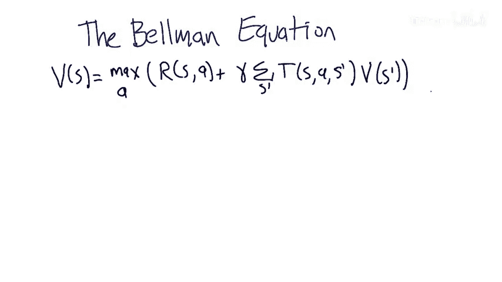
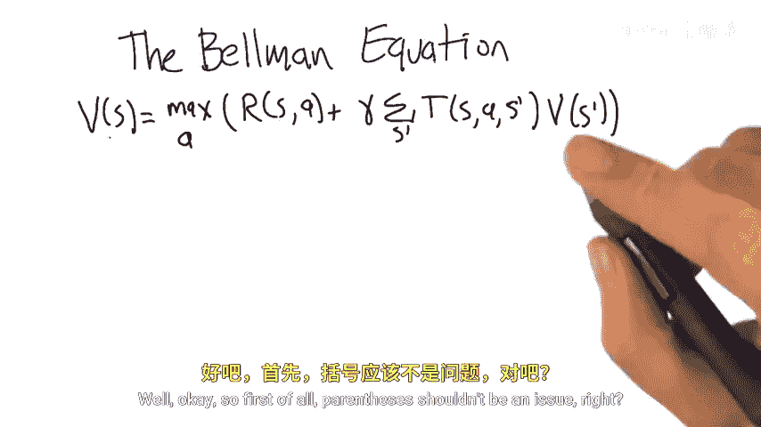
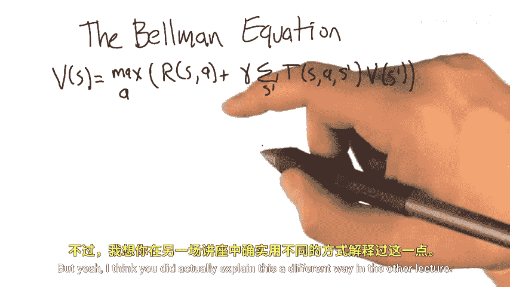
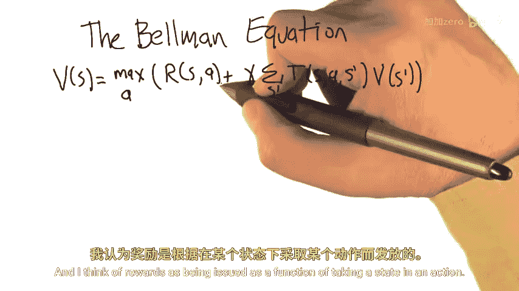
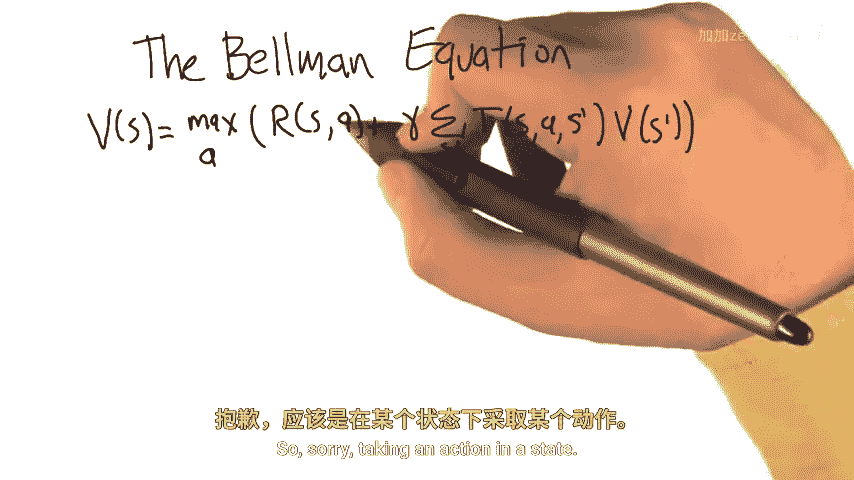
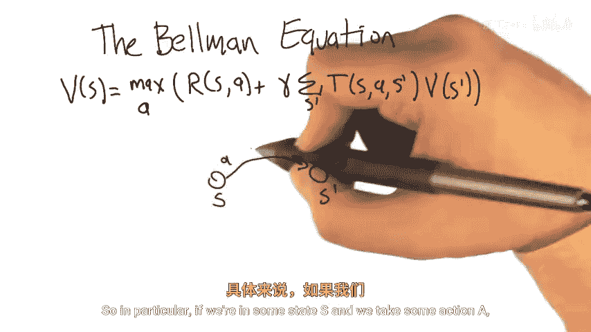
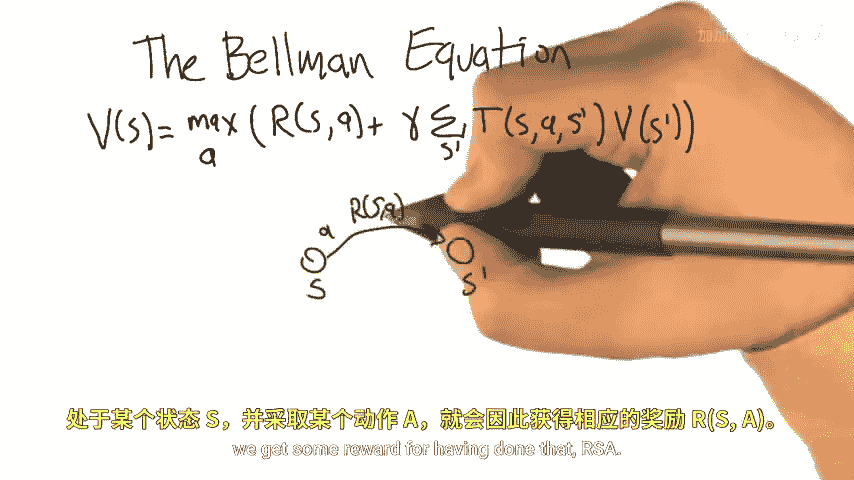
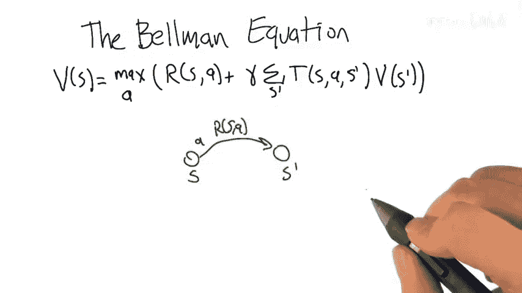
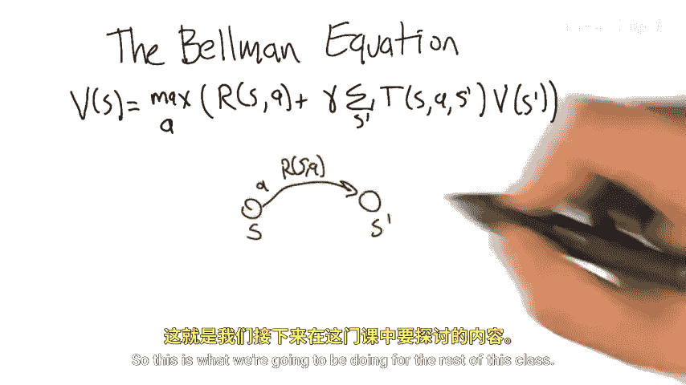
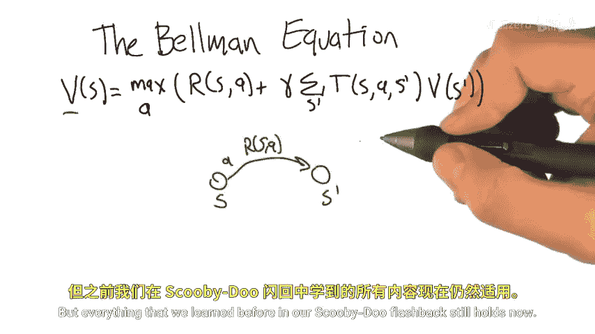

强化学习导论：P31：贝尔曼方程 - 1

在本节课中，我们将要学习强化学习中的一个核心概念——贝尔曼方程。我们将理解它如何形式化地定义状态的价值，并建立起当前价值与未来可能状态价值之间的联系。

上一节我们介绍了马尔可夫决策过程的基本框架，本节中我们来看看如何精确计算其中状态的价值。

这就是我们刚刚讨论的贝尔曼方程。一个状态的价值，等于对所有可能行动取最大值。这个最大值由两部分组成：第一部分是从该状态采取该行动所获得的即时奖励；第二部分是折扣后的、你最终到达的下一个状态的价值，并按照你到达该状态的概率进行加权求和。

这个公式应该看起来很熟悉吗？不，它看起来可能完全陌生。公式里有V，外面有一个最大值运算符，还有很多括号。奖励写作R(s, a)而不是其他形式。括号只是为了将内容分组，这不应该成为问题。

我认为在之前的讲座中，确实用另一种方式解释过这个思想。我使用V代表价值，而不是U代表效用。并且，我将奖励视为在某个状态下采取某个动作所获得的回报。

具体来说，这意味着你处于马尔可夫决策过程的某个状态S中。当我们处于状态S并采取动作A时，我们会因这个行为获得奖励R(s, a)，然后我们到达某个新的状态S‘。

这与之前讨论的方式有所不同。在讲解马尔可夫决策过程的定义时，我曾指出，奖励可以被视为状态的函数、状态和动作的函数，或者是状态、动作及下一状态的函数，它们在数学上基本是等价的。

在接下来的课程中，我们将采用现在这种方式进行讨论。我习惯于将V视为价值函数。为了避免混淆，我们不妨现在就统一使用这种表示法。

因此，我们将使用R(s, a)来表示奖励。但请记住，之前我们通过“scubby do flashback”所学到的所有原理依然成立。

以下是贝尔曼方程的核心公式：

**V(s) = maxa [ R(s, a) + γ * Σs' P(s' | s, a) * V(s') ]**

其中：
*   **V(s)** 是状态 `s` 的价值。
*   **maxa** 表示对所有可能的动作 `a` 取最大值。
*   **R(s, a)** 是在状态 `s` 下采取动作 `a` 获得的即时奖励。
*   **γ** 是折扣因子，用于权衡即时奖励和未来奖励。
*   **Σs'** 表示对所有可能的下一状态 `s'` 求和。
*   **P(s' | s, a)** 是在状态 `s` 下采取动作 `a` 后转移到状态 `s'` 的概率。

本节课中我们一起学习了贝尔曼方程的基本形式。它告诉我们，一个状态的最优价值，等于从该状态出发，所有可能行动中能带来的“即时奖励”与“未来折扣奖励的期望值”之和的最大值。这是连接当前决策与长期收益的关键桥梁，为后续求解最优策略奠定了基础。