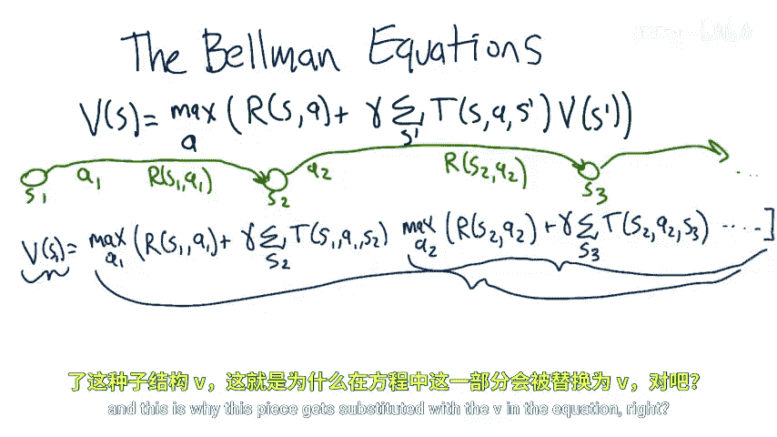
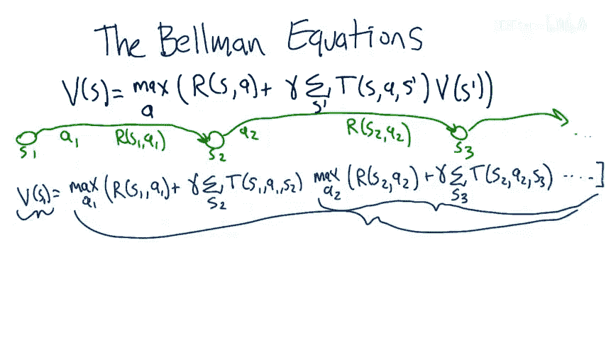
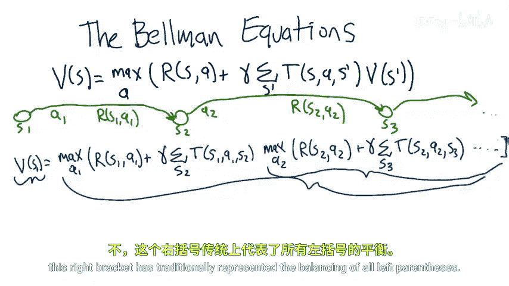
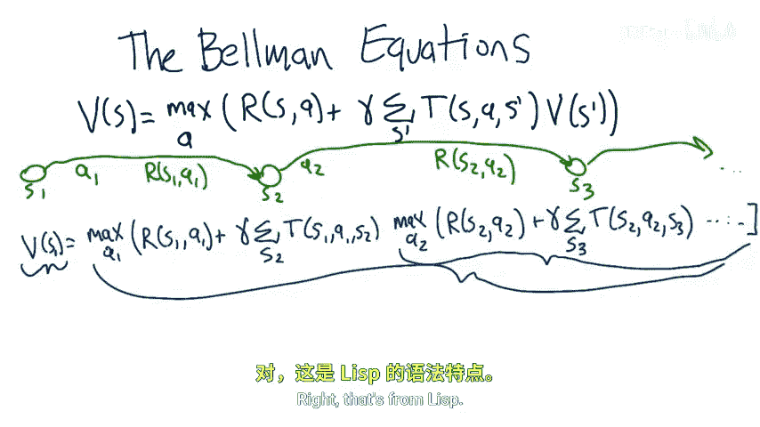
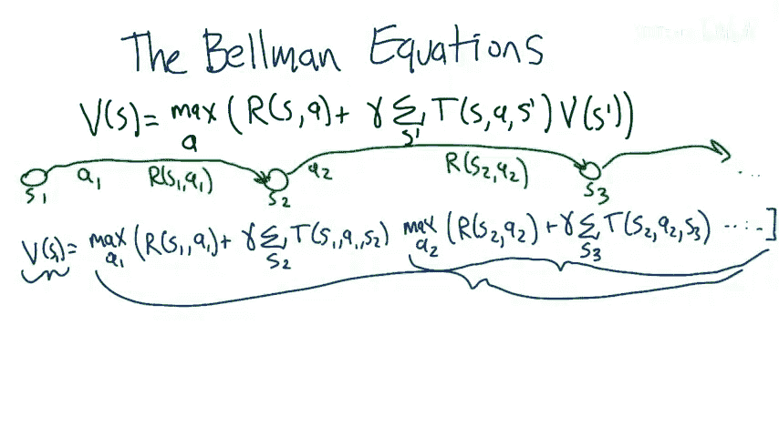

强化学习导论：P32：贝尔曼方程 - 2

在本节课中，我们将学习如何将贝尔曼方程的概念进行推广，并理解其背后的数学结构。我们将通过分析价值函数的递归特性，推导出更通用的贝尔曼方程形式。

上一节我们介绍了价值函数的基本概念，本节中我们来看看如何从无限序列中识别出不同的递归结构。

在之前的推导中，我们注意到价值函数V包含一个重复的结构。这个结构以 **max_a** 开始，并且自身内部又包含了一个V。正是因为这个子结构的存在，我们才能将其代入方程，从而得到贝尔曼方程。

这个无限序列可以形象地表示为一组无限嵌套的括号。

由于这是一个无限序列，我们实际上可以用多种不同的方式对其进行分组。

以下是另一种分组方式。

我们可以将无限序列从 **R** 开始的部分进行分组。可以观察到，从这个 **R** 开始向前的整个表达式，在后面会再次重复出现。

因此，我们可以基于这个重复的子结构建立一个新的方程。

我们可以给这个用大括号括起来的子结构起一个名字，称为 **Q(s, a)**。

其思想是，我们可以定义 **Q(s, a)** 等于立即奖励 **R(s, a)**，加上折扣因子 **γ**，乘以对下一个可能状态 **s‘** 的求和。这个求和包括转移到 **s‘** 的概率 **P(s‘ | s, a)**，乘以下一个状态的最大动作价值 **max_{a‘} Q(s‘, a‘)**。

用公式表示如下：

**Q(s, a) = R(s, a) + γ * Σ_{s‘} [ P(s‘ | s, a) * max_{a‘} Q(s‘, a‘) ]**

本节课中我们一起学习了贝尔曼方程的推广形式。我们通过识别价值函数无限序列中的重复子结构，定义了动作价值函数 **Q(s, a)**，并推导出了其对应的贝尔曼方程。这为我们后续理解和使用Q-learning等算法奠定了基础。