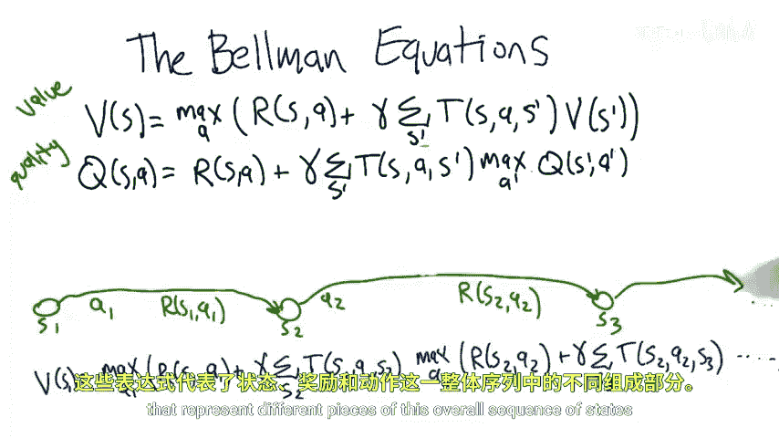
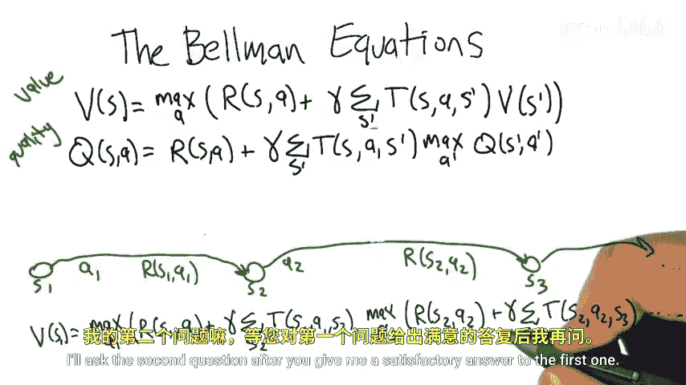

# 033：贝尔曼方程 - 3

在本节课中，我们将深入探讨贝尔曼方程的两种不同形式：价值函数V和动作价值函数Q。我们将解释为何需要引入Q函数，并分析其在强化学习中的关键作用。

## 概述

上一节我们介绍了贝尔曼方程的基本概念。本节中，我们将聚焦于贝尔曼方程的两种具体形式：价值函数V和动作价值函数Q。我们将探讨它们各自的含义、区别，以及为何Q函数在强化学习中扮演着更为核心的角色。

## 两种贝尔曼方程形式

我们有两种不同形式的贝尔曼方程。

第一种是价值函数，用字母 **V** 表示。

第二种是动作价值函数，用字母 **Q** 表示。

我们可以将 **V** 理解为“价值”，将 **Q** 理解为“质量”。本质上，它们只是我们为方程赋予名称而使用的字母。例如，之前我们使用 **U** 代表效用，这里 **V** 代表价值，**Q** 代表质量。

关键在于，这两个表达式共同描述了状态、奖励和动作序列的整体过程。

## 为何需要Q函数？

第一个问题是：既然价值函数V已经足够好用，我们为何还要费心创建这个质量函数Q？

在某种意义上，两者同样有效。但实际情况是，贝尔曼方程的 **Q** 形式在强化学习背景下将变得更为实用。

原因在于，我们将能够仅凭经验数据来对此量求取期望，而无需直接访问奖励函数或状态转移函数。

相比之下，如果我们试图学习V值，连接一个V值与下一个V值的唯一途径是知晓状态转移和奖励的具体细节。

因此，这在强化学习环境中将非常有帮助，因为我们通常无法预先知道状态转移和奖励机制。

## Q函数的优势

第二个问题是：你已经有了描述从特定状态开始会发生什么的V函数，那么Q函数具体好在哪里？

Q函数的优势在于其学习方式。在强化学习中，我们通常没有关于环境动态（即转移函数T和奖励函数R）的先验知识。Q函数允许我们直接从智能体与环境的交互经验中学习，而不需要显式地建模T和R。

其核心思想是，Q值 **Q(s, a)** 代表了在状态 **s** 下采取动作 **a** 后，遵循最优策略所能获得的期望累积回报。更新Q值的经典公式（如Q-learning）是：

`Q(s, a) ← Q(s, a) + α * [r + γ * max_a’ Q(s’, a’) - Q(s, a)]`

其中：
*   **α** 是学习率。
*   **r** 是立即奖励。
*   **γ** 是折扣因子。
*   **s’** 是执行动作 **a** 后到达的新状态。

这个更新规则仅依赖于观察到的四元组 **(s, a, r, s’)**，而不需要知道完整的 **T(s, a, s’)** 和 **R(s, a)**。这使得无模型强化学习算法成为可能。

## 总结

本节课中，我们一起学习了贝尔曼方程的两种形式：价值函数V和动作价值函数Q。我们明确了Q函数的核心优势在于它能通过智能体的直接经验进行学习，而无须知晓环境模型（状态转移和奖励函数）。这种特性使得基于Q函数的算法（如Q-Learning）成为解决无模型强化学习问题的强大工具。理解V与Q的区别与联系，是掌握后续强化学习算法的基础。