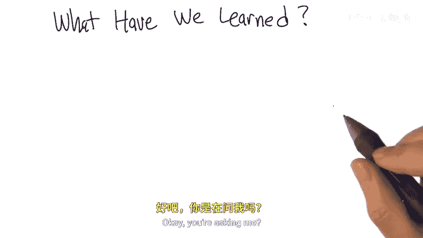
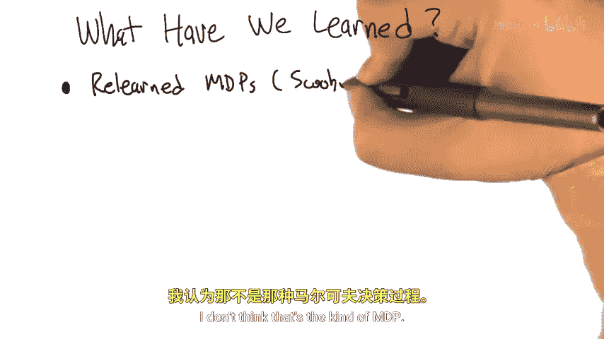
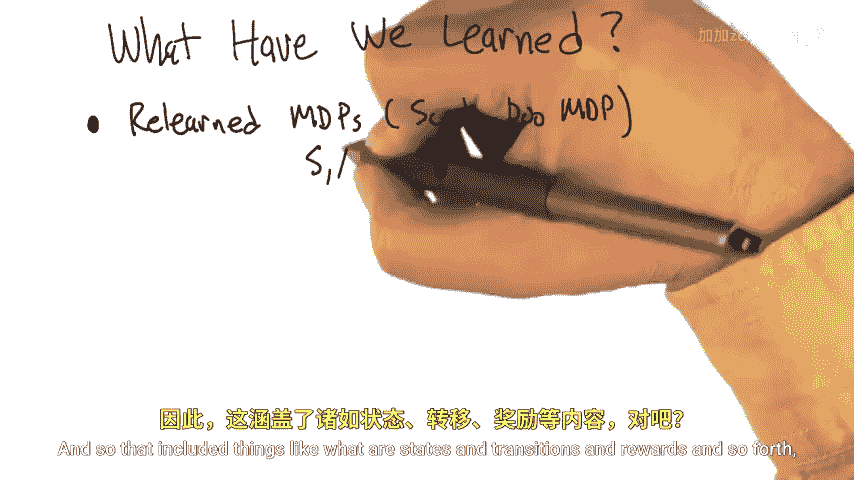
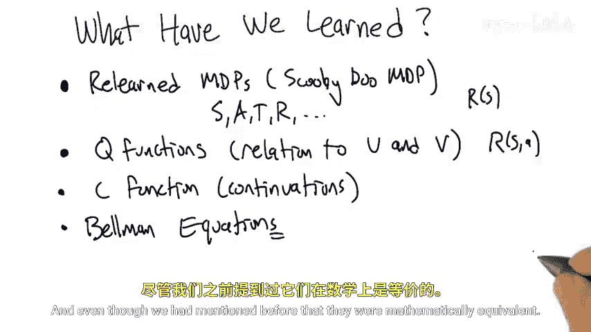

# 038：我们学到了什么

在本节课中，我们将回顾并总结从马尔可夫决策过程到贝尔曼方程的核心学习内容，梳理关键概念与符号变化。

---

上一节我们回顾了马尔可夫决策过程的基础。本节中，我们将系统性地总结所学到的全部新知识。

我们首先重新学习了之前马尔可夫决策过程课程中的所有内容。

以下是马尔可夫决策过程的核心组成部分：
*   **状态**
*   **状态转移**
*   **奖励**

我认为这不仅仅是某种马尔可夫过程。它现在已经是了。我们应该快点写篇论文。

---

在回顾了马尔可夫决策过程之后，我们学习了一系列新的概念。

对我而言，我全面学习了关于Q函数的知识。我学习了延续函数的概念。

总的来说，当我思考这些时，我真正理解了贝尔曼方程试图为你捕捉的核心思想，这比我们在马尔可夫决策过程背景下讨论时要深入得多。

因此，我们获得了对贝尔曼方程及其如何将无限奖励序列中的奖励相互关联起来的更深层次理解。

是的，这正是我想要达到的目的。我认为这内容非常丰富。

---

此外，我认为我学到了符号表示很重要。

现在，请记住，在讨论Scooby-Doo马尔可夫决策过程中的奖励时，我们将R视为状态S的函数。

而当我们讨论Q函数、C函数和贝尔曼方程时，我们将奖励R转变为了状态S和动作A的函数。

尽管我们之前提到过它们在数学上是等价的，但事实证明，就像有时思考Q函数能带来新视角一样，这种符号上的转变对于理解和推导至关重要。

---

本节课中我们一起学习了从马尔可夫决策过程的基础要素到Q函数、延续函数以及贝尔曼方程深层含义的核心知识。我们认识到，即使数学本质等价，不同的符号表示（如R(S)与R(S, A)）也能为理解和解决问题提供关键的视角转换。