强化学习导论：P40：第一个MDP问题

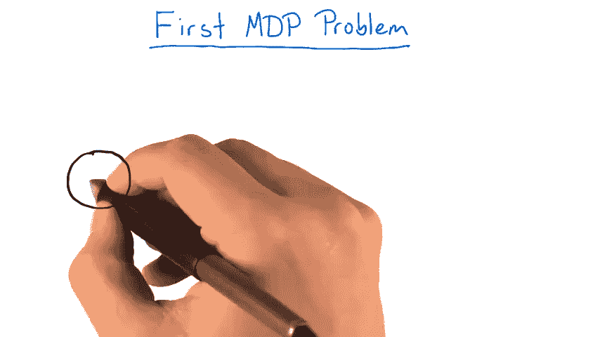

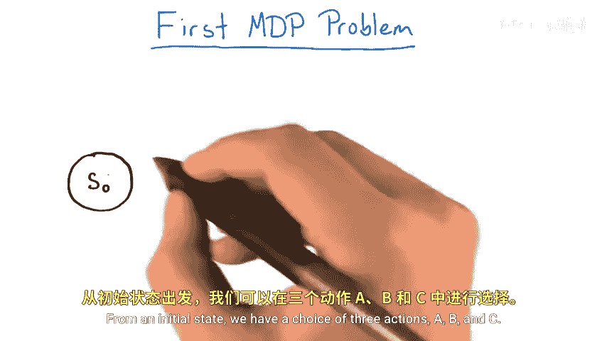

在本节课中，我们将学习如何分析一个简单的马尔可夫决策过程问题。我们将通过一个具体的例子，理解如何计算不同策略下的长期回报，并比较它们以做出最优决策。

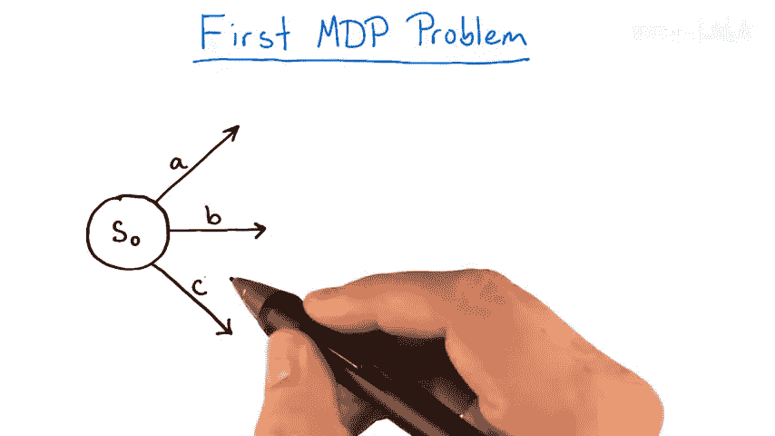

---

让我们考虑从初始状态出发的以下决策问题。

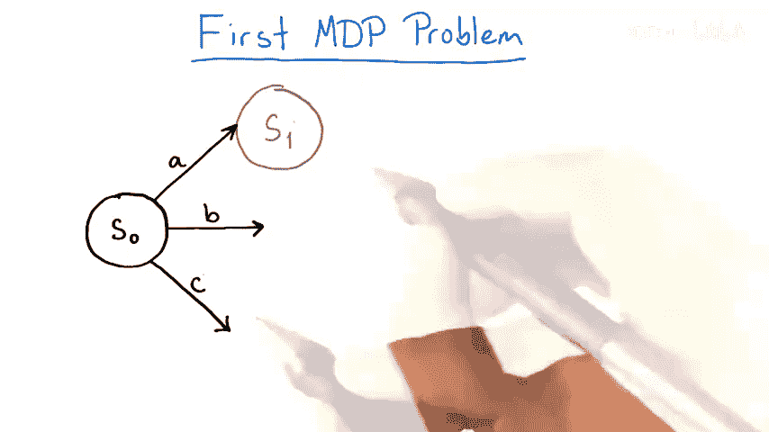

我们面临三个可选动作：A、B和C。每个动作的即时奖励都是0。

但是，这三个动作会将我们带到不同的状态，并从这些状态获得不同的潜在奖励。

上一节我们介绍了问题的基本设定，本节中我们来看看每个动作的具体后果。

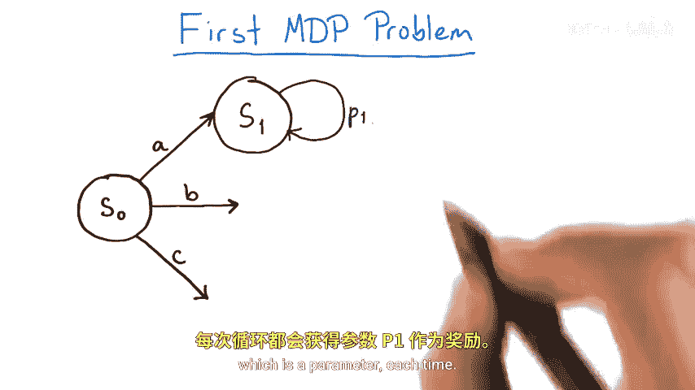

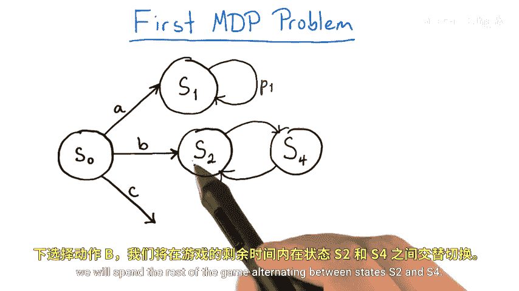

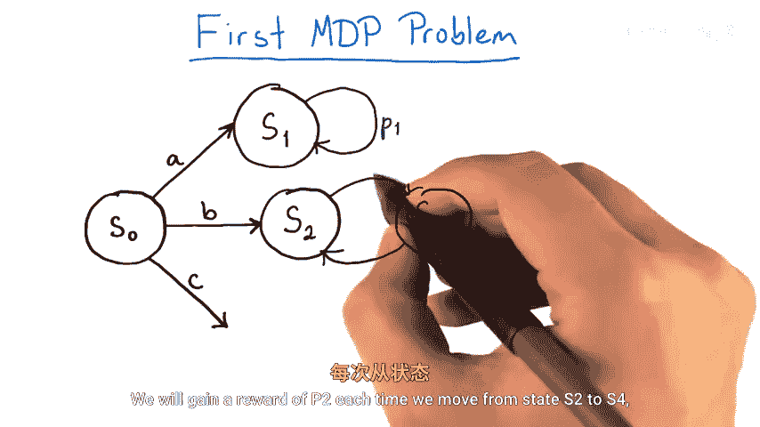

以下是每个动作的详细路径：

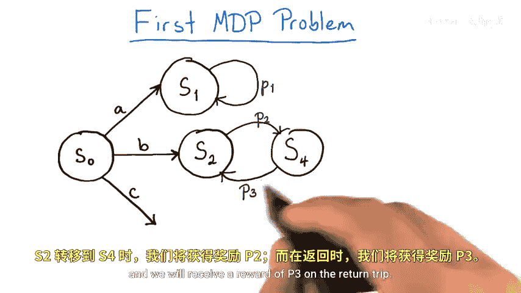

*   **动作A**：将我们带到状态S1。从S1出发，唯一的动作是在每一步循环回到状态S1，每次获得参数为P1的奖励。
*   **动作B**：在初始状态选择此动作后，我们将在游戏的剩余时间里在状态S2和S4之间交替。每次从S2移动到S4时，我们获得奖励P2；在返回行程（从S4到S2）中，我们获得奖励P3。
*   **动作C**：初始选择此动作将使我们进入状态S3。从S3出发，唯一的下一个动作是移动到状态S5，此过程没有奖励。之后，我们在状态S5中反复循环，每一步获得奖励P4。

假设游戏在每一步之后都有一个独立的结束概率。我们称这个概率为 `1 - γ`，因此该场景的有效折扣因子是 `γ`。

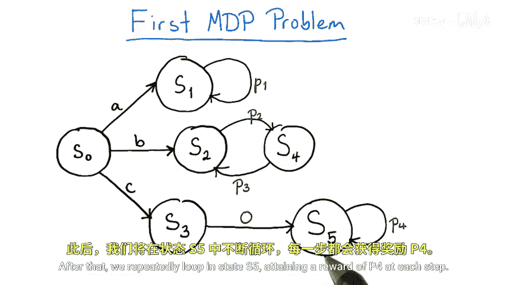

给定参数P1、P2、P3和P4，我们的问题是：确定在什么条件下，每个动作（A、B或C）是最优的初始选择。

---

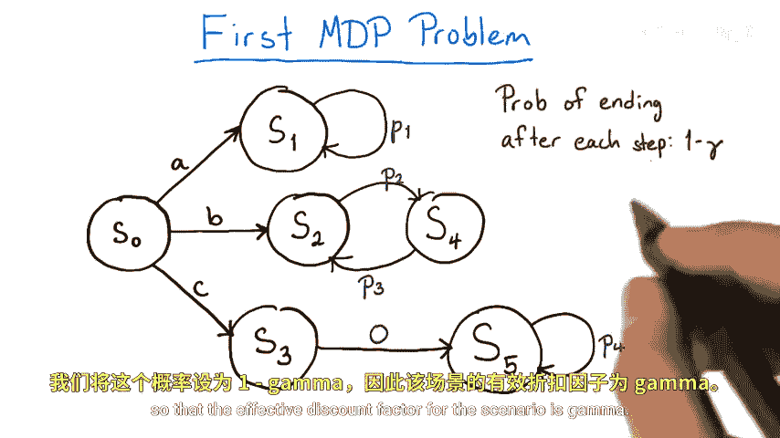

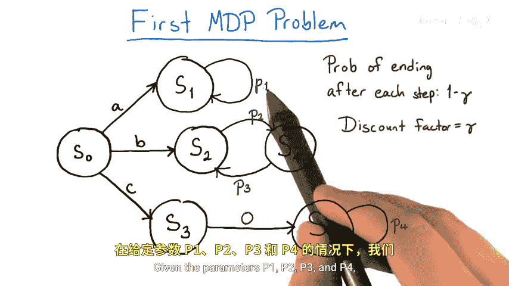

本节课中我们一起学习了如何构建和分析一个简单的MDP问题。我们明确了从初始状态出发的三个动作所导致的不同状态转移路径和奖励序列，并引入了折扣因子 `γ` 来考虑游戏的随机终止。这为下一步计算和比较各个动作的长期价值函数奠定了基础。