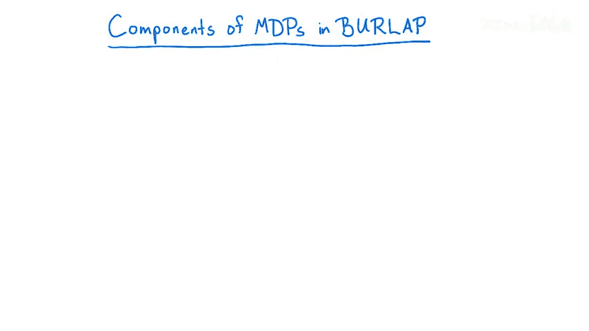
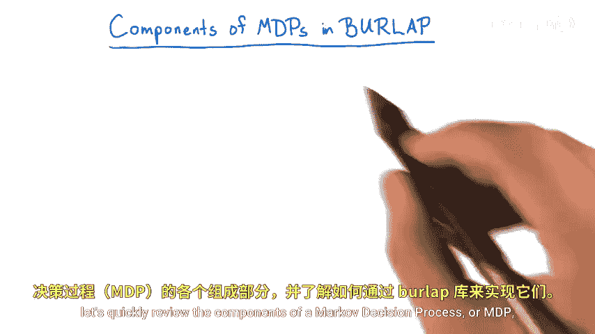
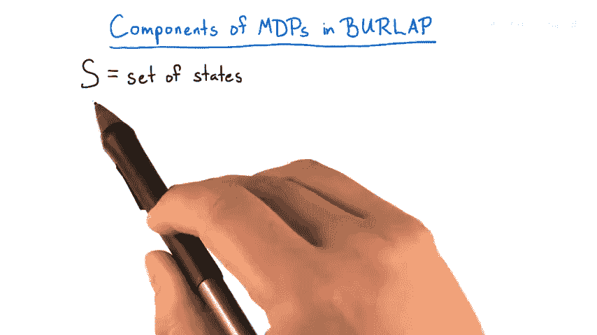
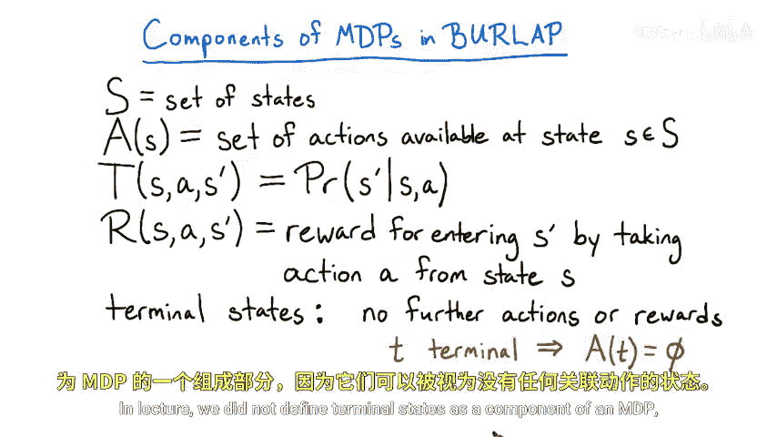

强化学习导论：P41：BURLAP中的MDP组件 🧩

在本节课中，我们将学习马尔可夫决策过程的核心组件，并了解如何使用BURLAP库来实现它们。

在深入代码之前，我们先快速回顾一下马尔可夫决策过程的组成部分，并看看如何用BURLAP库来实现它们。

MDP的第一个组成部分是系统可能处于的状态集合 **S**。

与集合 **S** 中的每个状态 **s** 相关联的，是在该状态下可以采取的动作集合 **A(s)**。

此外，还有一个转移函数 **T(s, a, s')**，它给出了在状态 **s** 下采取动作 **a** 后，我们进入状态 **s'** 的概率。

最后，还有一个奖励函数 **R(s, a, s')**。

它给出了在状态 **s** 下采取动作 **a** 并最终进入状态 **s'** 时所获得的奖励。

请注意，有时将奖励表示为仅关于 **s** 和 **a** 的函数，甚至仅关于初始状态 **s** 的函数更为自然。在本教程中，我们将使用最通用的形式 **R(s, a, s')**，因为BURLAP中的奖励函数就是以这种方式实现的。

终端状态是指进入该状态后，智能体无法再采取任何进一步动作的状态。智能体在之后的时间里不会再获得任何奖励。在课程中，我们没有将终端状态定义为MDP的一个独立组成部分，因为它们可以被视为没有任何关联动作的状态。

---

**总结**

本节课我们一起学习了马尔可夫决策过程的四个核心组件：状态集合 **S**、动作集合 **A(s)**、转移函数 **T(s, a, s')** 和奖励函数 **R(s, a, s')**。我们还了解了BURLAP库如何实现这些组件，并讨论了终端状态的概念。理解这些组件是构建和解决强化学习问题的基础。