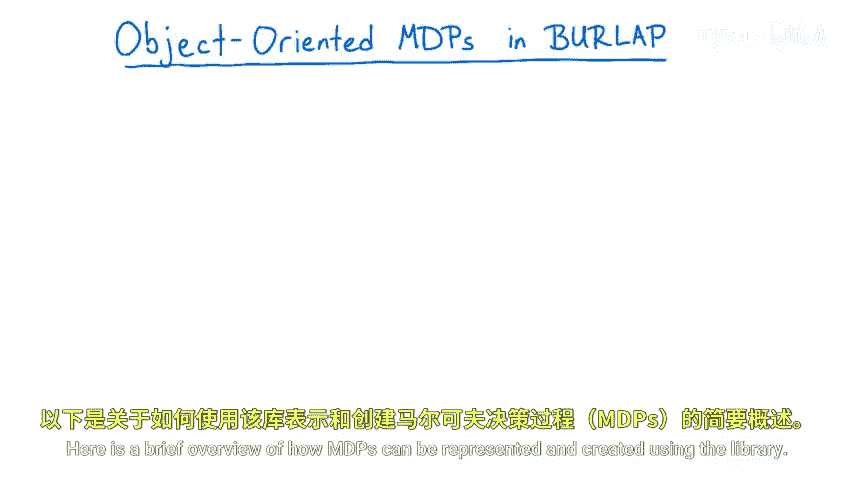
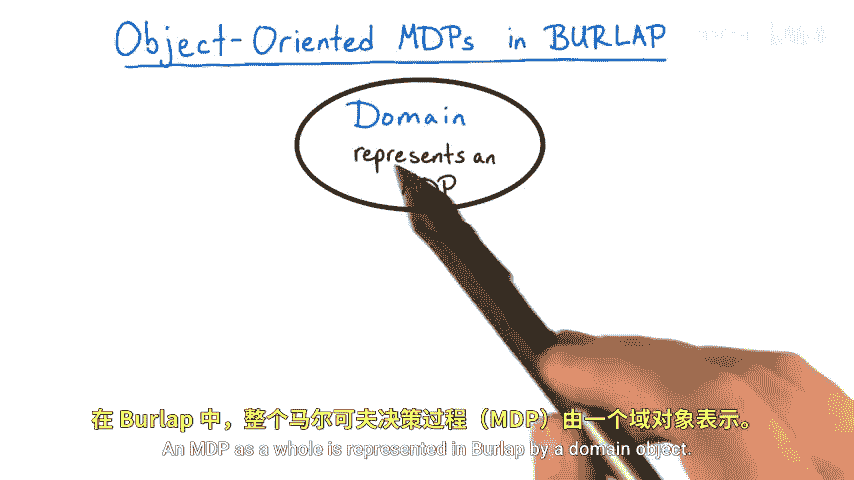
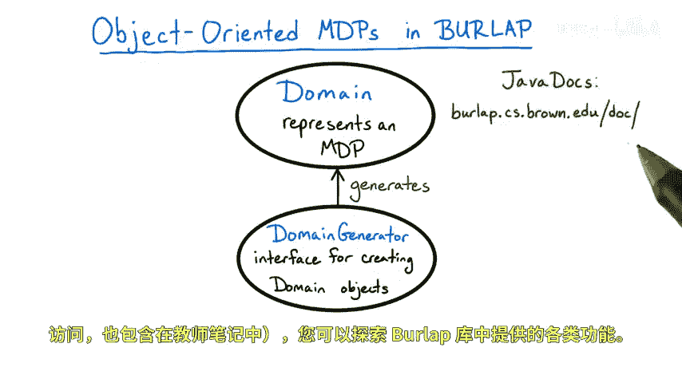

强化学习导论：P42：BURLAP中的OOMDPs

在本节课中，我们将学习如何使用BURLAP库来表示和创建面向对象的马尔可夫决策过程。BURLAP采用面向对象范式来构建MDP模型，我们将了解其核心概念和基本操作流程。

BURLAP使用面向对象范式来表示马尔可夫决策过程。

以下是关于如何使用该库表示和创建MDP的简要概述。

在BURLAP中，整个MDP由一个**域**对象表示。

上一节我们了解了MDP在BURLAP中的基本表示形式。接下来，我们看看如何具体创建这些域对象。

域可以直接创建，但通常使用BURLAP库中的几个特定类会更有帮助。

具体来说，这些类用于生成特定类型的MDP。这些类实现了**域生成器**接口，相关Java文档位于此处提供的URL，也包含在教师笔记中。

你可以通过BURLAP库文档探索可用的类。

在文档的左侧窗格中，你会看到BURLAP中所有可用类的列表。

向下滚动直到找到**DomainGenerator**。注意**DomainGenerator**是斜体显示的。

这表明它是一个接口。如果你点击左侧的**DomainGenerator**链接。

你将在主窗格中看到关于该接口的信息。

请注意，在页面顶部，有一个列表显示了实现**DomainGenerator**接口的类。

如果你不熟悉Java文档，可以点击每个类来阅读它们各自生成的域类型的简要描述。

现在，考虑到我们想要构建的MDP类型，这些类中哪一个最适合我们用来生成域对象。

请使用每个实现类的文档以及你的判断来选择。