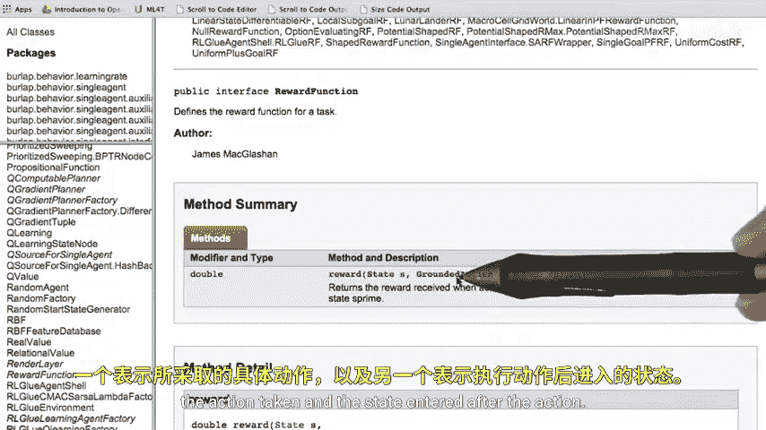
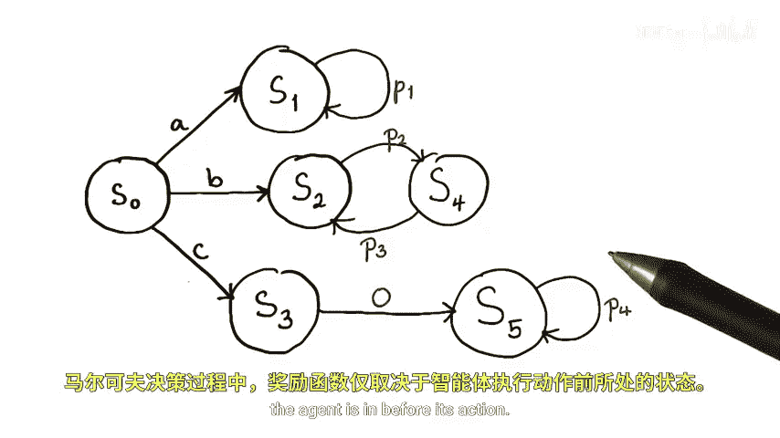
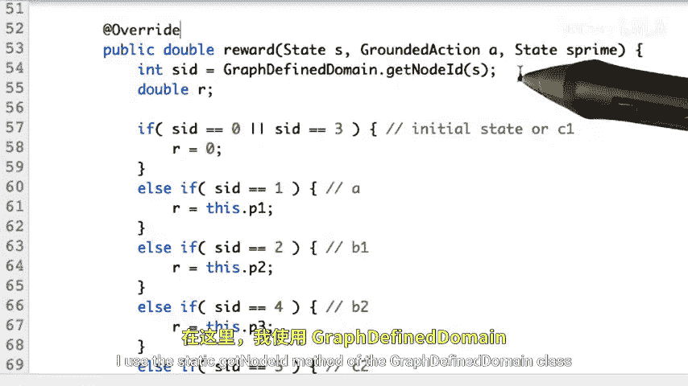
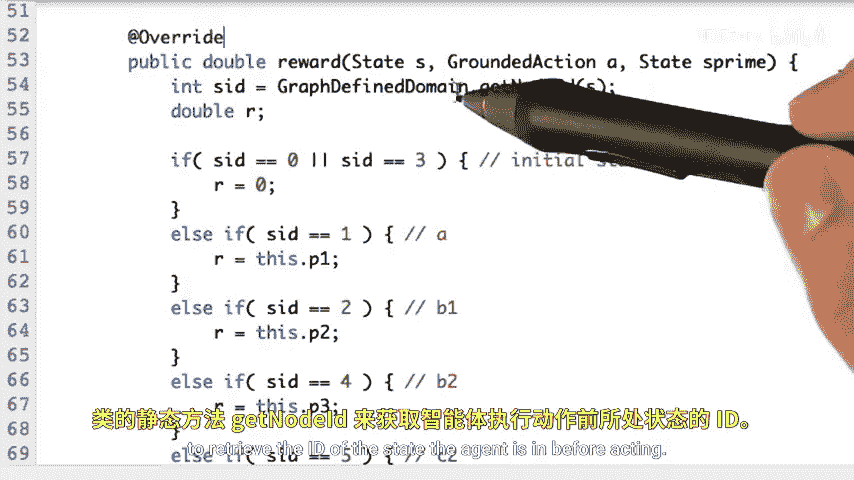
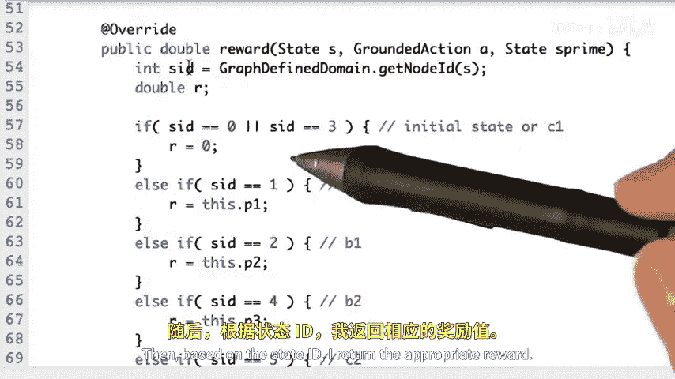
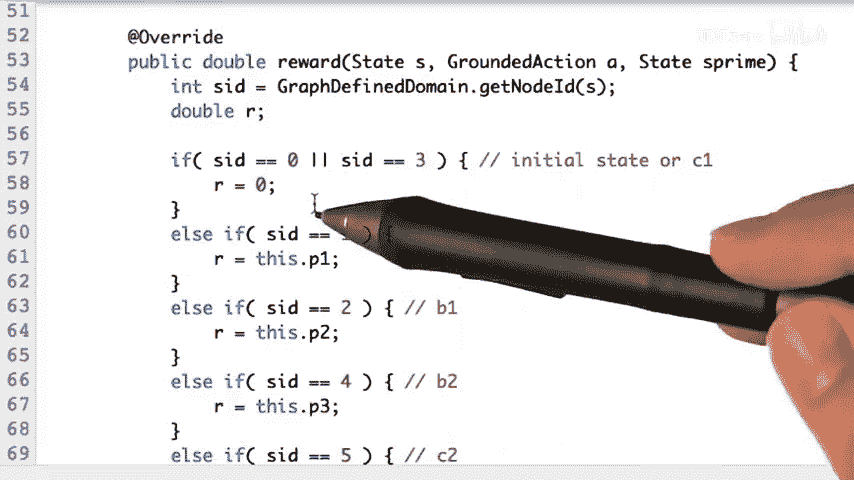
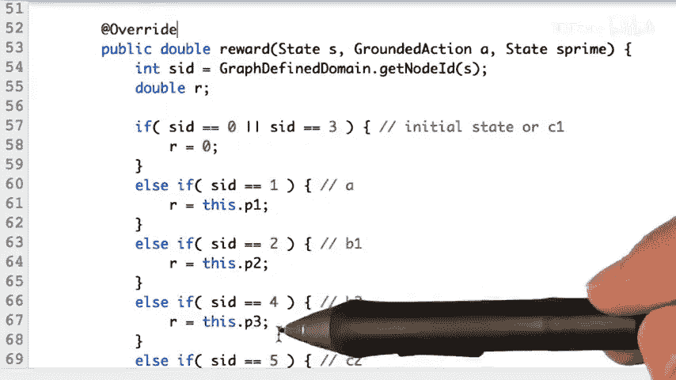
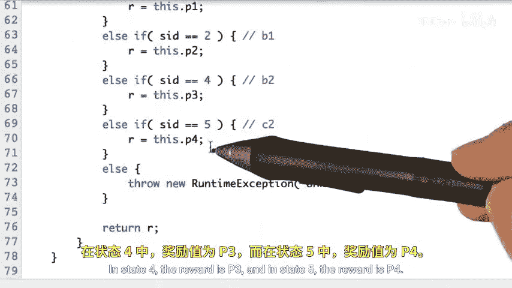
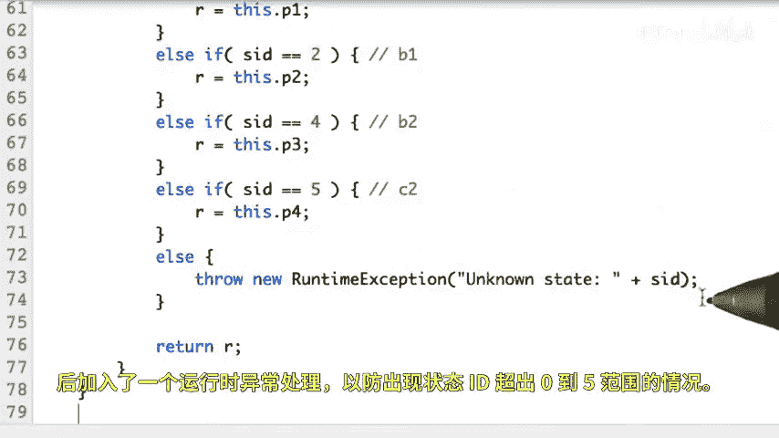

强化学习导论：P52：奖励函数实现方案

在本节中，我们将学习如何为一个特定的马尔可夫决策过程（MDP）实现奖励函数。我们将分析状态转移图的特点，并据此编写一个简洁的奖励函数。



根据奖励函数的文档说明，`reward` 方法接收三个参数：一个表示执行动作前的状态 `s`，一个具体的动作 `a`，以及一个表示执行动作后进入的状态 `s'`。该方法需要返回一个 `double` 类型的奖励值。

以下是该方法的签名：
```java
public double reward(State s, GroundedAction a, State s_prime)
```



观察我们当前MDP的状态转移图，可以发现一个关键特征：除了初始状态外，每个状态都只有一条出边。并且，每个动作都是确定性的，只会导向唯一的下一个状态。此外，所有从初始状态出发的动作，其奖励值都是零。

基于以上观察，我们可以得出一个重要结论：在这个特定的MDP中，奖励函数的值**仅取决于**智能体执行动作前所处的状态 `s`，而与执行的具体动作 `a` 以及进入的新状态 `s'` 无关。



因此，在实现时，我们可以只检查参数 `s`，而忽略 `a` 和 `s'`。具体步骤如下：







以下是实现奖励函数的核心步骤：
1.  使用 `GraphDefinedDomain` 类的静态方法 `getNodeId` 来获取状态 `s` 的唯一标识符（ID）。
2.  根据获取到的状态ID，返回对应的奖励值。
    *   状态 0 和 状态 3 的奖励为 **0**。
    *   状态 1 的奖励为 **P1**。
    *   状态 2 的奖励为 **P2**。
    *   状态 4 的奖励为 **P3**。
    *   状态 5 的奖励为 **P4**。
3.  在检查逻辑的最后，添加一个运行时异常处理，以防出现ID不在0到5范围内的未知状态。





以下是该逻辑的代码框架：
```java
int sid = GraphDefinedDomain.getNodeId(s);
switch(sid) {
    case 0:
    case 3:
        return 0.0;
    case 1:
        return P1;
    case 2:
        return P2;
    case 4:
        return P3;
    case 5:
        return P4;
    default:
        throw new RuntimeException("Received an unknown state ID: " + sid);
}
```



本节课中，我们一起学习了如何为一个具有确定性转移和状态依赖奖励的MDP实现奖励函数。核心在于分析MDP的特性，识别出奖励仅与当前状态相关，从而简化了函数的实现逻辑。我们通过状态ID进行分支判断，为每个状态返回预设的奖励值，并添加了健壮性检查以处理意外情况。