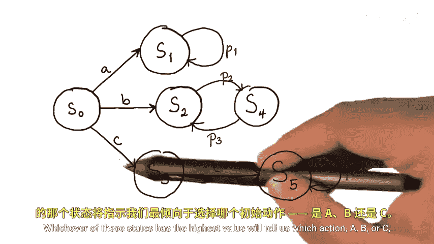
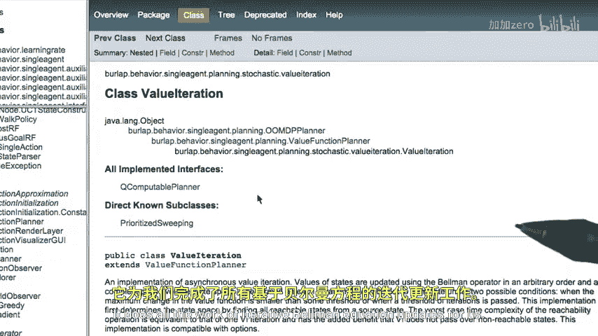
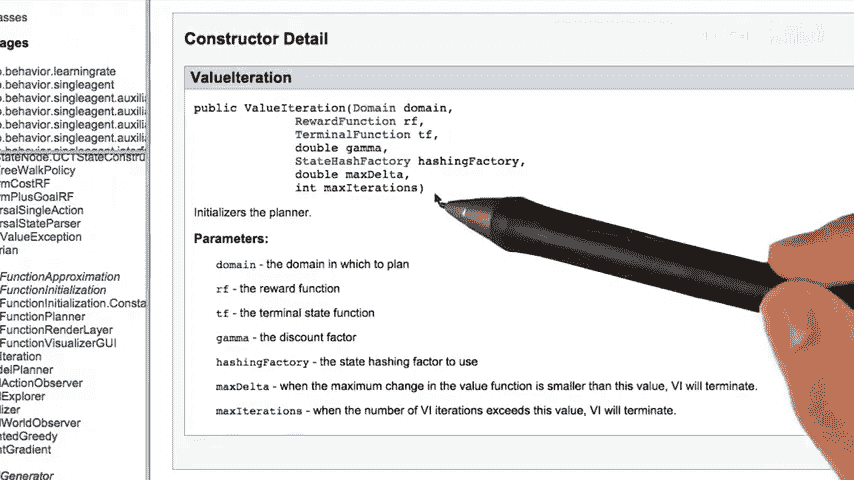
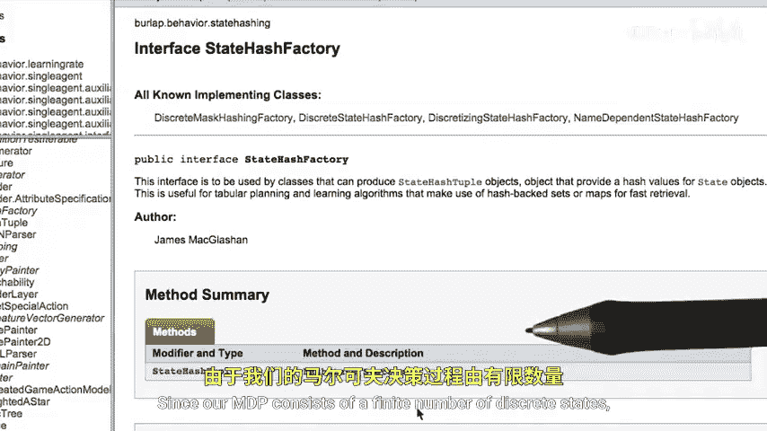

强化学习导论：P55：执行价值迭代 🧮

在本节课中，我们将学习如何使用BURLAP库中的价值迭代算法来解决一个已定义的马尔可夫决策过程。我们将通过计算状态S1、S2和S3的价值，来确定初始时最偏好的行动A、B或C。

上一节我们完成了MDP和BURLAP环境的定义，本节中我们来看看如何使用BURLAP提供的规划或强化学习算法来解决这个MDP。

我们将使用价值迭代算法来寻找状态S1、S2和S3的价值。其中价值最高的状态将告诉我们，对于初始行动，我们最偏好行动A、B还是C。BURLAP中有一个`ValueIteration`类，它实现了课程中讲授的价值迭代算法。它为我们完成了贝尔曼方程的迭代更新工作。

要实例化它，我们需要传入之前定义的域、奖励函数和终止函数。我们还需要传入几个额外的参数。

以下是需要传入的参数列表：
*   `double gamma`：折扣因子，取值范围在0到1之间。
*   `StateHashFactory`对象：一个状态哈希工厂对象，稍后会进行说明。
*   `double maxDelta`：最大差值。
*   `int maxIterations`：最大迭代次数。

`maxDelta`和`maxIterations`是价值迭代过程的两个停止条件。该过程将在满足以下任一条件时停止：在一次迭代中，所有状态的价值变化都不超过`maxDelta`；或者过程已经运行了`maxIterations`次。

`StateHashFactory`是一个接口，它提供了`hashState`方法。该方法接收一个`State`对象，并生成一个`StateHashTuple`。这允许在价值迭代过程中快速检索状态对象。由于我们的MDP由有限数量的离散状态组成，我们将传入一个`SimpleHashableStateFactory`。

本节课中我们一起学习了如何配置并运行BURLAP中的价值迭代算法，包括必要的参数设置和算法停止条件的理解。通过计算状态价值，我们可以据此选择最优的初始行动。