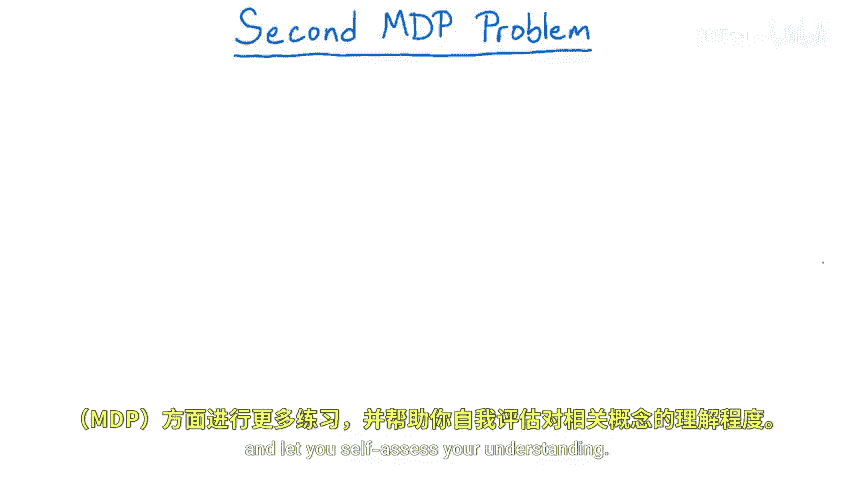
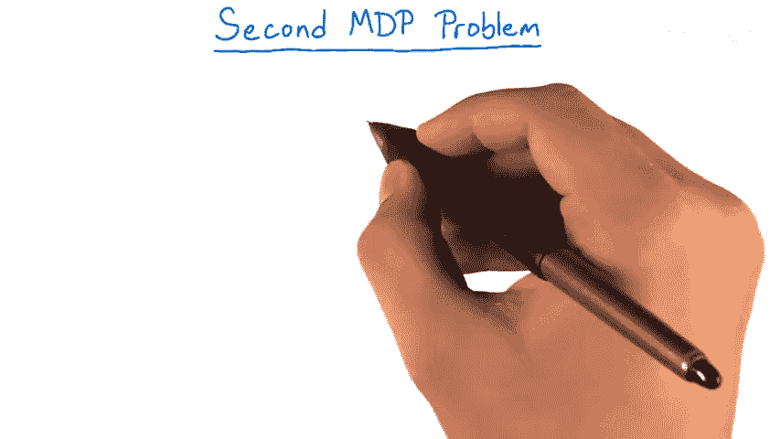
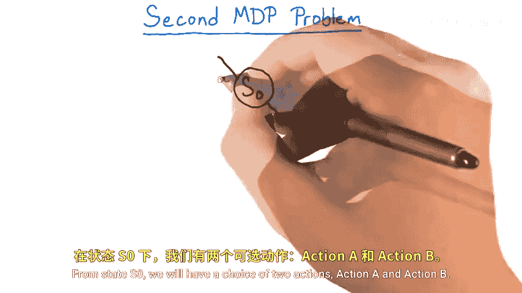
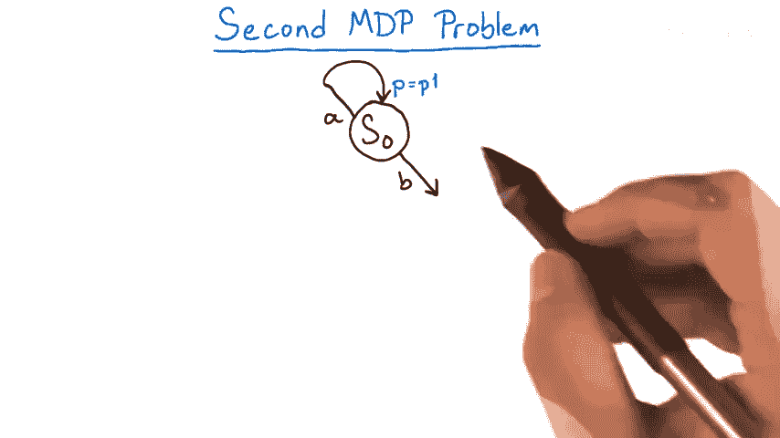
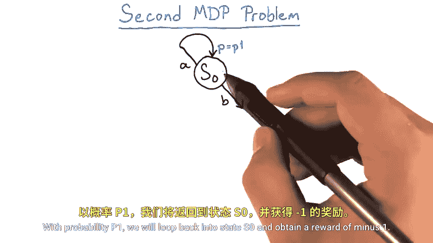
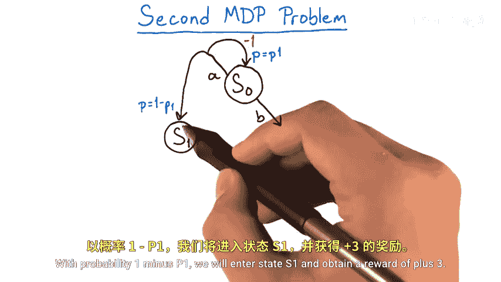
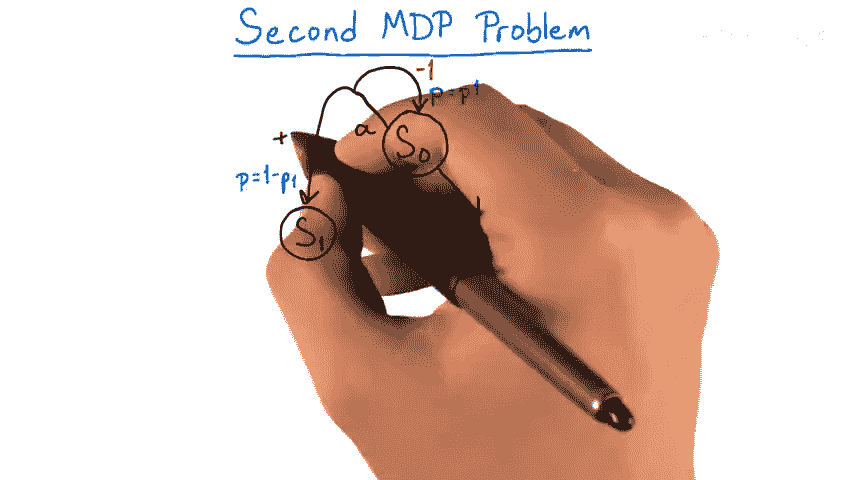
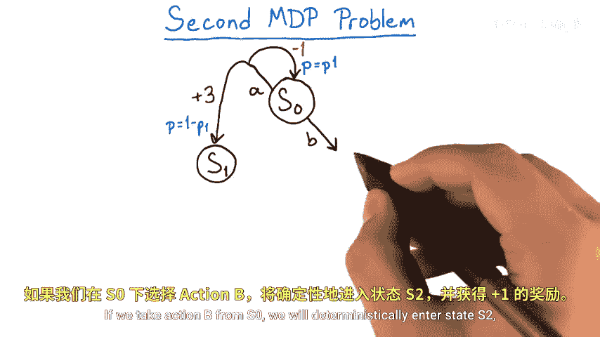
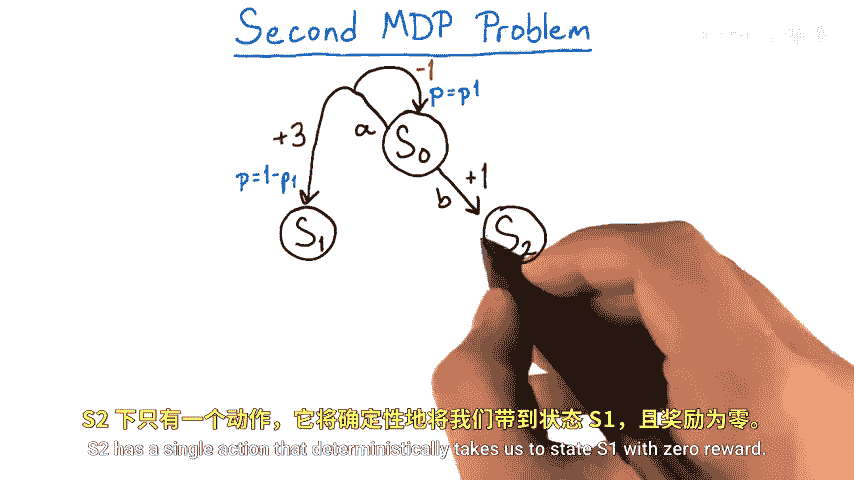
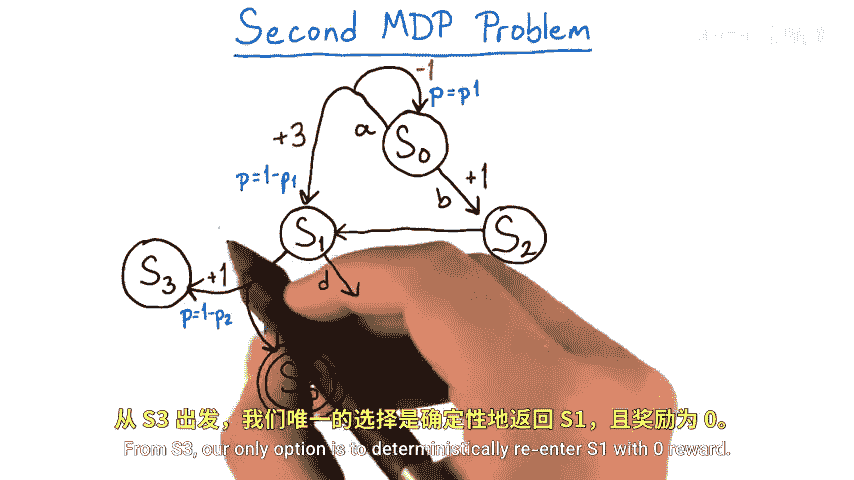

强化学习导论：P59：第二个MDP问题 🧩

在本节课中，我们将学习如何构建和解决一个新的马尔可夫决策过程问题。通过这个练习，你可以巩固在BURLAP中构建MDP的技能，并进行自我评估。

---

### 问题概述

我们从一个新的MDP问题开始。智能体从状态 **S0** 出发，目标是理解状态转移和奖励机制。

### 状态与动作描述

以下是该MDP中各个状态和可用动作的详细说明。

**从状态 S0 出发：**
*   **动作 A**：这是一个随机动作。
    *   以概率 **P1** 执行：返回状态 **S0**，并获得奖励 **-1**。
    *   以概率 **1 - P1** 执行：进入状态 **S1**，并获得奖励 **+3**。
*   **动作 B**：这是一个确定性动作。
    *   执行后：确定性地进入状态 **S2**，并获得奖励 **+1**。

**在状态 S2：**
*   只有一个确定性动作。
*   执行后：确定性地进入状态 **S1**，奖励为 **0**。

**在状态 S1：**
*   **动作 C**：这是一个随机动作。
    *   以概率 **P2** 执行：进入终止状态 **S5**，奖励为 **0**。
    *   以概率 **1 - P2** 执行：进入状态 **S3**，并获得奖励 **+1**。
*   **动作 D**：这是一个确定性动作（描述中未明确其效果，需根据完整问题上下文补充）。

**在状态 S3：**
*   只有一个确定性动作。
*   执行后：确定性地重新进入状态 **S1**，奖励为 **0**。



**状态 S5** 是终止状态，没有后续动作。



---





### 问题图示与公式表示



为了更直观地理解，我们可以用状态转移图来表示这个过程。同时，核心的状态转移概率和奖励可以用公式定义。





状态转移关系可直观表示为：
```
S0 --(A, P1)--> S0 (R=-1)
S0 --(A, 1-P1)--> S1 (R=+3)
S0 --(B)--> S2 (R=+1)
S2 --> S1 (R=0)
S1 --(C, P2)--> S5 (R=0)
S1 --(C, 1-P2)--> S3 (R=+1)
S3 --> S1 (R=0)
```
其中，`(动作, 概率)` 表示执行某动作后以特定概率转移，`(R=奖励值)` 表示获得的即时奖励。



状态转移概率和奖励的函数可以定义为：
对于在状态 `s` 执行动作 `a` 后转移到状态 `s‘` 的概率：
`P(s' | s, a)`
对应的即时奖励为：
`R(s, a, s')`



---

### 练习目标

现在，你已经清楚了整个MDP的结构。接下来，请尝试在BURLAP中构建这个模型，并计算最优策略或价值函数。这个练习能帮助你熟悉MDP的建模过程。

---

### 总结



本节课我们一起分析并定义了一个包含随机和确定性转移的MDP问题。我们明确了从初始状态 **S0** 到终止状态 **S5** 的所有可能路径、相应的动作选择、转移概率以及即时奖励。理解这些元素是形式化和解决强化学习问题的基础。