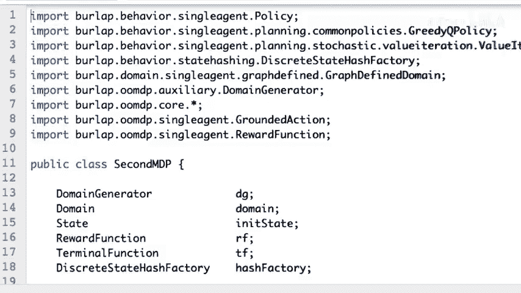
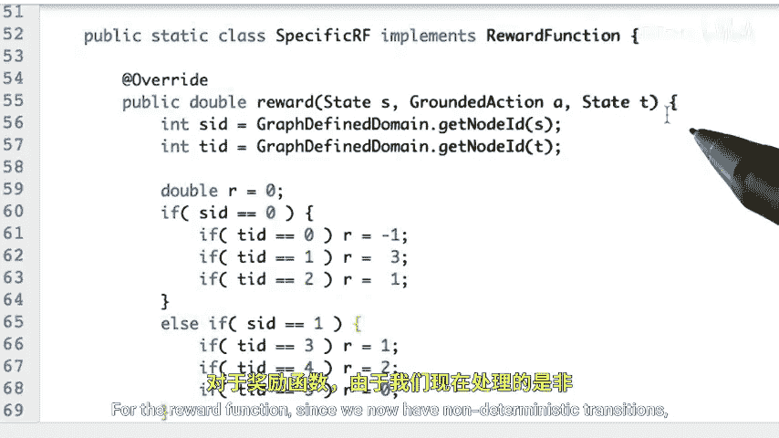
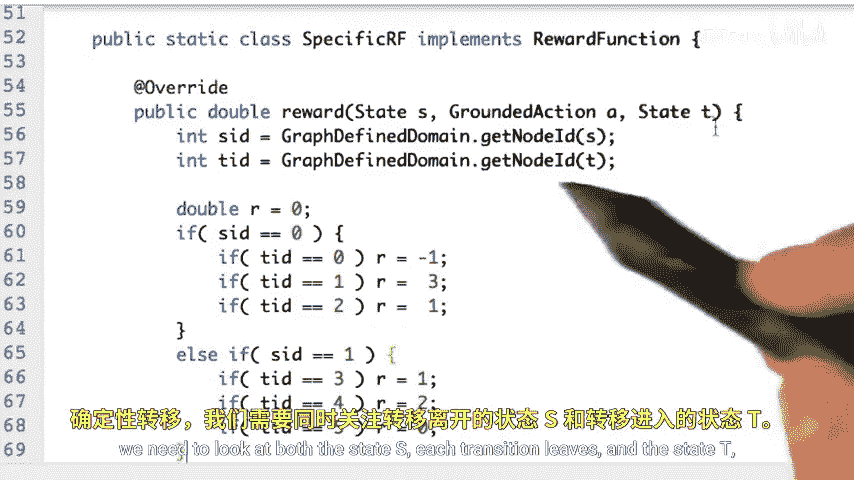
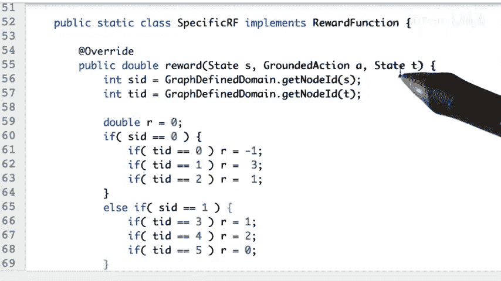
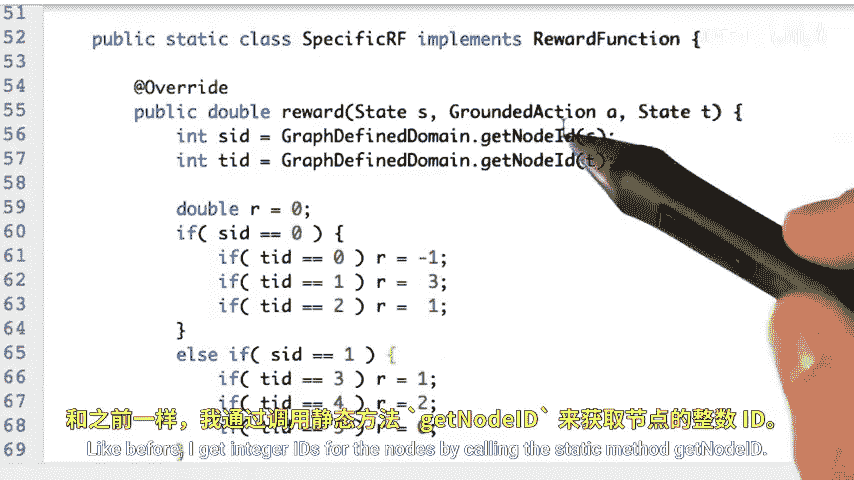
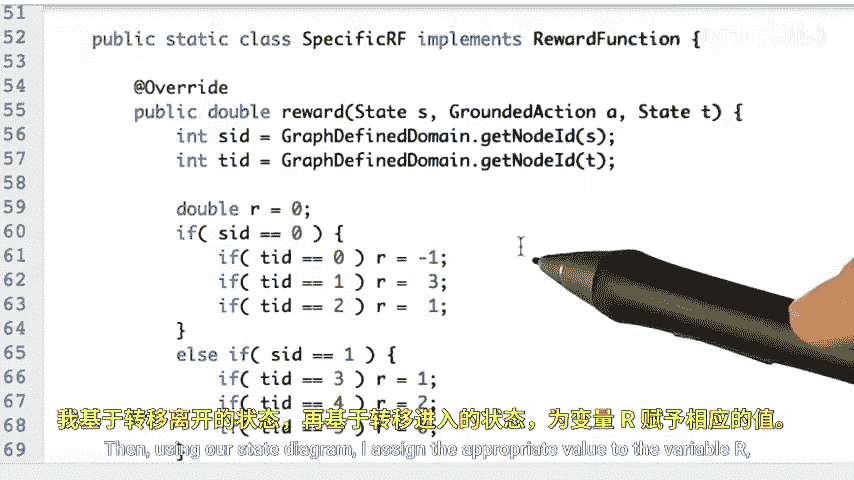
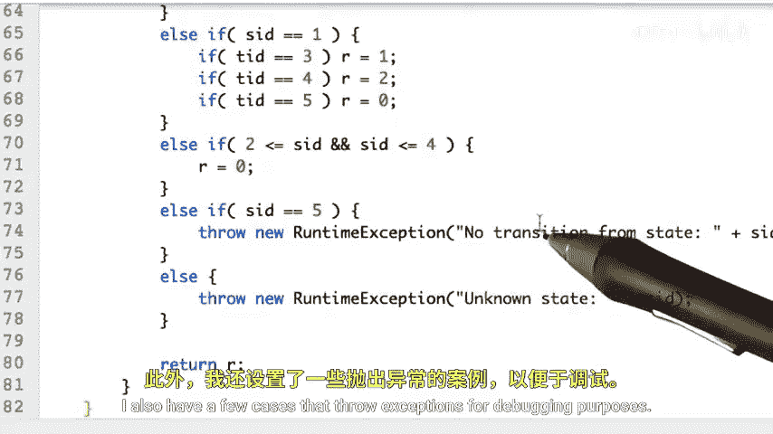
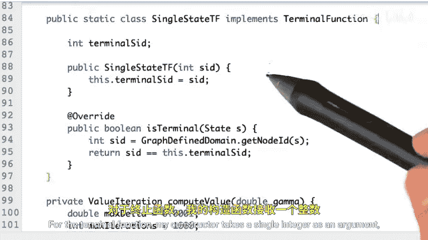

强化学习导论：P60：第二个MDP问题解决方案 🧩



在本节中，我们将学习如何使用BURLAP库实现第二个马尔可夫决策过程问题的解决方案。我们将重点关注如何定义具有随机转移概率的环境，并实现相应的奖励函数和终止函数。

---

### 概述

我们将构建一个包含六个状态的MDP环境。与之前不同，本次的核心参数是状态转移的概率，而非奖励值。我们将使用BURLAP库来定义状态、动作、转移概率、奖励函数和终止条件，并最终生成可用的领域模型。

---

### 环境构建

首先，我们来看如何构建MDP环境。我们的构造函数定义了六个状态，并且本次只使用两个核心参数（不包含折扣因子），这两个参数代表状态转移的概率。

以下是构建领域模型的核心代码步骤：

```java
// 定义状态和动作
// 设置转移概率（基于状态图）
// 生成领域模型
// 设置初始状态为0
// 设置奖励函数和终止函数
// 实例化离散状态哈希工厂
```

在代码中，我们使用了自定义的类 `RF` 和 `SingleStateTF` 来实现奖励函数和终止函数的接口。

---

### 奖励函数实现

由于转移是非确定性的，奖励函数需要同时考虑转移离开的状态 `S` 和转移进入的状态 `T`。





以下是奖励函数实现的关键逻辑：



1.  通过静态方法 `getNodeID` 获取状态的ID。
2.  根据状态图，基于转移离开的状态 `S` 为变量 `R` 分配合适的奖励值。
3.  同时，也可以根据转移进入的状态 `T` 进行额外的逻辑判断。
4.  包含了一些异常抛出案例，用于调试目的。

```java
// 伪代码示例：根据离开状态S确定基础奖励
if (S == stateA) {
    R = rewardA;
} else if (S == stateB) {
    R = rewardB;
}
// 可根据进入状态T调整奖励（如果需要）
```

---



### 终止函数实现



终止函数的实现相对简单。其构造函数接收一个整数参数，即终止状态的ID，并将其存储在成员字段中。

```java
// 伪代码示例
class SingleStateTF {
    private int terminalStateId;
    
    SingleStateTF(int terminalId) {
        this.terminalStateId = terminalId;
    }
    
    boolean isTerminal(State s) {
        return (getStateId(s) == terminalStateId);
    }
}
```



当查询某个状态是否为终止状态时，函数只需比较该状态的ID是否与存储的终止状态ID一致。

---

### 总结



本节课中，我们一起学习了如何使用BURLAP库解决第二个MDP问题。核心内容包括：
1.  构建了一个具有随机转移概率的六状态MDP环境。
2.  实现了**奖励函数**，它需要处理非确定性转移，同时考虑离开状态和进入状态。
3.  实现了一个简单的**终止函数**，通过检查状态ID来判断是否为终止状态。
通过定义清晰的转移概率、奖励规则和终止条件，我们为后续的强化学习算法（如值迭代或策略迭代）打下了坚实的基础。