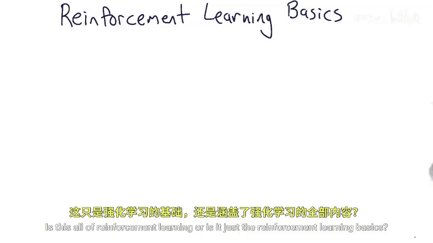
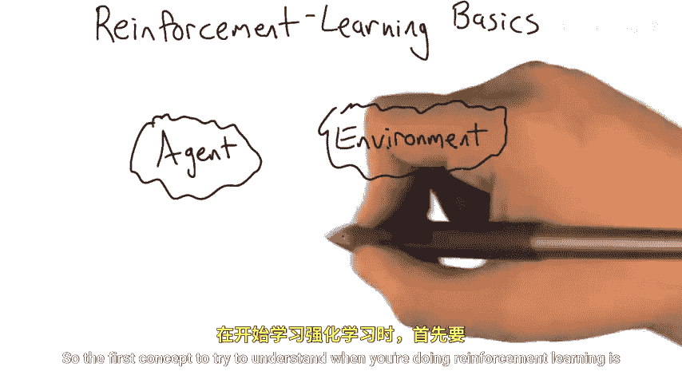
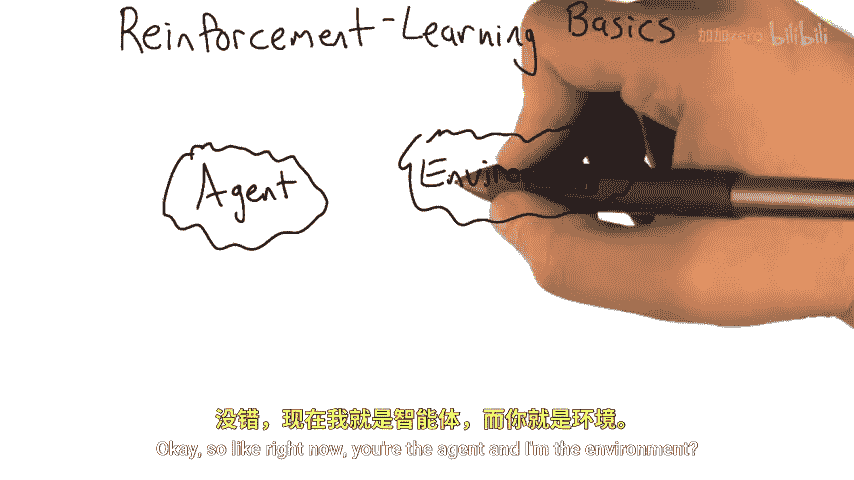
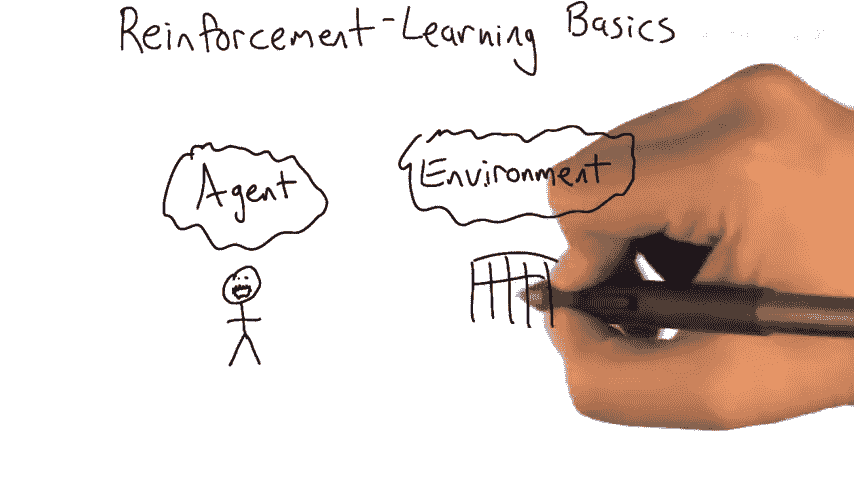
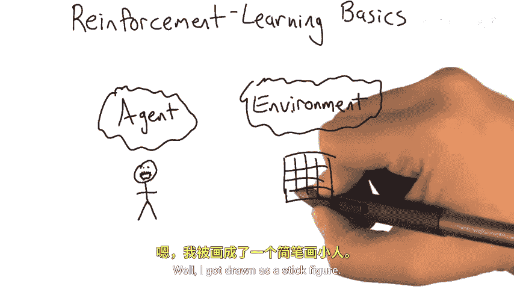
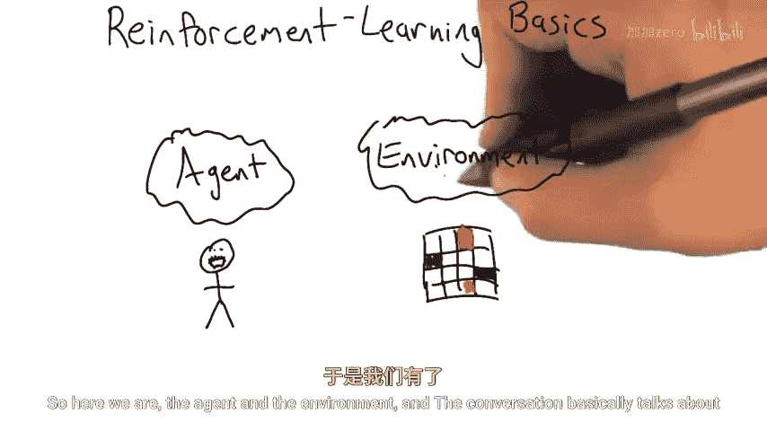
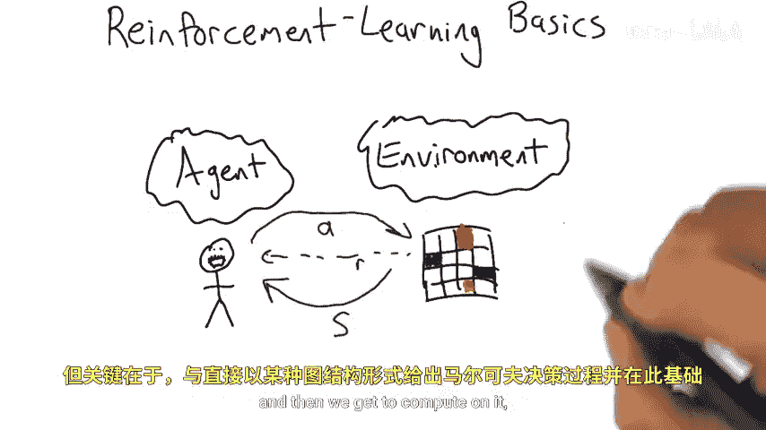

# 061：强化学习基础

在本节课中，我们将要学习强化学习的基础概念，特别是智能体与环境之间如何通过交互来学习。我们将从最核心的对话模型开始，理解状态、动作和奖励这些基本元素是如何运作的。

## 智能体与环境的对话

上一节我们介绍了课程背景，本节中我们来看看强化学习的核心交互模型。理解强化学习的第一步，是认识到其大部分过程表现为智能体与环境之间的一场“对话”。

在这个模型中，你（或一个程序）扮演**智能体**的角色。我们将想象一个合理的环境，例如一个视频游戏世界。智能体与环境持续进行交互。

以下是交互过程中传递的核心信息：

*   **状态**：环境会以**状态**的形式向智能体展示自身。我们用符号 **S** 表示状态。
*   **动作**：智能体通过执行**动作**来影响环境。我们用符号 **A** 表示动作。
*   **奖励**：在环境转移到下一个状态之前，智能体会因为最近一次“状态-动作”组合而收到一个**奖励**信号。

这个过程与马尔可夫决策过程（MDP）中的元素相同。但关键区别在于，在强化学习中，我们并非直接获得一个完整的、如图结构般的MDP模型然后进行计算。相反，真正的计算发生在智能体“内部”。智能体需要通过与环境的实际交互来逐步了解这个世界。

## 总结

本节课中我们一起学习了强化学习的基础交互框架。我们明确了智能体与环境通过状态、动作和奖励进行持续对话的核心模式。理解这个基础对话模型是后续学习各种强化学习算法的重要前提。