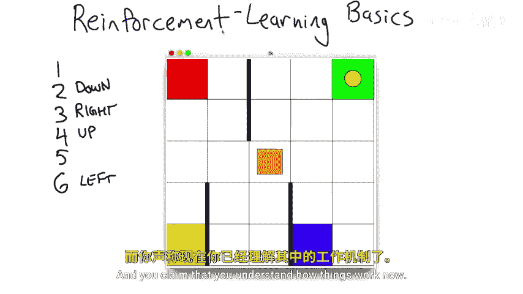
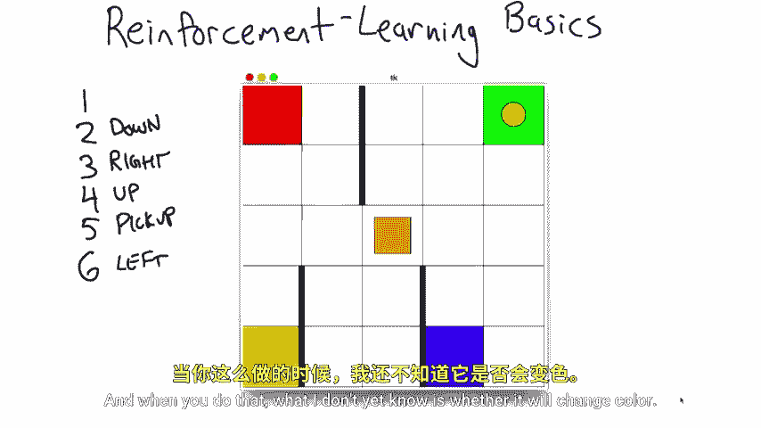
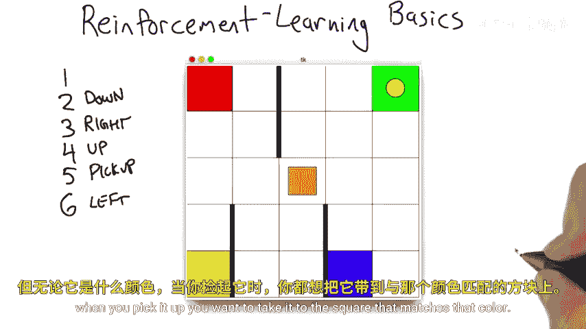
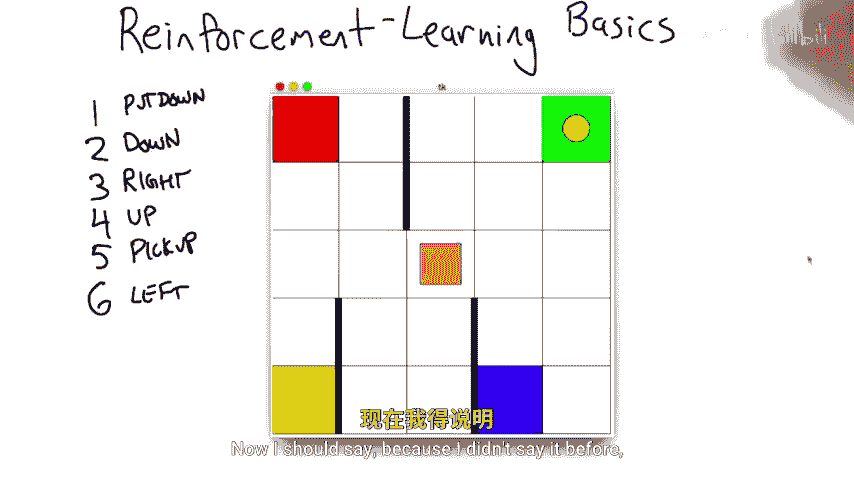
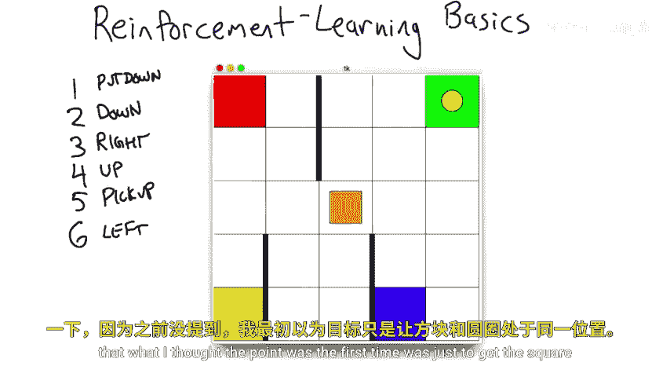
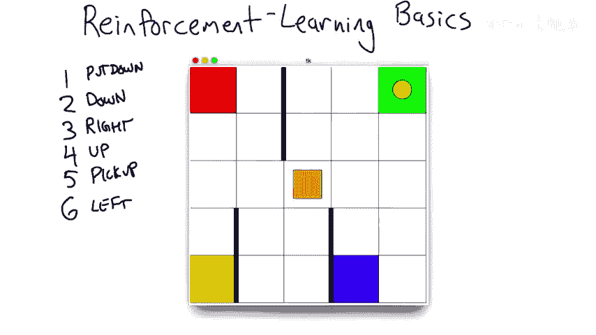
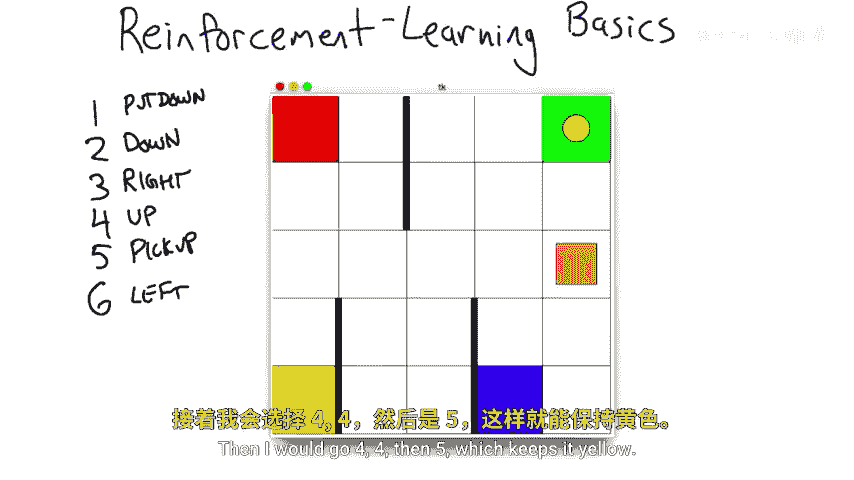

# 063：神秘游戏 - 2

在本节课中，我们将通过一个具体的游戏示例，学习如何理解强化学习中的状态、动作、奖励和转移函数。我们将跟随一位学习者的探索过程，分析其如何通过交互来构建对环境的认知，并规划出达成目标的路径。

上一节我们介绍了神秘游戏的基本界面和初步探索。本节中我们来看看学习者在获得一些经验后，如何解释和应对一个新的游戏状态。

好的，这是另一个状态。我刚刚随机地将你传送到了另一个起始状态。

你声称现在明白游戏如何运行了。那么你能解释一下吗？

我想我明白了。目标是去拿到那个小黄圈，或者说一开始是黄色的圈。我不确定颜色变化是否有特殊含义，上次它好像是绿色的。你想拾起它，我记得拾起动作是5。当你拾起它时，我还不确定它是否会改变颜色。但无论拾起时它是什么颜色，你都需要把它带到与之颜色匹配的方块处，然后放下它，放下动作是1。我应该说一下，我之前没说清楚，我最初以为目标只是让方块和圆圈处在同一位置。是的，你上次做到了，但那样做并没有得到任何奖励。所以我推断可能我什么都没做对。但那时我也还在摸索所有指令的作用。

我进行了很多探索。

好的，所以你学到了一些关于转移函数的知识。你学到了一点关于动作如何改变状态的知识，也学到了一点关于哪些状态是有奖励的。

是的。所以现在你认为，尽管情况有些不同，但你可以规划出一条到达目标状态的最短路径了。

当然。从这个状态开始，我会先执行动作3，再执行动作3。

然后我会执行动作4，再执行动作4。

然后执行动作5。这个动作会保持当前状态。

---

本节课中我们一起学习了如何通过试错来理解一个未知的强化学习环境。我们看到了学习者如何整合关于状态、动作、转移函数和奖励的信息，从而形成对任务目标的假设，并最终规划出一个具体的行动序列。这个过程体现了强化学习智能体通过与环境的交互来学习和改进策略的核心思想。