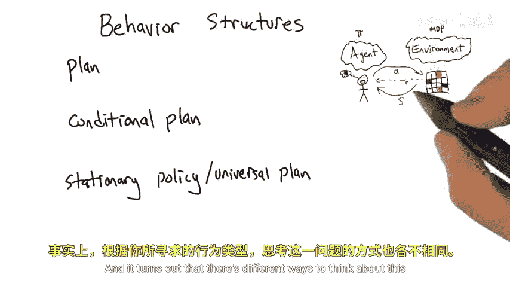
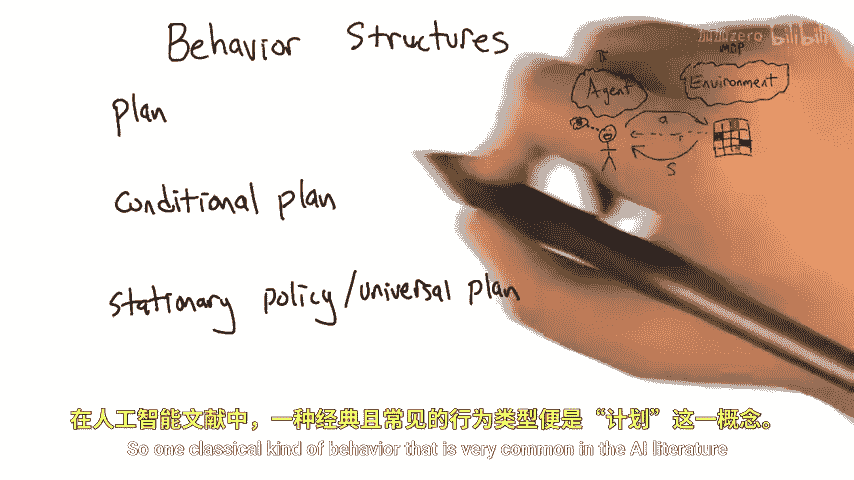
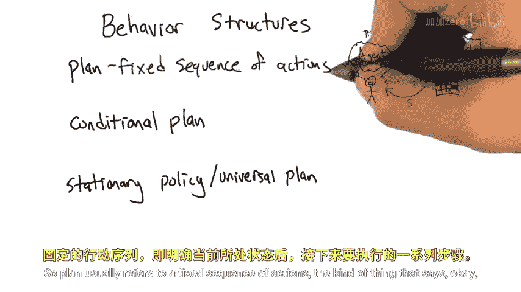
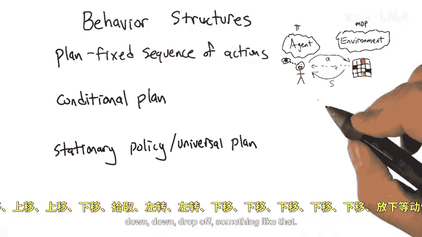
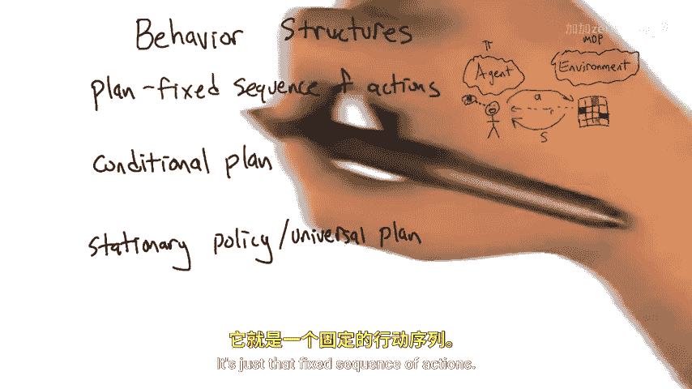
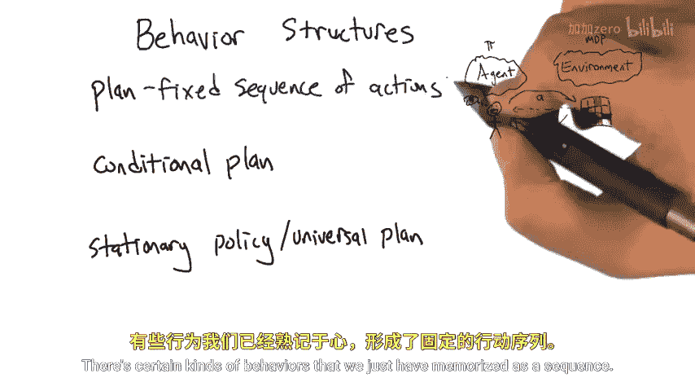
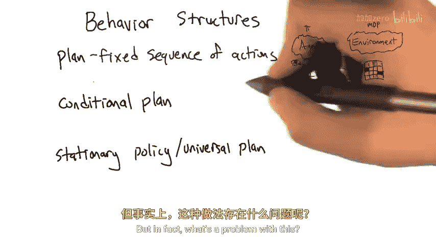
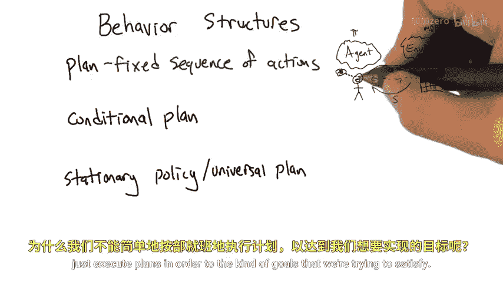

# 064：行为结构 - 1

在本节课中，我们将探讨强化学习中的核心目标——学习一种能获得高回报的行为。我们将介绍几种不同的行为结构，并重点分析第一种结构：**计划**。理解这些结构是设计有效学习算法的第一步。

我们的目标是创建学习算法。这些算法可能不如人类聪明，但我们将努力使其尽可能接近人类水平。我们希望算法能尽可能完善。不过，人类可能仍将在某些方面胜过我们将要讨论的算法。关键在于，我们必须明确我们试图学习的是什么。

我们试图学习的是**一种行为**，即一种与环境交互以获得高回报的方式。根据所寻求的行为类型，思考这个问题的方式有多种。

## 计划：固定的行动序列

一种在人工智能文献中非常经典的行为概念是**计划**。计划通常指一个固定的行动序列。它类似于这样的表述：“我知道我现在的位置，接下来我将执行以下动作序列：左、右、上、上、上、下……”

例如，“拾取、左、左、下、下、放下”等。一旦你选择了计划，就可以直接执行它。它只是一个固定的动作序列。

在现实生活中，有时确实存在这种行为。某些类型的行为我们就是作为序列记忆并执行的。

## 计划的局限性

然而，这里存在一个问题。为什么在一般情况下，我们不能仅仅通过执行计划来满足我们试图达成的目标？

主要原因有两个。

---

本节课中，我们一起学习了强化学习中行为的基本概念，并重点介绍了**计划**这种固定的行动序列。我们了解到，计划虽然简单直接，但在应对复杂或不确定的环境时存在局限性。在接下来的课程中，我们将探讨其他更灵活的行为结构。