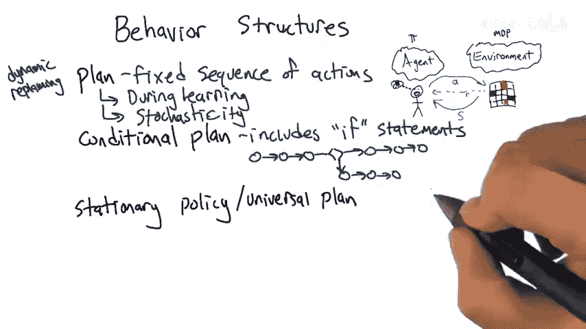

# 065：行为结构 - 2

在本节课中，我们将探讨强化学习中的行为结构，特别是**平稳策略**的概念。我们将了解它的定义、特点，以及它与其他规划方式的区别。

上一节我们介绍了条件规划，本节中我们来看看另一种更通用的行为结构——平稳策略。

## 平稳策略（通用规划）

平稳策略，有时在文献中也被称为**通用规划**，实际上就是我们在马尔可夫决策过程（MDP）背景下讨论的策略。

**平稳策略**是一个从状态到动作的映射：`π: S → A`。这意味着对于每一个可能的状态，策略都指定了一个要执行的动作。

这是一个非常强大的概念，因为它能很好地处理随机性。每次你经历一次状态转移后，你都可以回到你的策略表中查询：“好的，我现在处于这个状态，从这里出发应该做什么？”

然而，向人们传达这种策略可能有些困难。你知道这是为什么吗？

一种理解方式是，我们可以声称一个平稳策略或通用规划，就是一个在每个可能状态都有一个“如果”分支的条件规划。

这种说法是正确的，但它实际上比条件规划更受约束一些。区别在于，平稳策略在每个可能状态使用的是**相同的“如果”逻辑**。无论你之前从哪里来，无论你正在做什么，一旦你发现自己处于某个状态，这个状态就决定了你的下一步行动。

这意味着你需要做出很多判断，包含很多“如果”语句。如果你试图向别人传达这个策略，你必须告诉他们所有这些“如果”语句是什么。

以下是几个类比，帮助理解不同规划方式的区别：

*   **简单序列规划**：就像指路时说“左转，右转，左转，一直走到枫树街，然后右转”。
*   **条件规划**：可能会说“上高速公路，如果那里拥堵，就走这些小路；否则，就继续走高速公路”。
*   **平稳策略（通用规划）**：则会说“对于每一个可能的地理位置，都遵循对应的规则：如果在A地点，就执行动作X；如果在B地点，就执行动作Y……”。

本节课中我们一起学习了**平稳策略**（或称**通用规划**）的核心概念。我们了解到它是一个从状态到动作的确定性映射 `π: S → A`，能够有效处理MDP中的随机性。同时，我们也通过类比，理解了它与简单序列规划、条件规划在表达方式和复杂度上的区别。平稳策略是强化学习中定义智能体行为的基础构件。