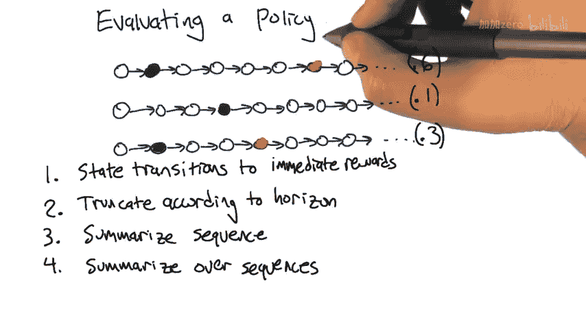
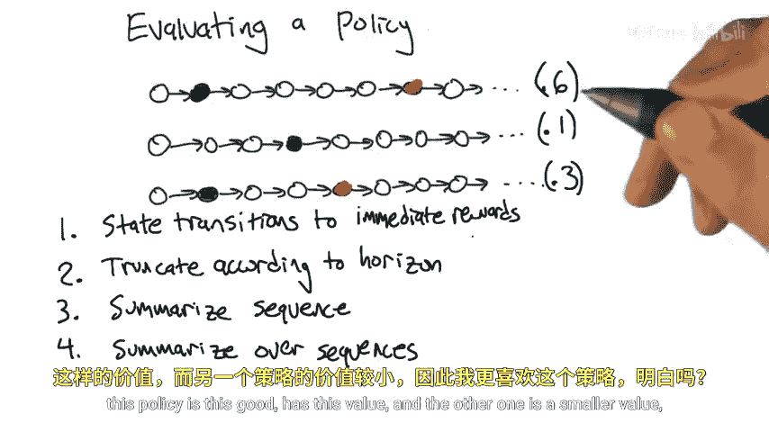

强化学习导论：P66：策略评估

在本节课中，我们将学习如何评估一个强化学习策略的价值。为了判断一个策略是否“最优”，我们需要一种方法，将遵循该策略可能产生的所有随机轨迹（即状态、动作和奖励序列）汇总成一个单一的数值指标。本节将详细介绍实现这一目标的四个关键步骤。

上一节我们介绍了策略会产生多种可能的轨迹。本节中我们来看看如何将这些轨迹转化为一个可比较的数值。

**第一步：定义即时奖励**

首先，我们需要为智能体在环境中经历的每一次状态转移赋予一个具体的数值，即**即时奖励**。这个奖励函数 `R(s, a, s')` 量化了从状态 `s` 执行动作 `a` 到达状态 `s'` 的即时好坏。

例如，在一个网格世界中，到达红色格子可能获得奖励 `-0.2`，而到达绿色格子可能获得奖励 `+1.0`。

**第二步：聚合轨迹内的奖励**

有了每一步的即时奖励后，我们需要将一条完整轨迹中的所有奖励合并起来。这通常通过计算**回报**来实现。一种常见的方法是使用**折扣回报**的公式：

`G_t = R_{t+1} + γ * R_{t+2} + γ^2 * R_{t+3} + ...`

其中，`γ`（伽马）是一个介于0和1之间的**折扣因子**，它决定了未来奖励相对于即时奖励的重要性。`γ` 越接近0，智能体越“短视”；`γ` 越接近1，智能体越“有远见”。

**第三步：处理轨迹的不确定性**

由于环境是随机的，遵循同一个策略从同一个初始状态出发，也可能产生许多不同的轨迹，从而得到不同的回报值。因此，我们不能只看某一条轨迹的回报。

我们需要考虑所有可能轨迹的回报，并计算它们的**期望值**。这个期望值综合考虑了不同轨迹发生的概率及其对应的回报。

**第四步：定义状态价值函数**

最终，我们将一个策略 `π` 在某个状态 `s` 下的价值，定义为：**从状态 `s` 开始，遵循策略 `π` 所能获得的期望回报**。这被称为**状态价值函数**，记作 `V^π(s)`。

其公式化定义为：
`V^π(s) = E_π[ G_t | S_t = s ]`

其中，`E_π` 表示在策略 `π` 下的期望。

通过以上四个步骤——定义即时奖励、聚合轨迹奖励、计算期望回报、定义状态价值函数——我们成功地将一个策略在某一状态下的所有可能表现，浓缩成了一个具体的数值 `V^π(s)`。这个值就是我们评估和比较不同策略优劣的基础。在后续课程中，我们将利用这个概念来寻找最优策略。