# 068：评估学习器 🧠

在本节课中，我们将探讨一个哲学层面的问题：如何评估一个强化学习算法（学习器）的好坏。上一节我们讨论了如何评估一个策略，但策略本身是学习过程的输出。本节我们将聚焦于评估产生策略的学习器本身。

## 评估学习器的核心思路

一个直观的想法是：一个好的学习器，就是能输出好策略的学习器。这似乎很合理。然而，如果两个学习器都能输出相同的最优策略，我们该如何区分它们的高下呢？

以下是两种可能的思考方向：
*   **结果导向**：谁在乎过程？只要最终策略一样好，它们就一样好。
*   **效率导向**：我会选择那个能更快找到最优策略的学习器。

## 理解“更快”的含义：两种关键复杂度

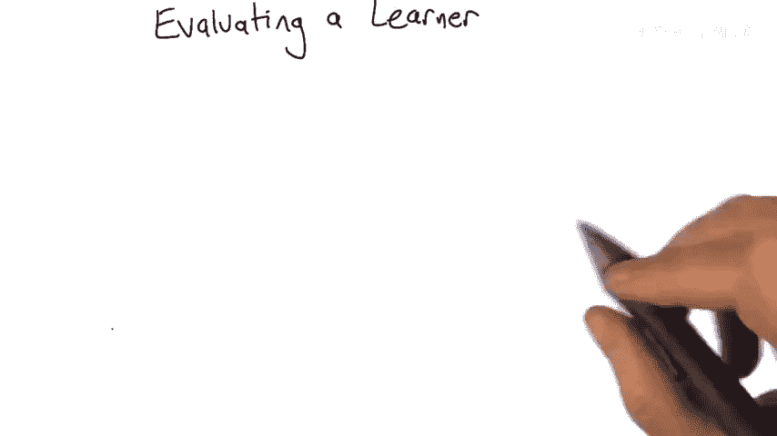

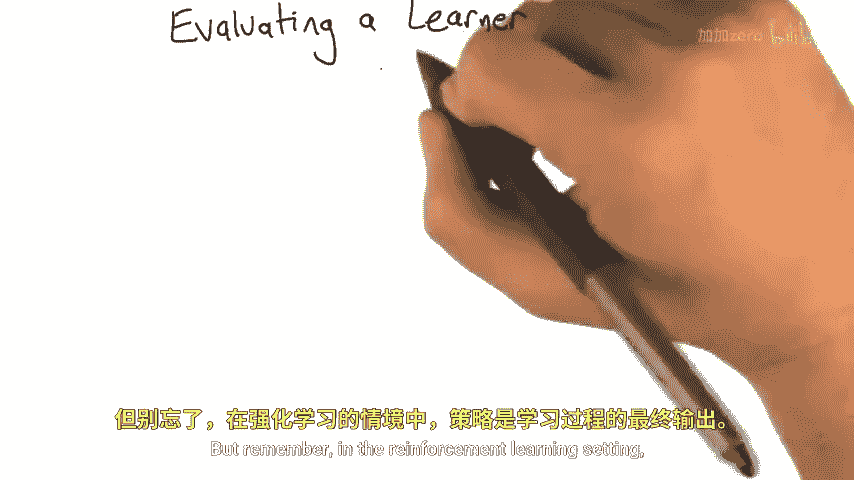

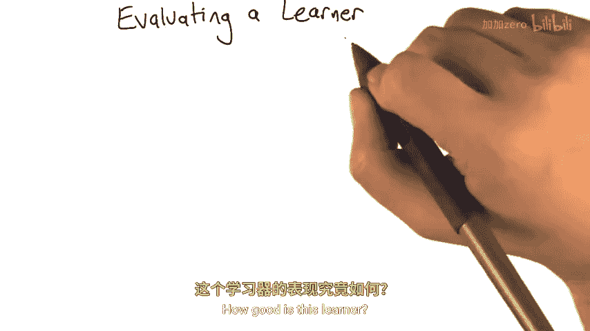

当我们说“更快”时，需要明确衡量的维度。在强化学习领域，有两种至关重要的“时间”或复杂度概念。

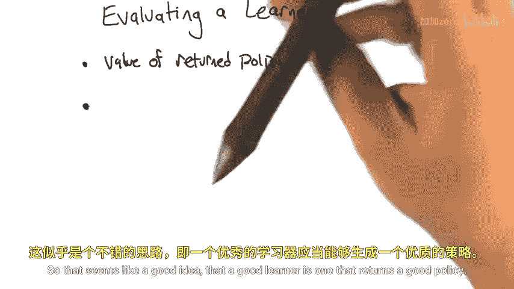

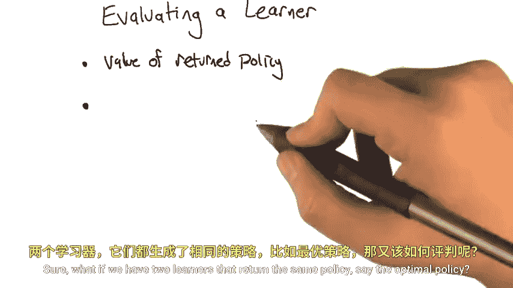

### 计算复杂度 💻

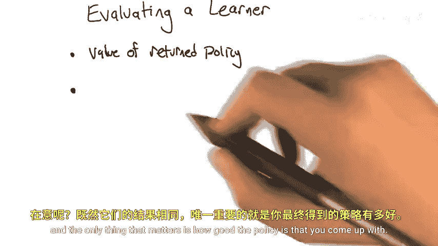

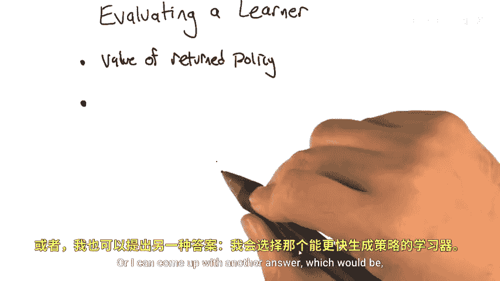

第一种是**计算复杂度**。这指的是算法运行所需的实际计算时间（或“墙钟时间”）。一个计算效率高的学习器，在寻找最优策略的过程中消耗的计算资源更少。

**核心公式**：`计算成本 = f(CPU时间， 内存使用)`

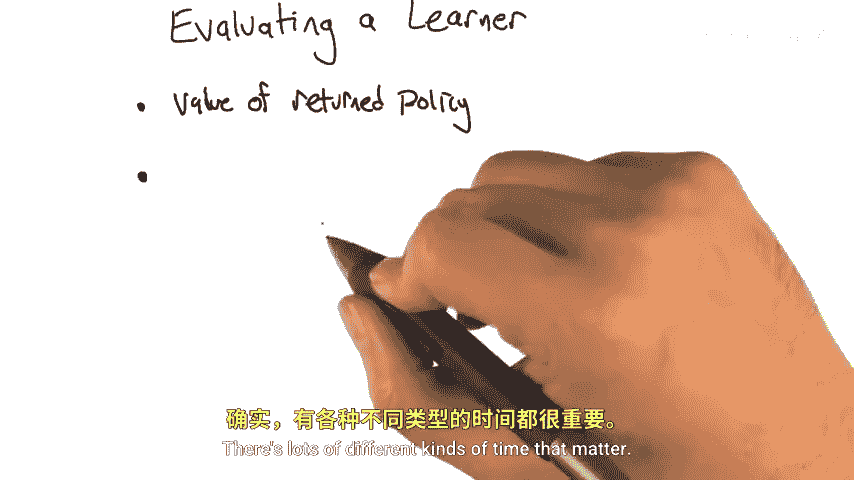

### 经验复杂度 🎯

第二种，也是在强化学习设定中尤为重要的，是**经验复杂度**。它衡量的是学习器为了学到好的策略，需要与环境进行多少次交互、收集多少经验数据。

**核心概念**：经验复杂度关注的是学习器达到特定性能水平所需的环境交互次数（如状态-动作-奖励序列的数量）。一个经验效率高的学习器，能用更少的试错学到同样多的知识。

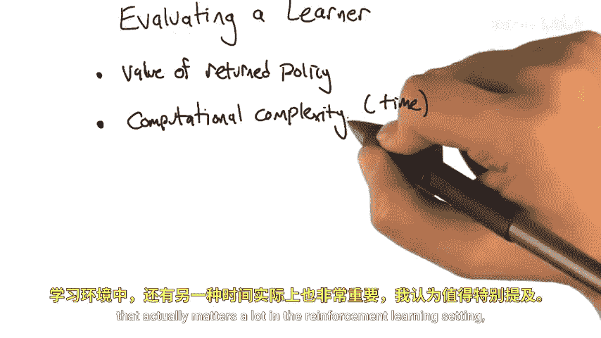

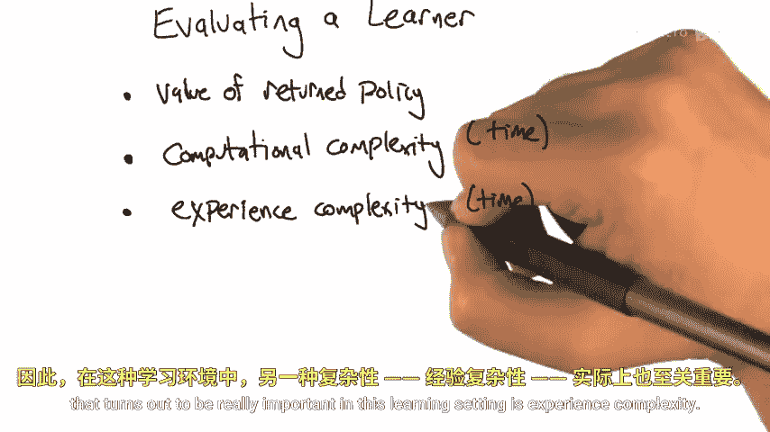

## 总结

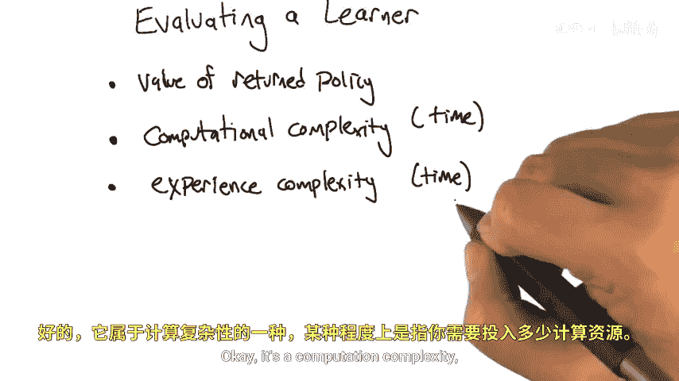

本节课我们一起学习了如何评估强化学习中的学习器。我们认识到，仅凭其输出的策略质量来评估是不够的，尤其是当多个学习器都能达到相同结果时。关键在于引入效率维度，主要分为两个方面：**计算复杂度**（消耗的计算资源）和**经验复杂度**（所需的环境交互经验）。一个优秀的学习器应该在策略性能、计算效率和经验效率之间取得良好的平衡。