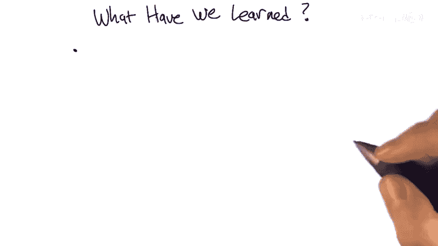
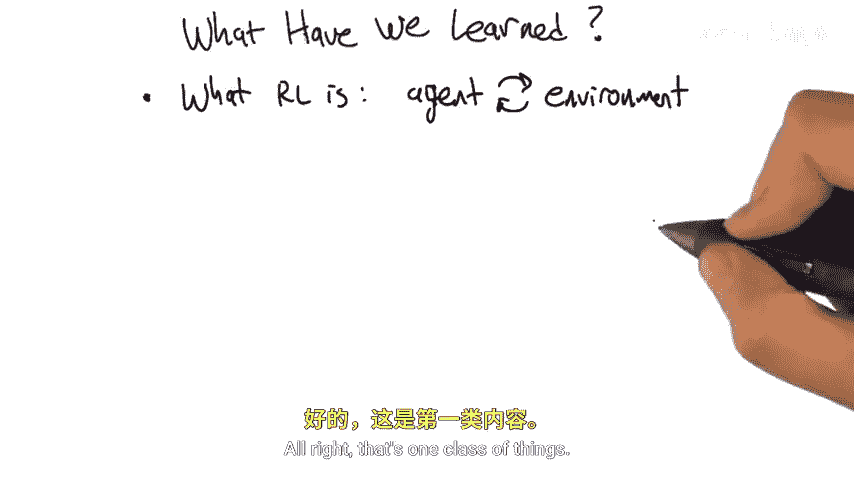
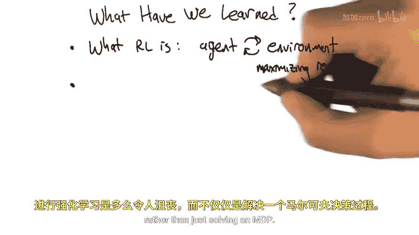
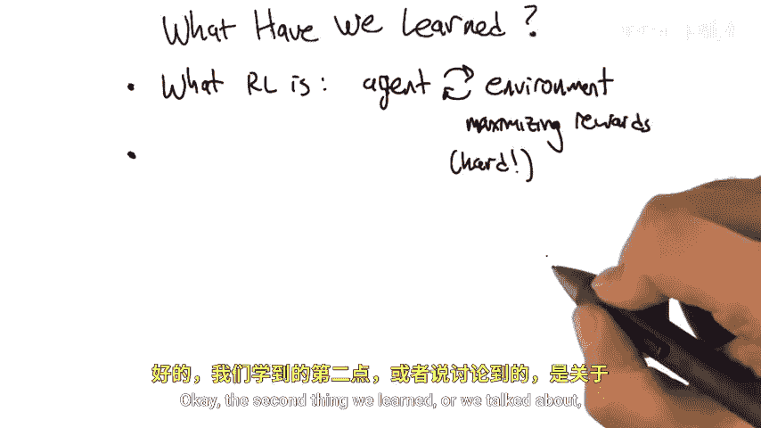
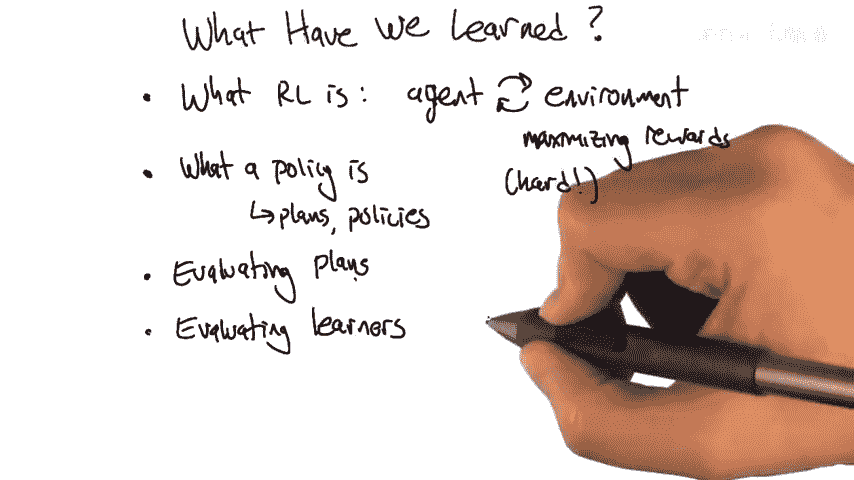
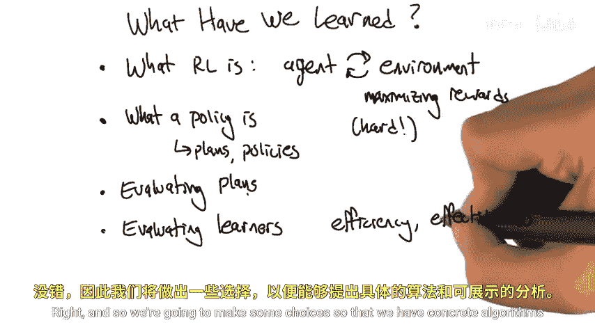

# 069：本课总结 📚

在本节课中，我们将对之前讨论的强化学习核心概念进行总结，为后续学习时间差分算法等内容奠定基础。

---

上一节我们探讨了强化学习的哲学基础，本节中我们来系统性地回顾所学内容。

我们主要学习了三类核心知识。

以下是第一类知识：**强化学习的定义**。

我们学习了强化学习是什么。强化学习是关于智能体与环境交互、获取奖励并理解世界本质的框架。在此过程中，我们也认识到，相比于仅仅求解一个已知的马尔可夫决策过程，实际进行强化学习更具挑战性。

---

在理解了强化学习的基本范式后，我们转向了第二类知识：**策略的描述与求解方法**。

我们讨论了策略的定义，以及解决和评估强化学习问题的不同途径。一个好的策略意味着什么？其核心目标是最大化长期累积奖励。

---

最后，我们学习了第三类知识：**学习器的评估方法**。

我们认识到，评估学习器有多种方式，正如评估策略和计划有多种维度一样。评估可以涉及有限时域或无限时域的问题。我们可以讨论学习器的速度、效率（例如样本复杂度），以及它是否返回了高质量的价值函数。评估既可以关注其最终输出，也可以关注其求解过程。

为了能够具体地介绍算法和分析，我们将做出一些标准化的选择。但重要的是要记住，评估维度是多元的。

---

**本节课总结**

本节课我们一起回顾了强化学习的三大支柱：
1.  强化学习的核心定义：智能体与环境的交互学习范式。
2.  策略的概念及其评估标准。
3.  评估强化学习算法性能的多维视角。

下一节课，我们将深入算法部分，开始学习**时间差分学习**。