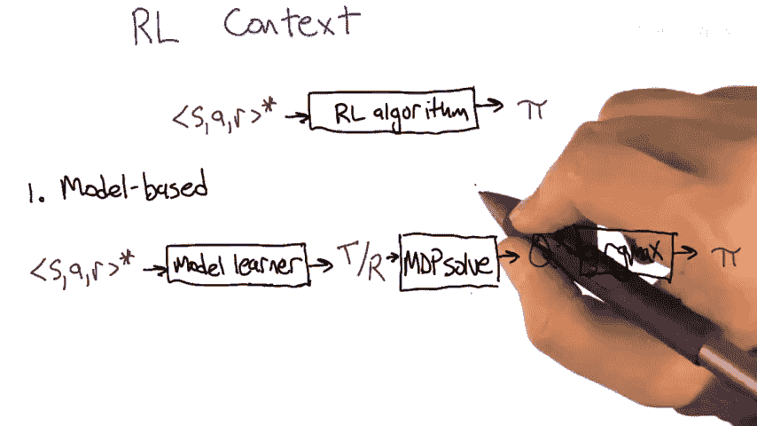
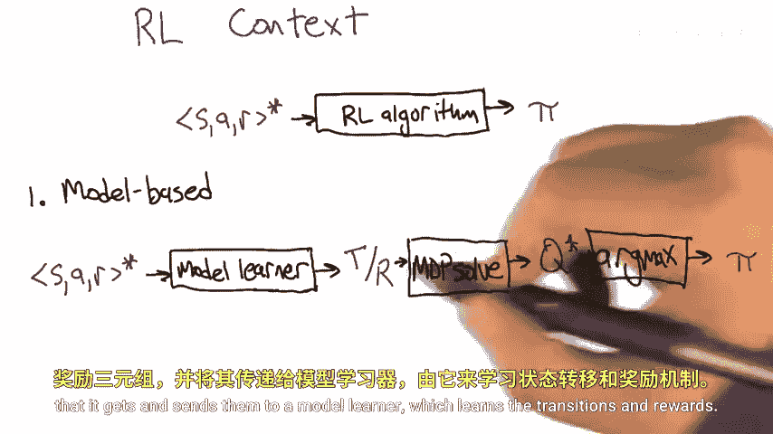
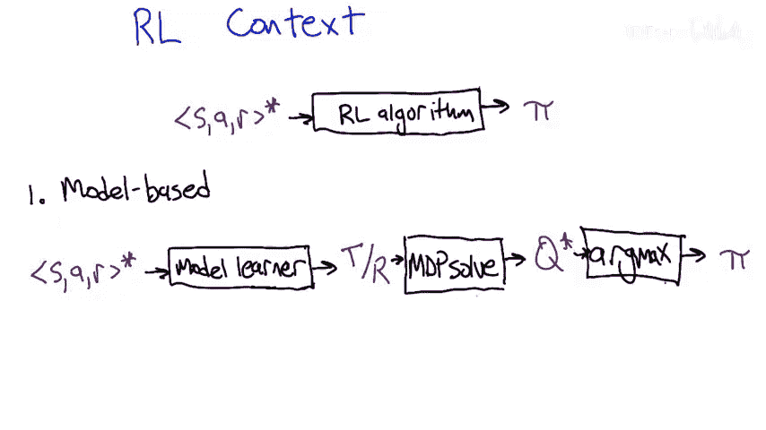
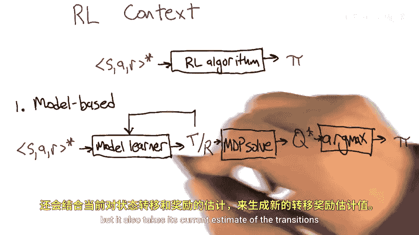
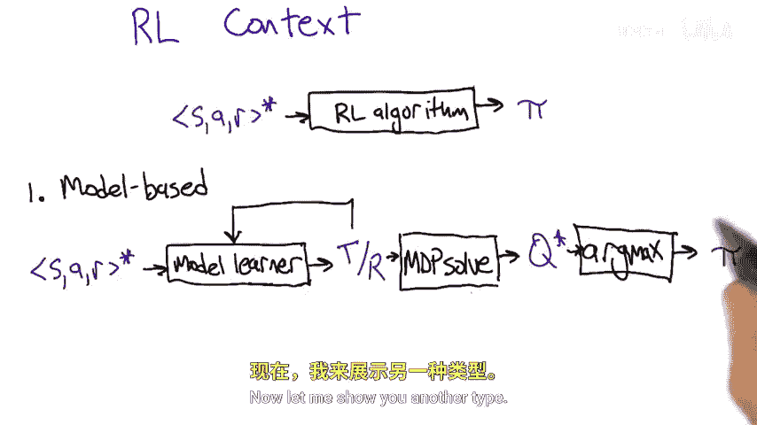
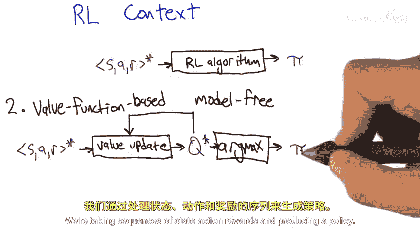

强化学习导论：P72：强化学习算法家族概述

在本节课中，我们将学习强化学习算法的三种主要类别。我们将了解它们如何将状态、动作和奖励序列转化为策略，并比较它们之间的核心差异。

---

### 基于模型的强化学习算法

上一节我们介绍了强化学习的基本框架。本节中，我们来看看第一种主要算法类别：基于模型的强化学习算法。

这种算法与我们目前讨论的内容最为相似。它接收一系列状态、动作和奖励三元组，并将其发送给一个模型学习器。

模型学习器负责学习状态转移概率和奖励函数。

一旦学会了这些转移概率和奖励，就可以将它们输入到一个马尔可夫决策过程求解器中，就像我们之前讨论过的那样。

该求解器可以计算出最优动作价值函数 **Q\***。

获得最优价值函数后，只需对当前状态下的所有可能动作价值取最大值，就可以决定在任意给定状态下应该采取哪个动作，从而得到策略。

因此，它仍然是将状态-动作-奖励序列映射到策略，但它是通过创建这些中间值来实现的。

需要补充一点：模型学习器不仅接收它观察到的历史数据，还会结合其对转移概率和奖励的当前估计，来生成新的估计值。这就是我想用来表示学习过程的方式。

---

### 基于价值函数的强化学习算法

了解了基于模型的方法后，现在让我们看看第二种重要的强化学习算法类别。

这类算法被称为基于价值函数的算法，有时也称为无模型算法。它的起点和终点与之前相同：接收状态-动作-奖励序列并输出策略。我们甚至同样在中间生成了一个 **Q\*** 函数，并据此生成策略。

---

本节课中，我们一起学习了强化学习的两大算法家族：基于模型的算法和基于价值函数的算法。基于模型的算法显式地学习环境模型，然后通过规划求解最优策略；而基于价值函数的算法则直接学习最优价值函数，无需构建环境模型。下一节我们将继续探讨第三种算法家族。