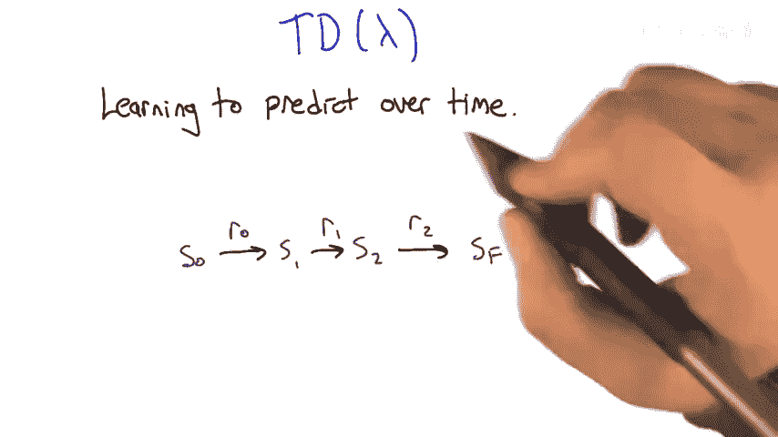
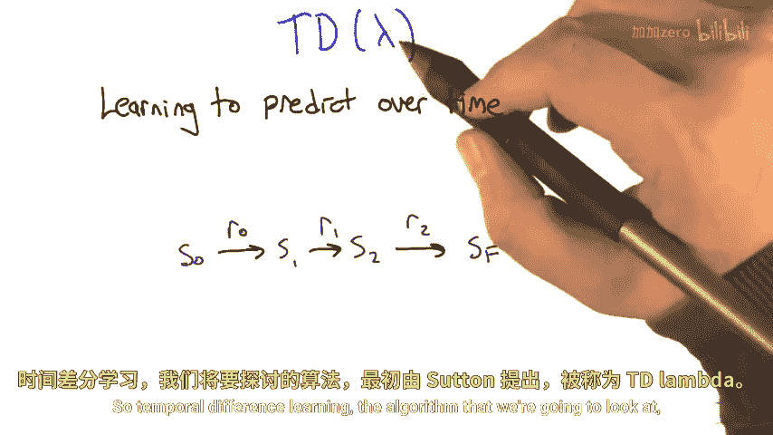
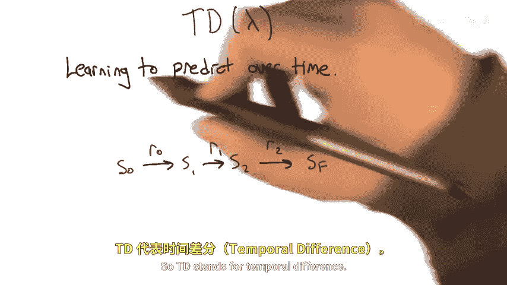
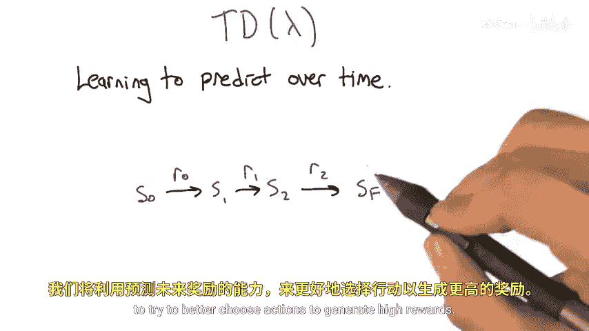
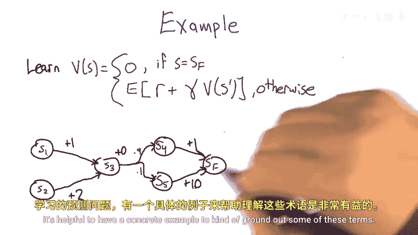

# 073：TD Lambda 算法 🧠

在本节课中，我们将学习时序差分学习，并重点介绍由 Sutton 提出的 TD Lambda 算法。我们将了解其核心思想，并通过一个具体的马尔可夫链示例来理解其工作原理。

---

## 时序差分学习简介

上一节我们讨论了强化学习的基础概念。本节中，我们来看看**时序差分学习**。时序差分学习的核心算法被称为 **TD Lambda**。这里的 TD 代表“时序差分”，而 Lambda 是一个参数符号。该算法的本质是学习对随时间推移发生的事件进行预测。

## 预测问题与具体示例

为了更好地理解时序差分方法所解决的学习问题，拥有一个具体示例来明确这些术语会很有帮助。因此，我们来看一个具体的预测场景。

假设我们有一个状态序列：状态0转移到状态1，再转移到状态2，最终到达某个终止状态。每次状态转移都会伴随一定的奖励。我们的目标是预测从某个状态开始的**期望折扣奖励总和**。这正是我们在强化学习中试图完成的核心任务。

这个预测能力将成为强化学习中的一个非常重要的子程序。因为我们将利用“能够预测未来奖励”这一概念，来更好地选择能够产生高奖励的动作。

以下是用于说明的马尔可夫链示例：

我们有一个包含状态 S1, S2, S3, S4, S5 和终止状态 SF 的马尔可夫链。每个状态转移弧上都标注了执行该转移后获得的即时奖励。

特别需要注意的是，从状态 S3 出发的转移是随机的：有 90% 的概率前往 S4，同时有 10% 的概率前往 S5。

---

## 核心概念与目标

总结来说，本节课我们一起学习了时序差分学习的入门知识，特别是 **TD Lambda** 算法。我们明确了其目标是预测未来折扣奖励的总和，并通过一个具体的马尔可夫链示例，了解了状态、转移、奖励以及随机转移等基本要素，为后续深入算法细节奠定了基础。