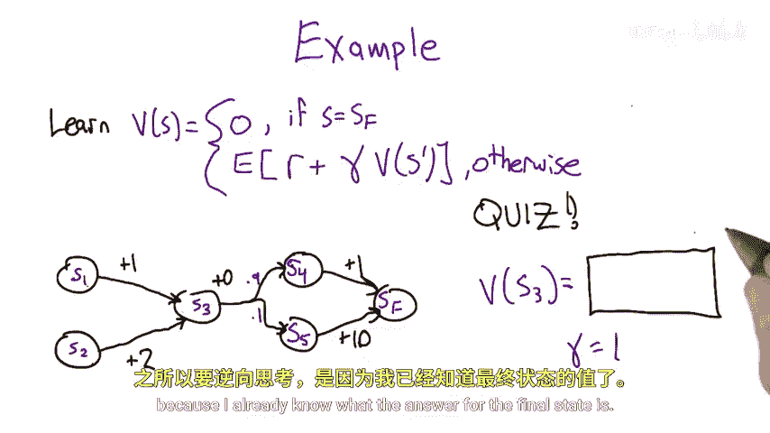
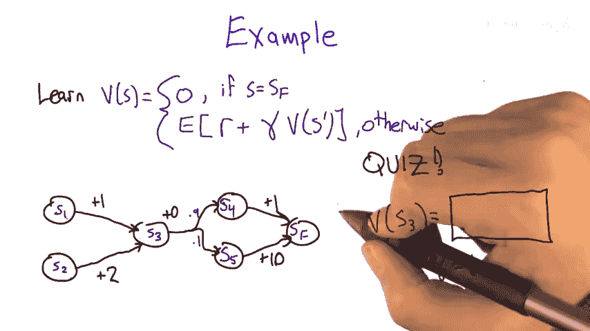
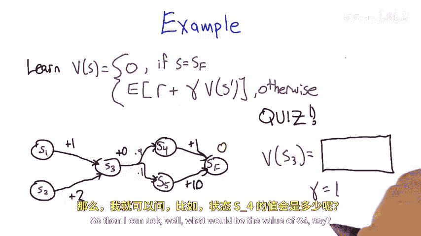
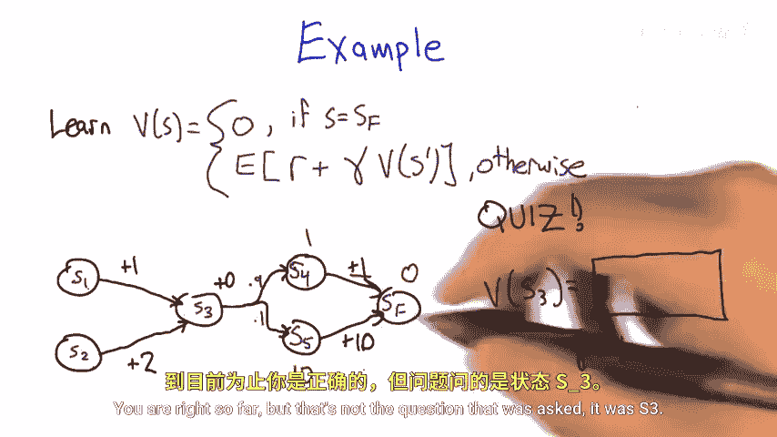
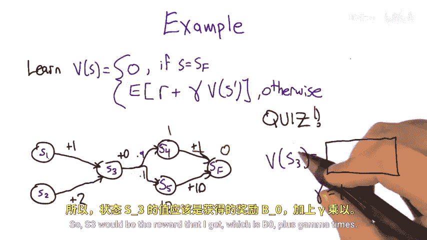

强化学习导论：P75：价值计算示例解析 🧮

在本节课中，我们将通过一个具体的例子，学习如何计算马尔可夫决策过程中各个状态的价值函数。我们将采用从后向前递推的方法，利用已知的最终状态价值，逐步计算出所有状态的价值。

---

上一节我们介绍了价值函数的基本概念，本节中我们来看看如何通过一个具体示例进行计算。首先，我们已知最终状态 **S_F** 的价值为0。

**S_F** 的价值公式如下：
```
V(S_F) = 0
```

---

接下来，我们计算状态 **S4** 的价值。从 **S4** 出发，执行动作后获得的即时奖励为1，并且会转移到最终状态 **S_F**。

因此，**S4** 的价值计算如下：
```
V(S4) = R + γ * V(S_F) = 1 + γ * 0 = 1
```
其中，**R** 代表即时奖励，**γ** 是折扣因子。





---



计算完 **S4** 后，我们以同样的逻辑计算状态 **S5** 的价值。从 **S5** 出发，执行动作后获得的即时奖励为10，并且同样会转移到最终状态 **S_F**。

因此，**S5** 的价值计算如下：
```
V(S5) = R + γ * V(S_F) = 10 + γ * 0 = 10
```

---

现在，我们来看状态 **S3** 的价值计算。从 **S3** 出发，执行动作后获得的即时奖励为0，但接下来会转移到哪个状态，其价值是多少呢？这正是我们需要通过递推来确定的。

**S3** 的价值公式如下：
```
V(S3) = R + γ * V(S_next)
```
这里的 **V(S_next)** 代表从 **S3** 执行动作后进入的下一个状态的价值。



---



本节课中我们一起学习了价值函数的递推计算方法。我们从已知的最终状态价值 **V(S_F)=0** 出发，逐步向前计算了 **S4** 和 **S5** 的价值，并建立了计算 **S3** 价值的公式框架。这种方法的核心在于利用后续状态的价值来确定当前状态的价值。