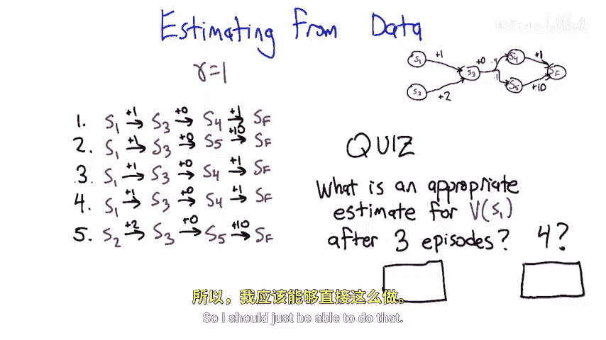
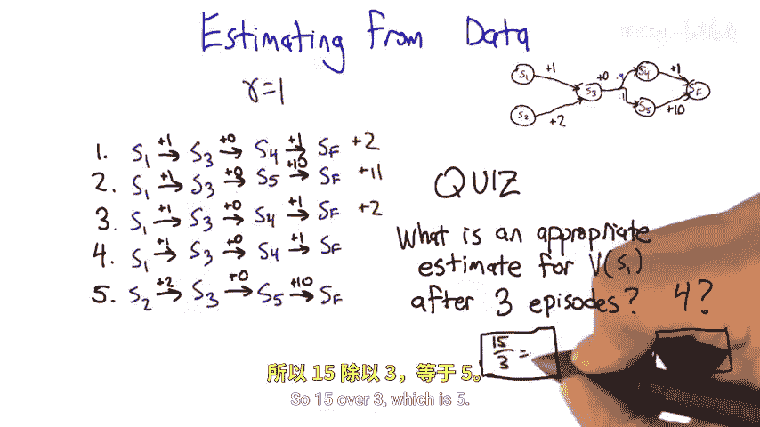
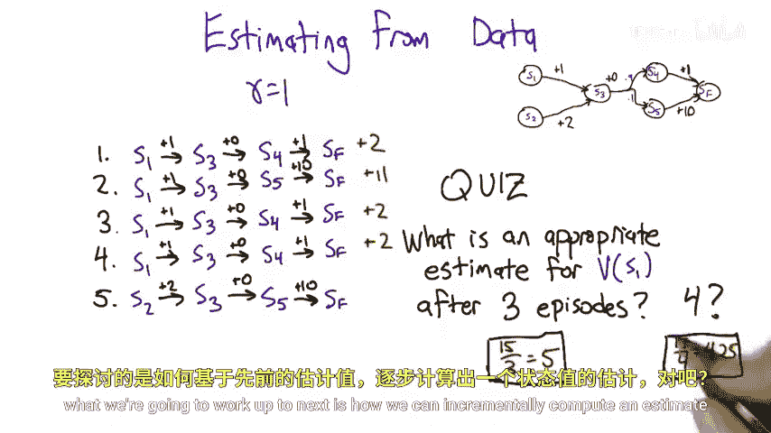

# 077：基于数据的价值估计

在本节课中，我们将学习如何利用从环境中收集到的实际数据，来估计一个状态的价值。我们将通过一个简单的例子，演示如何计算状态价值的经验平均值。

上一节我们介绍了状态价值函数的概念，本节中我们来看看如何从实际观测到的数据中对其进行估计。

## 概述

我们面临的任务是：给定若干条从状态 `S1` 开始的完整轨迹（或称“幕”，episode），以及每条轨迹中获得的回报，我们需要估计状态 `S1` 的价值 `V(S1)`。由于折扣因子 `γ` 被设为 1，一条轨迹的回报就是该轨迹中所有奖励的简单累加。状态价值的估计值，就是所有观测到的、从该状态出发的轨迹回报的平均值。

## 分步计算过程

以下是基于提供的数据进行计算的具体步骤。

**数据回顾：**
我们有三条轨迹数据。在第一条轨迹中，从 `S1` 出发获得的累计回报是 2。在第二条轨迹中，回报是 11。在第三条轨迹中，回报是 2。

**第一步：计算三轮后的估计值**
三轮后，观测到的回报分别是 2， 11， 2。其平均值为：
`(2 + 11 + 2) / 3 = 15 / 3 = 5`
因此，三轮后对 `V(S1)` 的估计是 **5**。

**第二步：计算四轮后的估计值**
假设我们获得了第四条轨迹，其回报为 2。那么四轮后的平均值为：
`(2 + 11 + 2 + 2) / 4 = 17 / 4 = 4.25`
因此，四轮后对 `V(S1)` 的估计更新为 **4.25**。

这个过程清晰地展示了如何通过简单的算术平均，利用越来越多的数据来改进我们对状态价值的估计。随着数据量的增加，这个平均值会越来越接近真实的期望价值。

## 增量计算的启示

事实上，我们可以为每一次观测（即每一幕）都计算一个估计值。更重要的是，我们接下来将要探讨的是，如何以**增量式**的方法来计算这个估计值，即每获得一条新数据，就快速更新现有的估计，而无需每次都重新累加所有历史数据。这对于处理海量数据或在线学习场景至关重要。

## 总结

本节课中我们一起学习了如何从实际数据中估计状态价值。核心方法是计算从该状态出发所观测到的所有回报的**平均值**。当折扣因子 `γ=1` 时，回报就是轨迹中奖励的直接求和。我们通过一个具体例子演示了计算过程，并指出随着数据增多，估计会越来越准确，同时引出了下一节将讨论的增量更新方法。